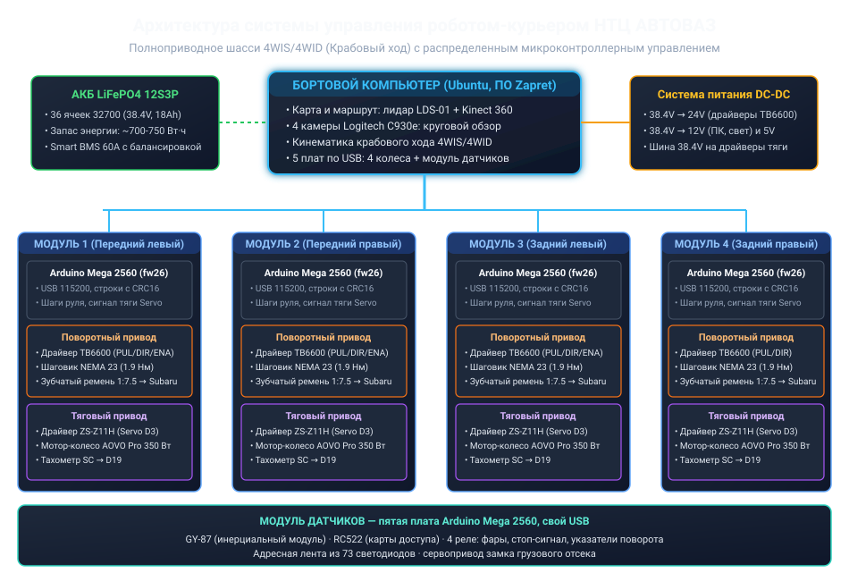
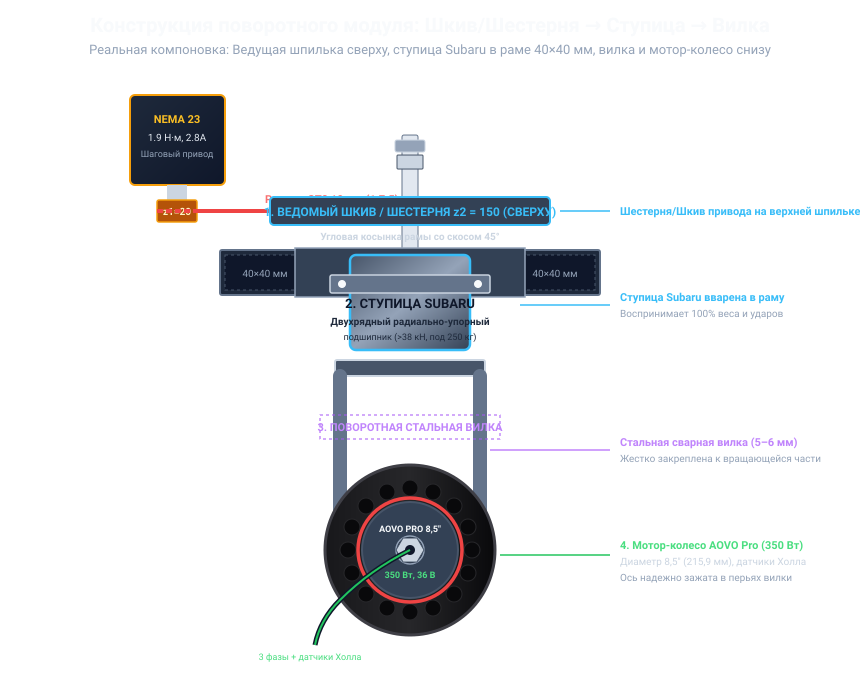
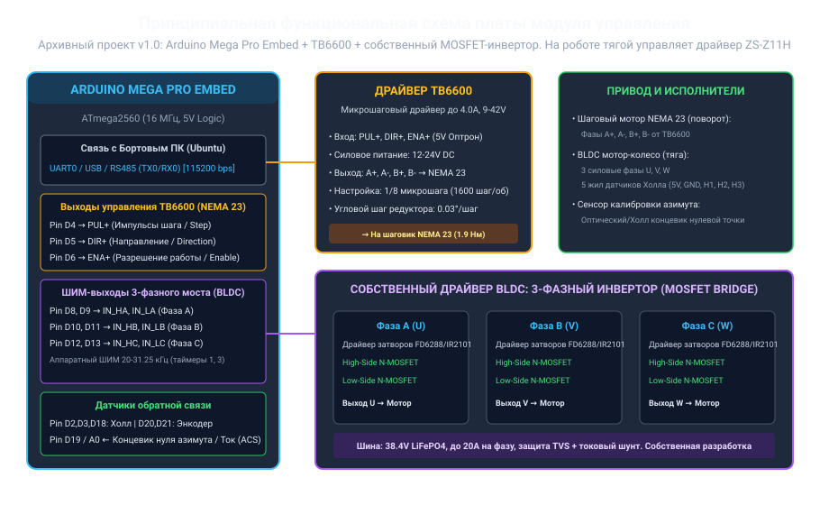

# Автономный робот-курьер с крабовым ходом (4WIS / 4WID) для НТЦ АО «АВТОВАЗ»

[](https://docs.ros.org/)
[](https://ubuntu.com/)
[](firmware/README.md)
[](firmware/README.md)
[](firmware/README.md)
[](#2-основные-технические-характеристики)
[-22c55e.svg)](#-спецификация-батарейного-блока-lifepo4-12s-3p)
[](#-кинематика-крабового-хода-4wis--4wid)
[](docs/EXPLANATORY_NOTE_AVTOVAZ.md)

Комплект инженерно-технической документации, сборочных схем, принципиальных электрических схем, алгоритмов кинематики, **прошивки микроконтроллеров** и справочных узлов ROS 2 для тяжелого автономного робота грузоподъемностью **250 кг** с полноуправляемым шасси (**4WIS / 4WID** — независимый поворот и тяга каждого из 4 колес).

> ### 📍 Что где лежит
>
> | Репозиторий | Роль | Содержимое |
> | :--- | :--- | :--- |
> | **этот** (`rus_slam`) | **главный по прошивке и железу** | `firmware/` — единственный источник истины для четырёх контроллеров колёс и модуля датчиков, `docs/ELECTRICAL_AND_PINOUTS.md`, `pcb/`, механическая документация, смета |
> | [danilka-revin/Zapret](https://github.com/danilka-revin/Zapret) | **побочный, весь бортовой софт** | `robot_control/`, `slam_gui/`, `run.py`, веб-пульт, киоск, навигация, лидар, BMS |
>
> Прошивок две, плат пять, у каждой свой USB-кабель и текстовый протокол:
>
> * [`firmware/motor_wheel/motor_wheel.ino`](firmware/motor_wheel/motor_wheel.ino) —
>   **fw26**, четыре платы колёс. Новое в fw26: отдельный измеренный угол
>   потенциометра `pa` в телеметрии, наклон калибровки любого знака переживает
>   перезапуск, удержание угла прерывается при потере сигнала датчика;
> * [`firmware/sensor_module/sensor_module.ino`](firmware/sensor_module/sensor_module.ino) —
>   **протокол 4**, плата модуля датчиков: свет, замок грузового отсека, карты
>   доступа с ролями, компас.
>
> Бортовой софт из Zapret только *потребляет* эти протоколы; при изменении кадров
> сначала правятся скетч и [`docs/SERIAL_PROTOCOL.md`](docs/SERIAL_PROTOCOL.md)
> здесь, затем парсер в Zapret. Что и когда перенесено между репозиториями —
> [`docs/ZAPRET_SYNC.md`](docs/ZAPRET_SYNC.md).
>
> ROS 2-пакеты (`ros2_ws/`) и веб-пульт (`gui/`) описывают архитектуру и
> интерфейсы робота; рабочий софт — в Zapret.
>
> Старая прошивка `firmware/module_controller` (бинарный протокол `0xAA 0x55` /
> `0xBB 0x44`, собственная 6-тактная коммутация MOSFET) **удалена из репозитория**:
> она не соответствует ни железу, ни софту робота. Соответствующие разделы
> документов переписаны под текущую прошивку (fw26).

Проект разработан в соответствии с требованиями конкурсного задания № 2: **«Автономное роботизированное устройство для внутренней логистики Научно-технического центра (НТЦ) АО «АВТОВАЗ»»** ([Регламент соревнований](https://pervye-events.hb.ru-msk.vkcloud-storage.ru/projects/documents/aac931ed623a48abb28c4cf1d844b4da.pdf)).

---

## 💰 Смета на изготовление

Один робот стоит **369 170,85 ₽ (4 461,09 USD)**: комплектующие и материалы — 298 170,85 ₽, работа, амортизация оборудования и интеграция — 71 000,00 ₽. По каждой из 64 позиций — фотография, количество, цена в рублях и долларах США и продавцы, у которых она найдена: [`docs/COST_ESTIMATE.md`](docs/COST_ESTIMATE.md) ([PDF](docs/pdf/COST_ESTIMATE.pdf)).

| Раздел сметы | Позиций | Сумма, ₽ | Сумма, USD |
| :--- | ---: | ---: | ---: |
| Поворотно-тяговые модули | 14 | 83 333,20 | 1 007,00 |
| Модуль датчиков, свет и доступ | 14 | 12 823,44 | 154,96 |
| Навигация и машинное зрение | 4 | 86 730,00 | 1 048,05 |
| Бортовой компьютер и интерфейс оператора | 6 | 45 682,97 | 552,04 |
| Аккумулятор и электропитание | 13 | 43 885,80 | 530,32 |
| Безопасность и сигнализация | 6 | 11 418,94 | 137,99 |
| Рама, корпус и крепёж | 7 | 14 296,50 | 172,76 |
| **Комплектующие и материалы** | **64** | **298 170,85** | **3 603,12** |
| Работа, амортизация оборудования, интеграция | — | 71 000,00 | 857,97 |
| **Всего на один робот** | | **369 170,85** | **4 461,09** |

- Цены собраны 10.11.2026 из поисковой выдачи, страницы магазинов не открывались. Курс — 82,7536 ₽ за доллар (официальный курс Банка России на эту дату).
- Цена позиции — медиана найденных предложений. По самым дешёвым предложениям итог равен 310 702,88 ₽, по самым дорогим — 438 672,67 ₽. Доставка не учтена.
- 18 позиций — допущения о модели или количестве, 4 — оценки без поиска цен. Работа, амортизация и интеграция перенесены без пересчёта из прежней калькуляции, где итог был 207 200 ₽.
- Смета собирается из таблиц [`docs/estimate/`](docs/estimate/README.md): поменяйте цену или количество и запустите сборщик.

```bash
python3 tools/estimate/build_estimate.py            # пересобрать docs/COST_ESTIMATE.md из таблиц
python3 tools/estimate/build_estimate.py --check    # проверить, что документ соответствует таблицам
python3 tools/estimate/build_estimate.py --rate 85  # показать итоги при другом курсе, файлы не менять
```

---

## 📌 Навигация по документации

| Документ | Содержание | Markdown | PDF |
| :--- | :--- | :--- | :--- |
| 📘 **Полный технический паспорт** | Инженерные расчеты прочности рамы под 250 кг, редуктора GT2 150/20, ступиц Subaru, АКБ | [`docs/TECHNICAL_SPECIFICATION.md`](docs/TECHNICAL_SPECIFICATION.md) | [`PDF`](docs/pdf/TECHNICAL_SPECIFICATION.pdf) |
| 📑 **Пояснительная записка по регламенту** | Пояснительная записка по критериям задания № 2 (экономика, сравнение с 3 аналогами, методика тестов) | [`docs/EXPLANATORY_NOTE_AVTOVAZ.md`](docs/EXPLANATORY_NOTE_AVTOVAZ.md) | [`PDF`](docs/pdf/EXPLANATORY_NOTE_AVTOVAZ.pdf) |
| 💰 **Смета на изготовление** | 64 позиции с фотографиями, количеством, ценой в рублях и долларах США и ссылками на продавцов; итог **369 170,85 ₽ (4 461,09 USD)** | [`docs/COST_ESTIMATE.md`](docs/COST_ESTIMATE.md) | [`PDF`](docs/pdf/COST_ESTIMATE.pdf) |
| 🔄 **Синхронизация с Zapret** | Что перенесено из бортового ПО: fw26, модуль датчиков, фактический состав робота; какие расхождения остались | [`docs/ZAPRET_SYNC.md`](docs/ZAPRET_SYNC.md) | [`PDF`](docs/pdf/ZAPRET_SYNC.pdf) |
| ⚡ **Электрические схемы и подключения** | Распиновка Mega (D2–D8, D18, D19, A0), TB6600, драйвер тяги ZS-Z11H, питание и предохранители | [`docs/ELECTRICAL_AND_PINOUTS.md`](docs/ELECTRICAL_AND_PINOUTS.md) | [`PDF`](docs/pdf/ELECTRICAL_AND_PINOUTS.pdf) |
| 💻 **Прошивка микроконтроллеров** | `motor_wheel` **fw26**: 4 платы Mega 2560/Mega Mini, по одному USB на колесо, роль в CRC-телеметрии, калибровка по оптодатчику и потенциометру, активное удержание угла, сохранённый полный ноль, команды тяги и руля. `sensor_module` **протокол 4**: пятая плата — свет, замок отсека, карты доступа, компас | [`firmware/README.md`](firmware/README.md) · [`motor_wheel.ino`](firmware/motor_wheel/motor_wheel.ino) · [`sensor_module.ino`](firmware/sensor_module/sensor_module.ino) | — |
| 🧪 **Проверка прошивки без железа** | Хост-симуляция четырёх плат колёс (TB6600, оптодатчик, потенциометр, EEPROM) — 61 сценарий; симуляция модуля датчиков (GY-87, RC522, лента, реле, замок) — 20 сценариев; сборка avr-gcc без Arduino IDE | [`firmware/firmware_sim/`](firmware/firmware_sim/sim.cpp) · [`sensor_sim.cpp`](firmware/firmware_sim/sensor_sim.cpp) · [`firmware/tools/avr_build.py`](firmware/tools/avr_build.py) | — |
| 📐 **Эталонный скетч руля** | Проверенный на реальной механике скетч, с которым сверяются пины, уровни и скорости | [`firmware/reference/`](firmware/reference/steering_tested/steering_tested.ino) | — |
| 🎛 **Печатная плата модуля (PCB)** | Инженерный архив v1.0: BOM, Netlist, распиновки, гайд. **Пины не совпадают с прошивкой колеса** — см. [`pcb/STATUS.md`](pcb/STATUS.md) | [`pcb/`](pcb/README.md) | — |
| 🧠 **Архитектура ПО (ROS 2)** | Справочная архитектура: пакеты, узлы, топики, дерево TF, режимы запуска. Рабочий софт — в Zapret | [`docs/SOFTWARE_ARCHITECTURE.md`](docs/SOFTWARE_ARCHITECTURE.md) | [`PDF`](docs/pdf/SOFTWARE_ARCHITECTURE.pdf) |
| 🔗 **Причинно-следственная карта** | Сквозные связи «требование → железо → прошивка → ROS → навигация/GUI», разрывы интеграции и проверенные ограничения | [`docs/CAUSAL_MAP.md`](docs/CAUSAL_MAP.md) | [`PDF`](docs/pdf/CAUSAL_MAP.pdf) |
| 🔌 **Протокол обмена** | Текстовые команды и кадры `@F`/`@TLM`/`@Z` плат колёс (fw26, поле `pa`), кадры `@S`/`@CARD`/`@EVT`/`@ACK` модуля датчиков, CRC16/Modbus, таймауты | [`docs/SERIAL_PROTOCOL.md`](docs/SERIAL_PROTOCOL.md) | [`PDF`](docs/pdf/SERIAL_PROTOCOL.pdf) |
| 🤖 **Пакеты ROS 2** | Справочно: кинематика, мост модулей, одометрия, лидар, восприятие, навигация, безопасность, запуск. Для реального железа требуется доработка моста | [`ros2_ws/README.md`](ros2_ws/README.md) | — |
| 🖥 **GUI — пульт робота** | Справочно: веб-пульт, карта SLAM, окно камеры. Рабочий пульт — в Zapret | [`gui/`](gui/README.md) · [`docs/GUI.md`](docs/GUI.md) | [`PDF`](docs/pdf/GUI.pdf) |
| 🖥 **Основной экран робота** | Справочно: киоск, 4 двигателя, АКБ, PIN и грузовой отсек; нативное Tkinter-приложение | [`gui/native_display.py`](gui/native_display.py) · [`docs/MAIN_SCREEN.md`](docs/MAIN_SCREEN.md) · [`docs/RUN_AND_ACCESS.md`](docs/RUN_AND_ACCESS.md) | [`PDF`](docs/pdf/MAIN_SCREEN.pdf) |
| 🔐 **Сервисный пульт (окно «Сервис»)** | Справочно: ячейка хранения по PIN/QR/RFID с аудитом, ручная подача команд двигателю (строка протокола), панель АКБ 12S3P, статистика рейсов | [`docs/SERVICE_CONSOLE.md`](docs/SERVICE_CONSOLE.md) · [`gui/console-core.js`](gui/console-core.js) | [`PDF`](docs/pdf/SERVICE_CONSOLE.pdf) |

### Тесты прошивки без железа

```bash
python3 -m venv .venv-test && .venv-test/bin/pip install pytest
.venv-test/bin/python -m pytest firmware/tests -q
# test_firmware_sim.py   — плата колеса: 10 проверок, внутри 61 сценарий симуляции
# test_sensor_module.py  — модуль датчиков: 17 проверок, внутри 20 сценариев симуляции
```

Тесты собирают оба скетча `g++` (плату колеса — в четырёх экземплярах, модуль
датчиков — с лентой и без неё), прогоняют все сценарии симуляции и **сверяют
документы со скетчами**: пины, 133.33 шага/град, предел ±100°, watchdog 650 мс,
формат `@F`/`@TLM`/`@S`, контрольные суммы примеров и число сценариев не могут
разойтись молча.

Смета и сборщик PDF проверяются так же:

```bash
.venv-test/bin/pip install -r tools/pdf/requirements.txt
.venv-test/bin/python -m pytest tools/estimate tools/pdf -q
# tools/estimate — 30 проверок: арифметика сметы, фотографии, итоги в документах
# tools/pdf      — 56 проверок: формулы, ширины колонок, PDF есть у каждого документа
```

### PDF-копии документации

Каждый Markdown-документ в `docs/` продублирован в PDF рядом с исходником
(`docs/pdf/*.pdf`). Актуализация копий после правок `.md`:

```bash
python3 -m venv .venv && .venv/bin/pip install -r tools/pdf/requirements.txt
.venv/bin/python tools/pdf/md2pdf.py            # пересобрать docs/pdf/*.pdf
.venv/bin/python tools/pdf/md2pdf.py --check    # проверить актуальность копий
```

---

## 🗂 Карта репозитория

Всё разложено по роли файла: исходники документации отдельно от готовых PDF,
инструменты сборки PDF — отдельно от самих документов, скрипты — рядом с тем,
что они обслуживают.

```text
rus_slam/
├── README.md                  ← эта страница-указатель
├── docs/                      документация (Markdown)
│   ├── *.md                   12 документов, список ниже
│   ├── pdf/                   готовые PDF-копии тех же 12 документов
│   ├── estimate/              таблицы сметы: состав, цены, источники фото
│   └── assets/
│       ├── images/            14 иллюстраций, вставленных в документы
│       ├── estimate/          61 фотография позиций сметы
│       └── screens/           9 настоящих скриншотов пульта и экрана робота
├── firmware/                  прошивка пяти плат (главное содержимое)
│   ├── README.md              руководство по прошивке: fw26 и модуль датчиков
│   ├── motor_wheel/           боевой скетч колеса motor_wheel.ino
│   ├── sensor_module/         скетч модуля датчиков sensor_module.ino
│   ├── reference/             эталонный скетч руля + его описание
│   ├── firmware_sim/          хост-симуляция обеих прошивок (без железа)
│   ├── tests/                 pytest-проверки прошивки и документов
│   ├── scripts/               сборка, заливка, синхронизация, диагностика
│   └── tools/                 сборщик avr-gcc без Arduino IDE
├── pcb/                       инженерный архив платы v1.0
├── deploy/                    автозапуск на бортовом ПК
│   ├── README.md              инструкция по установке юнитов
│   └── systemd/               три .service + скрипт запуска дисплея
├── gui/                       веб-пульт и нативный дисплей
│   ├── tools/                 сборка исполняемого файла дисплея
│   └── tests/                 JS- и Python-тесты интерфейса
├── ros2_ws/src/               восемь ROS 2-пакетов
└── tools/
    ├── pdf/                   сборщик PDF из Markdown
    └── estimate/              сборщик сметы из таблиц и её тесты
```

### 📄 Документы `docs/` — исходник и PDF рядом по смыслу

Каждый документ существует в двух видах: редактируемый Markdown в `docs/` и
готовая PDF-копия в [`docs/pdf/`](docs/pdf). PDF не правят руками — их
пересобирает [`tools/pdf/md2pdf.py`](tools/pdf/md2pdf.py) (см. ниже).

| Документ | Markdown | PDF |
| :--- | :--- | :--- |
| Технический паспорт робота | [`TECHNICAL_SPECIFICATION.md`](docs/TECHNICAL_SPECIFICATION.md) | [`PDF`](docs/pdf/TECHNICAL_SPECIFICATION.pdf) |
| Пояснительная записка по регламенту | [`EXPLANATORY_NOTE_AVTOVAZ.md`](docs/EXPLANATORY_NOTE_AVTOVAZ.md) | [`PDF`](docs/pdf/EXPLANATORY_NOTE_AVTOVAZ.pdf) |
| Смета на изготовление робота | [`COST_ESTIMATE.md`](docs/COST_ESTIMATE.md) | [`PDF`](docs/pdf/COST_ESTIMATE.pdf) |
| Синхронизация с Zapret | [`ZAPRET_SYNC.md`](docs/ZAPRET_SYNC.md) | [`PDF`](docs/pdf/ZAPRET_SYNC.pdf) |
| Электрические схемы и распиновка | [`ELECTRICAL_AND_PINOUTS.md`](docs/ELECTRICAL_AND_PINOUTS.md) | [`PDF`](docs/pdf/ELECTRICAL_AND_PINOUTS.pdf) |
| Протокол обмена с платами | [`SERIAL_PROTOCOL.md`](docs/SERIAL_PROTOCOL.md) | [`PDF`](docs/pdf/SERIAL_PROTOCOL.pdf) |
| Причинно-следственная карта | [`CAUSAL_MAP.md`](docs/CAUSAL_MAP.md) | [`PDF`](docs/pdf/CAUSAL_MAP.pdf) |
| Архитектура ПО (ROS 2) | [`SOFTWARE_ARCHITECTURE.md`](docs/SOFTWARE_ARCHITECTURE.md) | [`PDF`](docs/pdf/SOFTWARE_ARCHITECTURE.pdf) |
| Веб-пульт и карта SLAM | [`GUI.md`](docs/GUI.md) | [`PDF`](docs/pdf/GUI.pdf) |
| Основной экран робота | [`MAIN_SCREEN.md`](docs/MAIN_SCREEN.md) | [`PDF`](docs/pdf/MAIN_SCREEN.pdf) |
| Сервисный пульт | [`SERVICE_CONSOLE.md`](docs/SERVICE_CONSOLE.md) | [`PDF`](docs/pdf/SERVICE_CONSOLE.pdf) |
| Запуск и доступ к роботу | [`RUN_AND_ACCESS.md`](docs/RUN_AND_ACCESS.md) | [`PDF`](docs/pdf/RUN_AND_ACCESS.pdf) |

`COST_ESTIMATE.md` руками не правят: его собирает
[`tools/estimate/build_estimate.py`](tools/estimate/build_estimate.py) из таблиц
[`docs/estimate/`](docs/estimate/README.md) — состава
([`parts.csv`](docs/estimate/parts.csv)), найденных цен
([`price_observations.csv`](docs/estimate/price_observations.csv)), курса и разделов
([`estimate.json`](docs/estimate/estimate.json)) и источников фотографий
([`photo_sources.json`](docs/estimate/photo_sources.json)). Фотографии позиций —
в [`docs/assets/estimate/`](docs/assets/estimate).

Иллюстрации к документам лежат в [`docs/assets/images/`](docs/assets/images):
[`arduino_mega_pro.jpg`](docs/assets/images/arduino_mega_pro.jpg) / [`arduino_mega_pro.png`](docs/assets/images/arduino_mega_pro.png), [`belt_reduction_drive.png`](docs/assets/images/belt_reduction_drive.png),
[`bldc_mosfet_driver.jpg`](docs/assets/images/bldc_mosfet_driver.jpg),
[`kinematics_diagram.svg`](docs/assets/images/kinematics_diagram.svg),
[`lifepo4_32700.png`](docs/assets/images/lifepo4_32700.png),
[`module_circuit.svg`](docs/assets/images/module_circuit.svg),
[`nema23_motor.jpg`](docs/assets/images/nema23_motor.jpg),
[`pod_assembly.svg`](docs/assets/images/pod_assembly.svg),
[`scooter_hub_motor.jpg`](docs/assets/images/scooter_hub_motor.jpg),
[`subaru_hub_bearing.jpg`](docs/assets/images/subaru_hub_bearing.jpg),
[`swerve_drive_chassis.png`](docs/assets/images/swerve_drive_chassis.png),
[`system_architecture.svg`](docs/assets/images/system_architecture.svg),
[`tb6600_driver.jpg`](docs/assets/images/tb6600_driver.jpg).

### 🖼 Скриншоты интерфейсов `docs/assets/screens/`

Сняты с работающего сервера (`python3 gui/backend.py --port 8080 --source sim`),
браузер 1600×1000 — не макеты и не рендеры.

| Скриншот | Что на нём | Где описан |
| :--- | :--- | :--- |
| [`main-screen.png`](docs/assets/screens/main-screen.png) | основной экран робота: 4 модуля, АКБ, грузовой отсек | [`docs/MAIN_SCREEN.md`](docs/MAIN_SCREEN.md) · [`docs/RUN_AND_ACCESS.md`](docs/RUN_AND_ACCESS.md) |
| [`console-dashboard.png`](docs/assets/screens/console-dashboard.png) | пульт: метрики, карта SLAM, программа доставки, камеры, телеоперация | [`docs/GUI.md`](docs/GUI.md) |
| [`console-light.png`](docs/assets/screens/console-light.png) | тот же пульт в светлой теме | [`docs/GUI.md`](docs/GUI.md) |
| [`console-drive.png`](docs/assets/screens/console-drive.png) | вкладка «Ходовая»: 4 модуля 4WIS/4WID | [`docs/GUI.md`](docs/GUI.md) |
| [`console-mission.png`](docs/assets/screens/console-mission.png) | вкладка «Миссия»: FSM доставки | [`docs/GUI.md`](docs/GUI.md) |
| [`console-sensors.png`](docs/assets/screens/console-sensors.png) | вкладка «Сенсоры»: радар лидара, детекции | [`docs/GUI.md`](docs/GUI.md) |
| [`console-safety.png`](docs/assets/screens/console-safety.png) | вкладка «Безопасность»: E-stop, вотчдог, АКБ, CRC | [`docs/GUI.md`](docs/GUI.md) |
| [`console-logs.png`](docs/assets/screens/console-logs.png) | вкладка «Журнал»: события пульта | [`docs/GUI.md`](docs/GUI.md) |
| [`console-service.png`](docs/assets/screens/console-service.png) | вкладка «Сервис»: замок, двигатели, АКБ, статистика | [`docs/SERVICE_CONSOLE.md`](docs/SERVICE_CONSOLE.md) |

### ⚙️ Прошивка `firmware/`

| Файл / каталог | Что это |
| :--- | :--- |
| [`firmware/README.md`](firmware/README.md) | Полное руководство: пины, команды, калибровка, телеметрия, безопасность |
| [`firmware/motor_wheel/motor_wheel.ino`](firmware/motor_wheel/motor_wheel.ino) | **Боевой скетч fw26** — то, что заливается в четыре платы колёс |
| [`firmware/sensor_module/sensor_module.ino`](firmware/sensor_module/sensor_module.ino) | **Скетч модуля датчиков, протокол 4** — пятая плата: GY-87, RC522, 4 реле, адресная лента 73 диода, серво замка |
| [`firmware/reference/README.md`](firmware/reference/README.md) | Разбор эталонного скетча: чем он отличается от боевого и почему |
| [`firmware/reference/steering_tested/steering_tested.ino`](firmware/reference/steering_tested/steering_tested.ino) | Скетч руля, проверенный на реальной механике |
| [`firmware/firmware_sim/sim.cpp`](firmware/firmware_sim/sim.cpp) | Хост-симуляция четырёх плат колёс: 61 сценарий |
| [`firmware/firmware_sim/sensor_sim.cpp`](firmware/firmware_sim/sensor_sim.cpp) | Хост-симуляция модуля датчиков: 20 сценариев |
| [`firmware/firmware_sim/arduino_sim.h`](firmware/firmware_sim/arduino_sim.h) · [`board_prelude.h`](firmware/firmware_sim/board_prelude.h) | Обвязка симуляции: подмена Arduino API и EEPROM |
| [`firmware/firmware_sim/stubs/`](firmware/firmware_sim/stubs) | Заглушки для сборки `g++`: [`Arduino.h`](firmware/firmware_sim/stubs/Arduino.h), [`Servo.h`](firmware/firmware_sim/stubs/Servo.h), [`Wire.h`](firmware/firmware_sim/stubs/Wire.h), [`SPI.h`](firmware/firmware_sim/stubs/SPI.h), [`EEPROM.h`](firmware/firmware_sim/stubs/EEPROM.h), [`Adafruit_NeoPixel.h`](firmware/firmware_sim/stubs/Adafruit_NeoPixel.h), [`avr/eeprom.h`](firmware/firmware_sim/stubs/avr/eeprom.h), [`avr/interrupt.h`](firmware/firmware_sim/stubs/avr/interrupt.h), [`avr/pgmspace.h`](firmware/firmware_sim/stubs/avr/pgmspace.h), [`avr/wdt.h`](firmware/firmware_sim/stubs/avr/wdt.h) |
| [`firmware/tests/test_firmware_sim.py`](firmware/tests/test_firmware_sim.py) | 10 pytest-проверок платы колеса: симуляция, кадры `@F`/`@TLM`, поле `pa`, пины против документов |
| [`firmware/tests/test_sensor_module.py`](firmware/tests/test_sensor_module.py) | 17 pytest-проверок модуля датчиков: пины, безопасное состояние, симуляция, кадры, документы |
| [`firmware/tools/avr_build.py`](firmware/tools/avr_build.py) | Сборка `.hex` через avr-gcc без Arduino IDE (Servo и Adafruit NeoPixel подключаются по `#include` скетча) |

### 🧰 Скрипты `firmware/scripts/`

| Скрипт | Назначение |
| :--- | :--- |
| [`install_arduino_cli.sh`](firmware/scripts/install_arduino_cli.sh) | Поставить `arduino-cli` и ядро AVR |
| [`avr_upload.py`](firmware/scripts/avr_upload.py) | Собрать и залить `.hex` в плату по USB (`--check` — только осмотр); сам находит или скачивает ядро AVR, Servo и Adafruit NeoPixel |
| [`flash_firmware.sh`](firmware/scripts/flash_firmware.sh) | Собрать и залить сразу все четыре платы колёс |
| [`firmware_probe.py`](firmware/scripts/firmware_probe.py) | Прочитать версию прошивки с плат колёс |
| [`sync_firmware_desktop.sh`](firmware/scripts/sync_firmware_desktop.sh) | Положить на рабочий стол четыре копии скетча колеса по ролям и скетч модуля датчиков |

### 🚀 Автозапуск `deploy/`

| Файл | Что делает |
| :--- | :--- |
| [`deploy/README.md`](deploy/README.md) | Как установить и включить юниты, режимы дисплея |
| [`deploy/systemd/rus-slam-server.service`](deploy/systemd/rus-slam-server.service) | Веб-сервер пульта |
| [`deploy/systemd/rus-slam-display.service`](deploy/systemd/rus-slam-display.service) | Киоск-браузер с основным экраном |
| [`deploy/systemd/rus-slam-native-display.service`](deploy/systemd/rus-slam-native-display.service) | Нативное окно Tkinter вместо браузера |
| [`deploy/systemd/display.sh`](deploy/systemd/display.sh) | Общий запуск дисплея для обоих юнитов |

### 🎛 Плата `pcb/` (архив v1.0)

[`README.md`](pcb/README.md) · [`STATUS.md`](pcb/STATUS.md) ·
[`SCHEMATIC_CIRCUIT_DESIGN.md`](pcb/SCHEMATIC_CIRCUIT_DESIGN.md) ·
[`easyeda_schematic_guide.md`](pcb/easyeda_schematic_guide.md) ·
[`BOM.csv`](pcb/BOM.csv) · [`CONNECTOR_PINOUTS.csv`](pcb/CONNECTOR_PINOUTS.csv) ·
[`kicad_netlist.net`](pcb/kicad_netlist.net).
**Пины платы не совпадают с прошивкой колеса** — она прошивкой не используется, см. `STATUS.md`.

### 🖥 Интерфейсы `gui/`

| Файл | Что это |
| :--- | :--- |
| [`gui/README.md`](gui/README.md) | Описание пульта, запуск, сборка |
| [`gui/serve.py`](gui/serve.py) · [`gui/backend.py`](gui/backend.py) | HTTP-сервер и API состояния робота |
| [`gui/index.html`](gui/index.html) · [`gui/main.html`](gui/main.html) | Страница пульта и страница основного экрана |
| [`gui/app.js`](gui/app.js) · [`gui/main.js`](gui/main.js) · [`gui/console.js`](gui/console.js) · [`gui/vision.js`](gui/vision.js) | Логика пульта, экрана, сервисного окна и камеры |
| [`gui/console-core.js`](gui/console-core.js) · [`gui/native_display_core.py`](gui/native_display_core.py) | Ядро сервисного окна и нативного экрана |
| [`gui/main.css`](gui/main.css) · [`gui/styles.css`](gui/styles.css) | Оформление |
| [`gui/native_display.py`](gui/native_display.py) | Нативный экран на Tkinter, без браузера |
| [`gui/requirements-native-display.txt`](gui/requirements-native-display.txt) | Зависимости нативного экрана |
| [`gui/tools/build-native-linux.sh`](gui/tools/build-native-linux.sh) · [`gui/tools/build-native-windows.bat`](gui/tools/build-native-windows.bat) | Сборка `RUS-SLAM-Display` через PyInstaller |
| [`gui/tests/`](gui/tests) | 8 тестов интерфейса: [`backend.test.py`](gui/tests/backend.test.py), [`native_display.test.py`](gui/tests/native_display.test.py), [`console.test.js`](gui/tests/console.test.js), [`console.api.test.js`](gui/tests/console.api.test.js), [`jsdom.console.test.js`](gui/tests/jsdom.console.test.js), [`main.api.test.js`](gui/tests/main.api.test.js), [`main.screen.test.js`](gui/tests/main.screen.test.js), [`ui.audit.test.js`](gui/tests/ui.audit.test.js) |

### 🤖 ROS 2 `ros2_ws/src/`

[`ros2_ws/README.md`](ros2_ws/README.md) | — общее описание и порядок сборки.
В каждом пакете также лежат штатные файлы упаковки (`package.xml`, `setup.py`,
`setup.cfg`, `__init__.py`) — они не перечислены, чтобы не заслонять содержимое.

<details>
<summary><b>Восемь пакетов — развернуть список файлов</b></summary>

**`rus_slam_base`** — кинематика и мост модулей:
[`crab_drive_node.py`](ros2_ws/src/rus_slam_base/rus_slam_base/crab_drive_node.py) ·
[`kinematics.py`](ros2_ws/src/rus_slam_base/rus_slam_base/kinematics.py) ·
[`module_bridge_node.py`](ros2_ws/src/rus_slam_base/rus_slam_base/module_bridge_node.py) ·
[`module_link.py`](ros2_ws/src/rus_slam_base/rus_slam_base/module_link.py) ·
[`odometry_core.py`](ros2_ws/src/rus_slam_base/rus_slam_base/odometry_core.py) ·
[`odometry_node.py`](ros2_ws/src/rus_slam_base/rus_slam_base/odometry_node.py) ·
[`protocol.py`](ros2_ws/src/rus_slam_base/rus_slam_base/protocol.py);
тесты: [`test_kinematics.py`](ros2_ws/src/rus_slam_base/test/test_kinematics.py),
[`test_odometry.py`](ros2_ws/src/rus_slam_base/test/test_odometry.py),
[`test_protocol.py`](ros2_ws/src/rus_slam_base/test/test_protocol.py).

**`rus_slam_bringup`** — запуск и конфигурация:
[`robot.launch.py`](ros2_ws/src/rus_slam_bringup/launch/robot.launch.py) ·
[`full.launch.py`](ros2_ws/src/rus_slam_bringup/launch/full.launch.py) ·
конфиги [`robot.yaml`](ros2_ws/src/rus_slam_bringup/config/robot.yaml),
[`lidar.yaml`](ros2_ws/src/rus_slam_bringup/config/lidar.yaml),
[`mission.yaml`](ros2_ws/src/rus_slam_bringup/config/mission.yaml),
[`perception.yaml`](ros2_ws/src/rus_slam_bringup/config/perception.yaml),
[`safety.yaml`](ros2_ws/src/rus_slam_bringup/config/safety.yaml) ·
udev-правила [`99-rus-slam.rules`](ros2_ws/src/rus_slam_bringup/udev/99-rus-slam.rules).

**`rus_slam_description`** — модель робота:
[`rus_slam.urdf.xacro`](ros2_ws/src/rus_slam_description/urdf/rus_slam.urdf.xacro) ·
[`description.launch.py`](ros2_ws/src/rus_slam_description/launch/description.launch.py).

**`rus_slam_interfaces`** — сообщения и сервисы:
[`WheelCommand.msg`](ros2_ws/src/rus_slam_interfaces/msg/WheelCommand.msg),
[`WheelCommandArray.msg`](ros2_ws/src/rus_slam_interfaces/msg/WheelCommandArray.msg),
[`ModuleState.msg`](ros2_ws/src/rus_slam_interfaces/msg/ModuleState.msg),
[`ModuleStateArray.msg`](ros2_ws/src/rus_slam_interfaces/msg/ModuleStateArray.msg),
[`BatteryInfo.msg`](ros2_ws/src/rus_slam_interfaces/msg/BatteryInfo.msg),
[`SignDetection.msg`](ros2_ws/src/rus_slam_interfaces/msg/SignDetection.msg),
[`SignDetectionArray.msg`](ros2_ws/src/rus_slam_interfaces/msg/SignDetectionArray.msg),
[`TrafficLightState.msg`](ros2_ws/src/rus_slam_interfaces/msg/TrafficLightState.msg);
сервисы [`HomeModules.srv`](ros2_ws/src/rus_slam_interfaces/srv/HomeModules.srv),
[`SetModulesEnabled.srv`](ros2_ws/src/rus_slam_interfaces/srv/SetModulesEnabled.srv);
[`CMakeLists.txt`](ros2_ws/src/rus_slam_interfaces/CMakeLists.txt).

**`rus_slam_lidar`** — драйвер LDS01:
[`lds01_driver_node.py`](ros2_ws/src/rus_slam_lidar/rus_slam_lidar/lds01_driver_node.py) ·
[`lds_protocol.py`](ros2_ws/src/rus_slam_lidar/rus_slam_lidar/lds_protocol.py) ·
[`test_lds_protocol.py`](ros2_ws/src/rus_slam_lidar/test/test_lds_protocol.py).

**`rus_slam_navigation`** — nav2 и SLAM:
[`navigation.launch.py`](ros2_ws/src/rus_slam_navigation/launch/navigation.launch.py) ·
[`slam.launch.py`](ros2_ws/src/rus_slam_navigation/launch/slam.launch.py) ·
[`nav2_params.yaml`](ros2_ws/src/rus_slam_navigation/config/nav2_params.yaml) ·
[`slam_toolbox.yaml`](ros2_ws/src/rus_slam_navigation/config/slam_toolbox.yaml) ·
[`maps/README.md`](ros2_ws/src/rus_slam_navigation/maps/README.md).

**`rus_slam_perception`** — камеры и распознавание:
[`camera_node.py`](ros2_ws/src/rus_slam_perception/rus_slam_perception/camera_node.py) ·
[`sign_detector_node.py`](ros2_ws/src/rus_slam_perception/rus_slam_perception/sign_detector_node.py) ·
[`traffic_light_node.py`](ros2_ws/src/rus_slam_perception/rus_slam_perception/traffic_light_node.py) ·
[`vision_common.py`](ros2_ws/src/rus_slam_perception/rus_slam_perception/vision_common.py).

**`rus_slam_safety`** — безопасность и миссии:
[`safety_node.py`](ros2_ws/src/rus_slam_safety/rus_slam_safety/safety_node.py) ·
[`mission_manager_node.py`](ros2_ws/src/rus_slam_safety/rus_slam_safety/mission_manager_node.py).

</details>

### 🛠 Инструменты `tools/`

| Файл | Что делает |
| :--- | :--- |
| [`tools/pdf/md2pdf.py`](tools/pdf/md2pdf.py) | Собирает `docs/pdf/*.pdf` из `docs/*.md`; `--check` проверяет актуальность, `--out` меняет каталог |
| [`tools/pdf/requirements.txt`](tools/pdf/requirements.txt) | Зависимости сборщика: reportlab, svglib, Pillow |
| [`tools/pdf/test_md2pdf.py`](tools/pdf/test_md2pdf.py) | 56 pytest-проверок сборщика: формулы, перенос строк, ширины колонок, PDF-копия у каждого документа |
| [`tools/estimate/build_estimate.py`](tools/estimate/build_estimate.py) | Собирает `docs/COST_ESTIMATE.md` и `docs/estimate/cost_estimate_calculated.csv` из таблиц сметы; `--check`, `--totals`, `--rate` |
| [`tools/estimate/add_photo.py`](tools/estimate/add_photo.py) | Готовит фотографию позиции 180 × 180 и записывает её источник (нужен Pillow) |
| [`tools/estimate/test_estimate.py`](tools/estimate/test_estimate.py) | 30 pytest-проверок сметы: арифметика, полнота фотографий и источников, совпадение итогов в документах |
| [`.gitignore`](.gitignore) | Что не попадает в репозиторий (сборки, PDF-кэш, venv) |

---

## 📸 Галерея основных узлов и компонентов

| Узел / Компонент | Изображение | Параметры и роль в конструкции |
| :---: | :---: | :--- |
| **Опорно-поворотный узел**<br>(Ступицы Subaru) |  | Автомобильные ступицы Subaru Forester/Impreza с двухрядным радиально-упорным подшипником. Нулевой люфт, динамическая стойкость >38 кН (с избытком выдерживает нагрузку 250 кг). |
| **Привод поворота**<br>(NEMA 23 + Редуктор 1:7.5) | <br> | Шаговый двигатель NEMA 23 (1.9 Н·м, 2.8 А) с зубчато-ременной передачей **GT2 10 мм** (шкивы $z_1=20$, $z_2=150$, $i=7.5$). Итоговый момент на ступице: **13.68 Н·м**, дискретность: **0.03°**. |
| **Тяговый привод 4WD**<br>(Мотор-колеса AOVO Pro) |  | 4 мотор-колеса электросамоката AOVO Pro (8,5", BLDC 36 В) номинальной мощностью **350 Вт** каждое, с датчиками Холла; скорость измеряется по выходу тахометра `SC` драйвера. Суммарно 1400 Вт ном. Фото — иллюстрация, не снимок установленного колеса. |
| **Локальный контроллер**<br>(Arduino Mega 2560 / Mega Mini) |  | ATmega2560 (16 МГц, 54 I/O), по 1 плате на каждый из 4 модулей и пятая — в модуле датчиков, **свой USB-кабель у каждой платы**. Шаги руля — Timer2 (10 кГц), тяга — библиотека `Servo` на D3, телеметрия — текстовые кадры с CRC16. |
| **Драйвер шаговика**<br>(TB6600) |  | Микрошаговый драйвер (ток 2.8 А), оптоизолированные входы PUL/DIR/ENA на **D6/D7/D8**, 133.33 шага/град по прошивке, ≈75 °/с. |
| **Драйвер тяги**<br>(RioRand ZS-Z11H) |  | **Фактический драйвер робота:** готовый 3-фазный драйвер BLDC (ZS-Z11H, бездатчиковый аналог — ZS-X11F). Arduino задаёт тягу сигналом Servo на вход «P» (D3), сторону — DIR (D4), тормоз — BRAKE (D5), разрешение — STOP (D2), читает тахометр SC (D19). Собственный MOSFET-инвертор в `pcb/` — архив v1.0, прошивкой **не используется**. |
| **Тяговая батарея**<br>(LiFePO4 32700 12S3P) |  | 36 ячеек LiFePO4 32700 (3.2 В, 6200 мА·ч). Номинал 38.4 В, 18.6 А·ч, 714.2 Вт·ч. Высокая безопасность (не горит, не взрывается), ресурс >2500 циклов. |

---

## 🏗 Архитектура системы управления

Комплекс построен по двухуровневой схеме управления:
1. **Верхний уровень:** Бортовой мини-ПК под управлением **Ubuntu** с бортовым ПО [Zapret](https://github.com/danilka-revin/Zapret): веб-пульт оператора, карта занятости и локализация по **лидару LDS-01** (скан приходит через драйвер ROS 2), глубина Kinect 360, круговой обзор с четырёх камер Logitech C930e, собственный планировщик маршрута и расчет кинематики 4WIS/4WID. Nav2 не используется. Распознавание дорожных знаков и светофора **не реализовано**.
2. **Нижний уровень:** 4 независимых контроллера поворотно-тяговых модулей (**Arduino Mega 2560 / Mega Mini**), каждый со своим USB-кабелем в бортовой ПК. Контроллер выдаёт шаги NEMA 23 (TB6600, D6/D7/D8), управляет драйвером тяги **RioRand ZS-Z11H** (Servo D3, DIR D4, BRAKE D5, STOP D2), читает оптодатчик нуля (D18), потенциометр положения (A0) и тахометр SC (D19), и отдаёт текстовую телеметрию `@F`/`@TLM` с CRC16. Пятая плата — модуль датчиков: инерциальный модуль GY-87, считыватель карт RC522, четыре реле света, адресная лента и сервопривод замка грузового отсека.



---

## 🛠 Фотографии изготовленного шасси (Промежуточный конструктив)

Реальные фотографии изготовленной несущей рамы и ходовой части мобильной платформы на этапе механической сборки в мастерской (сварочный полуавтомат Aurora PRO Overman, профиль 40×40 мм со скошенными углами 45°, ступицы Subaru, мотор-колёса в вилках):

| Вид сверху (Рама 40×40 мм, скосы 45°, ступицы Subaru) | Вид сбоку (Вертикальный стек: шпилька → ступица → вилка) | Перспектива 3/4 (Шасси в сборе на 4 колесах) |
| :---: | :---: | :---: |
|  |  |  |

> Файлы `chassis_*.jpg` в репозиторий не добавлены, поэтому на месте фотографий
> пусто. Ссылки оставлены как место для них.

---

## 📐 Сборка поворотного модуля (Swerve Pod): Шкив/Шестерня → Ступица → Вилка

Конструкция поворотного модуля строго следует вертикальной иерархии:

```text
  1. [ВЕДОМЫЙ ШКИВ / ШЕСТЕРНЯ z2=150] (СВЕРХУ на центральной шпильке М16/М20)
                     │
  2. [АВТОМОБИЛЬНАЯ СТУПИЦА SUBARU]  (ПОСЕРЕДИНЕ, вварена в раму 40×40 мм)
                     │
  3. [ПОВОРОТНАЯ СТАЛЬНАЯ ВИЛКА]     (СНИЗУ, закреплена к вращающейся части ступицы)
                     │
  4. [МОТОР-КОЛЕСО AOVO PRO 350 Вт]   (В ВИЛКЕ, 8,5 дюйма, датчики Холла)
```



### Ключевые параметры узла:
- **Рама:** Сварная из стальной квадратной трубы 40×40×2 мм (Ст3сп) с диагональными скосами углов 45°;
- **Опорно-поворотный узел:** Автомобильная ступица Subaru с двухрядным радиально-упорным подшипником (>38 кН);
- **Приводная шестерня/шкив сверху:** Ведомый шкив **GT2 10 мм** ($z_2 = 150$), ведущий шкив NEMA 23 ($z_1 = 20$), редукция $1:7.5$;
- **Крутящий момент поворота:** Результирующий момент на ступице **13.68 Н·м** (запас >35% при повороте на месте с грузом 250 кг);
- **Поворотная вилка снизу:** Сварная из листовой стали 5–6 мм;
- **Тяговый привод:** Бесщеточное мотор-колесо электросамоката AOVO Pro 8,5 дюйма (36 В, 350 Вт) с датчиками Холла. Скорость колеса прошивка считает по выходу тахометра SC драйвера тяги.

---

## 🔄 Кинематика крабового хода (4WIS / 4WID)


1. **Крабовый ход (Crab Walk):** Все 4 колеса синхронно ориентируются под одинаковым углом $\theta$. Робот перемещается по диагонали или строго вбок без изменения ориентации корпуса ($\omega_z = 0$).
2. **Разворот на месте с нулевым радиусом (Zero-Radius Spin, $R = 0$):** Плоскости качения всех 4 колес разворачиваются **строго по касательным к окружности описания шасси** (перпендикулярно диагональным лучам от центра робота). Векторы тяги колес образуют замкнутый круговой контур в направлении $\Omega$, обеспечивая чистое вращение вокруг центра масс без бокового проскальзывания и износа резины.
3. **Криволинейное движение (Ackerman / Omnidirectional Trajectory):** Согласованное управление углами и скоростями для плавного огибания препятствий.

---

## ⚡ Схема платы модуля управления



Каждая из 4 плат объединяет микроконтроллер ATmega2560, интерфейс драйвера шагового привода TB6600 (D6/D7/D8) и интерфейс драйвера тяги RioRand ZS-Z11H (STOP D2, Servo D3, DIR D4, BRAKE D5, тахометр SC D19). Плюс оптодатчик нуля руля (D18) и потенциометр положения колеса (A0).

Полная распиновка и уровни сигналов — [`docs/ELECTRICAL_AND_PINOUTS.md`](docs/ELECTRICAL_AND_PINOUTS.md).
Плата из `pcb/` (собственный MOSFET-инвертор) — **проектный архив v1.0**; её пины
не совпадают с текущей прошивкой, см. [`pcb/STATUS.md`](pcb/STATUS.md).

## 🔋 Спецификация батарейного блока LiFePO4 12S 3P

| Параметр | Значение |
| :--- | :--- |
| **Тип ячеек** | Цилиндрические LiFePO4 банки **32700** |
| **Конфигурация** | **12S 3P** (36 банок: 12 последовательных троек) |
| **Номинальное напряжение** | **38.4 В** ($12 \times 3.2$ В) |
| **Диапазон рабочих напряжений** | от 30.0 В (разряд) до 43.8 В (полный заряд) |
| **Емкость сборки** | **18.6 А·ч** ($3 \times 6200$ мА·ч) |
| **Энергоемкость** | **714.2 Вт·ч** |
| **Плата защиты (BMS)** | Smart BMS 12S 60A с контролем температуры ячеек (NTC) и балансировкой |
| **Безопасность** | Полная устойчивость к тепловому разгону, отсутствие риска возгорания |

---

## 📋 Сводная таблица параметров робота

| Параметр | Значение | Соответствие регламенту Задания №2 |
| :--- | :--- | :--- |
| **Габариты платформы (Д × Ш × В)** | **750 × 600 × 400 мм** | Норматив: от 600×400×400 до 1200×800×800 мм ✅ |
| **Полезная грузоподъемность** | **250 кг** | Подтверждено расчетом прочности рамы 40×40 мм и ступиц Subaru ✅ |
| **Размер отсека для груза** | 420 × 340 × 200 мм | Норматив: прямоугольник $\ge 300\times 250\times 60$, цилиндр $\ge 200\times 100$ мм ✅ |
| **Защита груза** | Герметичный отсек IP65 + замок на сервоприводе, доступ по картам MIFARE (считыватель RC522) с ролями | Защита от осадков и несанкционированного доступа ✅ |
| **Материал рамы** | Стальная профильная труба 40×40×2 мм, сварная | Прочный цельносварной металлокаркас ✅ |
| **Опорно-поворотные узлы** | Автомобильные ступицы Subaru Forester/Impreza | Двухрядные подшипники, запас прочности под 250 кг груза ✅ |
| **Привод поворота** | 4 × NEMA 23 + ремень **GT2 10 мм** (шкивы 150 и 20), TB6600 на D6/D7/D8 | Редукция 1:7.5, момент 13.68 Н·м, **133.33 шага/град (0.0075°)** по прошивке ✅ |
| **Тяговый привод** | 4 × мотор-колеса AOVO Pro 8,5" (по **350 Вт** BLDC) + драйверы RioRand ZS-Z11H | Полноприводное шасси 4WD, суммарно 1400 Вт ном. ✅ |
| **Управление модулями** | 4 платы колёс (Arduino Mega 2560/Pro + TB6600 + драйвер тяги ZS-Z11H) и плата модуля датчиков, у каждой свой USB | Распределённая сеть контроллеров с CRC-телеметрией ✅ |
| **Прошивка** | `firmware/motor_wheel` **fw26**: калибровка по оптодатчику, потенциометр A0 с отдельным измеренным углом, активное удержание угла, сохранённый полный ноль; `firmware/sensor_module` протокол 4: свет, замок, карты, компас | Единый источник истины для контроллеров ✅ |
| **Бортовой компьютер** | Ubuntu 24.04/26.04 LTS, софт из репозитория **Zapret** (лидар через ROS 2-драйверы, навигация по карте) | Автономная навигация без оператора ✅ |
| **Сенсоры навигации** | **Лидар LDS-01** (360°, 0,12–3,5 м) + Kinect 360 + 4 камеры Logitech C930e | Карта, локализация и объезд препятствий ✅. Распознавание знаков («Стоп», светофор, неровность) **не реализовано** ❌ |
| **Световая/звуковая сигнализация**| Фары, стоп-сигналы и указатели поворота через реле, световая лента из 73 диодов, светоотражающая оклейка. Маячок и звуковой зуммер есть в смете, прошивка ими пока не управляет | Световая сигнализация ✅, звуковая — в работе |
| **Статус испытаний** | Программа контрольных тестов разработана по регламенту | Результатов полигонных испытаний в репозитории нет |
| **Стоимость комплекта** | **369 170,85 ₽ (4 461,09 USD)** на один робот | [Смета](docs/COST_ESTIMATE.md): 64 позиции с ценами и продавцами |

---

### Экран робота и веб-пульт (демо-режим)

> `gui/` работает с демо-источником `sim`; бинарные кадры 10/16 Б в `backend.py`
> **не соответствуют** прошивке fw26 — актуальный протокол в
> [`docs/SERIAL_PROTOCOL.md`](docs/SERIAL_PROTOCOL.md).

```bash
python3 gui/backend.py --port 8080     # /  → основной экран робота (киоск)
                                       # /index.html, /console → инженерный пульт
python3 gui/backend.py --kiosk         # то же + браузер без рамок на весь дисплей
node gui/tests/console.test.js         # 32 теста ядра сервисного пульта
python3 gui/tests/backend.test.py      # 40 проверок бэкенда и API
python3 gui/tests/main.screen.test.js  # 38 проверок экрана (нужен jsdom: npm i jsdom)
python3 gui/tests/ui.audit.test.js     # 20 проверок интерфейса: нет дублей кнопок и мёртвых ссылок
python3 gui/tests/console.api.test.js  # 17 сквозных: PIN и журнал общие с бортом
python3 gui/tests/main.api.test.js     # 19 сквозных: экран ↔ живой бэкенд
```

Источник данных для экрана: `--source sim` (стенд), `--source serial`
(4 USB, кадры протокола) или `--source ros` (ROS 2). Доступ к экранам
с планшета — `http://<ip-робота>:8080/`; подробно — [`docs/RUN_AND_ACCESS.md`](docs/RUN_AND_ACCESS.md).

Как это выглядит — скриншоты с работающего сервера:

| Пульт управления | Основной экран робота |
| :---: | :---: |
| [](docs/assets/screens/console-dashboard.png) | [](docs/assets/screens/main-screen.png) |

Остальные вкладки пульта («Ходовая», «Миссия», «Сенсоры», «Безопасность»,
«Журнал», «Сервис») — в [`docs/GUI.md`](docs/GUI.md), §1.1, и в
[`docs/SERVICE_CONSOLE.md`](docs/SERVICE_CONSOLE.md), §8.

Окно **«Сервис»** (вкладка в сайдбаре) закрывает требования задания № 2 по
защите груза: доступ к ячейке хранения по PIN (заводской `2580`; 5 неудачных
попыток — блокировка 30 с), журнал доступа с хеш-цепочкой, ручное управление
каждым из 4 модулей (руль + тяга, строки протокола прошивки колеса), контроль АКБ 12S3P и
статистика с выгрузкой CSV/JSON/печатью. Подробности — [`docs/SERVICE_CONSOLE.md`](docs/SERVICE_CONSOLE.md).

---

## 🚀 Прошивка, сборка и запуск

### 1. Прошивка плат (главный шаг этого репозитория)

Одна плата — одно колесо. Каждая плата колеса прошивается **своей ролью**;
пятая плата — модуль датчиков — своим скетчем.

```bash
# 1. Проверить, что скетчи вообще собираются (без железа)
g++ -std=c++17 -O1 -w -I firmware/firmware_sim/stubs \
    firmware/firmware_sim/sim.cpp -o /tmp/wheel-sim && /tmp/wheel-sim
g++ -std=c++17 -O1 -w -I firmware/firmware_sim/stubs \
    firmware/firmware_sim/sensor_sim.cpp -o /tmp/sensor-sim && /tmp/sensor-sim

# 2. Собрать .hex тем же avr-gcc, что в Arduino IDE (без IDE)
AVR_ROOT=/путь/к/avr CORE_ROOT=/путь/к/ArduinoCore-avr SERVO_ROOT=/путь/к/Servo \
python3 firmware/tools/avr_build.py firmware/motor_wheel/motor_wheel.ino

# 3. Или собрать и залить одну плату без Arduino IDE
python3 firmware/scripts/avr_upload.py --check
python3 firmware/scripts/avr_upload.py --sketch-dir firmware/motor_wheel --port /dev/ttyUSB0
python3 firmware/scripts/avr_upload.py --sketch-dir firmware/sensor_module --port /dev/ttyUSB4

# 4. Прочитать версию прошивки с плат колёс (fw=26)
python3 firmware/scripts/firmware_probe.py
```

> **Порядок обновления до fw26:** сначала бортовой софт (Zapret, коммит
> `973f9ba` от 09.11.2026 или новее), затем платы. Новый сервер понимает и кадры прежних прошивок (fw22–25), а старый сервер кадр `@F`
> с полем `pa` отбрасывает. Программа платы не перепрошивает — fw26 заливается
> вручную в каждую из четырёх.

В Arduino IDE: откройте [`firmware/motor_wheel/motor_wheel.ino`](firmware/motor_wheel/motor_wheel.ino),
задайте `MODULE_ID` (`"FL"`, `"FR"`, `"RL"`, `"RR"`), выберите **Arduino Mega or
Mega 2560** и прошейте **по одной плате**, сверяя кабель с реальным колесом.
Подробно, с калибровками и диагностикой — [`firmware/README.md`](firmware/README.md).

> Перед первым включением: вывесить колёса, закрепить раму, подготовить
> **независимый физический E-STOP**. Прошивка не является сертифицированным
> аварийным остановом.

### 2. Бортовой софт (репозиторий Zapret)

Веб-пульт, киоск, навигация и работа с BMS/лидаром живут в
[danilka-revin/Zapret](https://github.com/danilka-revin/Zapret):

```bash
git clone https://github.com/danilka-revin/Zapret.git robot-control
cd robot-control
./scripts/install_ubuntu.sh        # окружение, .env, оператор, ярлык «Запустить робот»
```

В режиме `RC_SLAM_SOURCE=master` бортовой процесс открывает только те четыре
порта, которые перечислены в `RC_WHEEL_PORTS`. Порты всех устройств назначает
оператор на странице «Устройства» (`/devices`): автопоиска нет. Порядок портов
колёс в списке не важен — роль FL/FR/RL/RR каждая плата сообщает сама в
CRC-защищённой телеметрии (fw22+).

### 3. ROS 2-стек

```bash
cd ros2_ws
colcon build --symlink-install && source install/setup.bash
ros2 launch rus_slam_bringup robot.launch.py sim:=true   # проверка графа без железа
```

Эти пакеты описывают архитектуру (кинематика, одометрия, мост модулей, Nav2,
восприятие) и **не используются на роботе**. Мост `module_bridge_node` в них
рассчитан на удалённый бинарный протокол; для реального железа нужен
`module_link.py` под текстовый протокол прошивки колеса — см.
[`docs/SOFTWARE_ARCHITECTURE.md`](docs/SOFTWARE_ARCHITECTURE.md), §10.

---

## 👥 Авторы и принадлежность

- **Организация:** НТЦ АО «АВТОВАЗ» / Конкурс «Первые в профессии»
- **Направление:** Транспортная сфера «Автомобильный транспорт»
- **Задание:** Задание № 2 «Автономное роботизированное транспортное средство для внутренней логистики НТЦ АО «АВТОВАЗ»»
- **Лицензия:** MIT License
