# СМЕТА НА ИЗГОТОВЛЕНИЕ РОБОТА

## Автономная платформа с крабовым ходом (4WIS / 4WID): комплектующие, цены, источники

> Этот файл собирает генератор [`tools/estimate/build_estimate.py`](../tools/estimate/build_estimate.py) из таблиц каталога [`docs/estimate/`](estimate/). Руками его не правят: меняют таблицы и запускают генератор заново.

---

## 1. ИТОГ

| Статья | Сумма, ₽ | Сумма, USD |
| :--- | ---: | ---: |
| Комплектующие и материалы, 64 позиции | 298 170,85 | 3 603,12 |
| Работа, амортизация оборудования, интеграция | 71 000,00 | 857,97 |
| **Всего на один робот** | **369 170,85** | **4 461,09** |

Цены собраны 10.11.2026. Пересчёт в доллары США — по курсу 82,7536 ₽ за доллар: это [официальный курс Банка России](https://www.akm.ru/news/tsb_rf_ustanovil_ofitsialnyy_kurs_dollara_ssha_na_10_noyabrya_v_82_7536_rub/) на 10.11.2026.

Что нужно знать, прежде чем пользоваться итогом:

* **Цены взяты из поисковой выдачи, а не со страниц магазинов.** Каждая цена — то, что показал поиск 10.11.2026. Страницы товаров не открывались, наличие и цена на день покупки не проверялись. Доставка в цены не входит.
* **Цена позиции — середина найденных предложений.** Если по каждой позиции брать самое дешёвое из найденного, комплектующие обойдутся в 239 702,88 ₽, если самое дорогое — в 367 672,67 ₽ (раздел 6).
* **Часть состава — допущения.** У 18 позиций модель или количество в документах проекта не названы и подобраны по смыслу, ещё 4 позиции оценены без поиска цен. Все они перечислены в разделе 8.
* **Работа, амортизация и интеграция не пересчитывались:** суммы перенесены из прежней калькуляции.

---

## 2. КАК ПОЛУЧЕНЫ ЦЕНЫ

1. **Состав.** Взят из документов этого репозитория, из прошивок [`firmware/motor_wheel`](../firmware/motor_wheel/motor_wheel.ino) и [`firmware/sensor_module`](../firmware/sensor_module/sensor_module.ino) и из документации бортового ПО [Zapret](https://github.com/danilka-revin/Zapret). В таблицах под названием каждой позиции указано, на что она опирается.
2. **Поиск.** По каждой позиции 10.11.2026 выполнен поисковый запрос с названием и ключевыми параметрами. Из выдачи выписаны предложения, в которых однозначно видны товар и цена в рублях: 150 предложений. Цены в другой валюте и строки, где цену нельзя уверенно отнести к товару, не выписывались.
3. **Цена позиции.** Медиана выписанных предложений; при двух предложениях это их среднее. В расчёте 142 предложения от 106 продавцов; 8 предложений в расчёт не взяты, причины указаны в приложении А.
4. **Суммы.** Сумма по строке — цена, умноженная на количество, с округлением до копейки. Доллары — рубли, делённые на курс, с округлением до цента. Итоги в долларах считаются от итогов в рублях, а не сложением строк.
5. **Пересчёт.** Чтобы обновить смету, исправьте [`parts.csv`](estimate/parts.csv) или [`price_observations.csv`](estimate/price_observations.csv) и запустите `python3 tools/estimate/build_estimate.py`. Курс доллара задаётся в [`estimate.json`](estimate/estimate.json).

---

## 3. СВОДКА ПО РАЗДЕЛАМ

| № | Раздел | Позиций | Сумма, ₽ | Сумма, USD | Доля |
| :---: | :--- | :---: | ---: | ---: | ---: |
| 1 | Поворотно-тяговые модули | 14 | 83 333,20 | 1 007,00 | 27,9 % |
| 2 | Модуль датчиков, свет и доступ | 14 | 12 823,44 | 154,96 | 4,3 % |
| 3 | Навигация и машинное зрение | 4 | 86 730,00 | 1 048,05 | 29,1 % |
| 4 | Бортовой компьютер и интерфейс оператора | 6 | 45 682,97 | 552,04 | 15,3 % |
| 5 | Аккумулятор и электропитание | 13 | 43 885,80 | 530,32 | 14,7 % |
| 6 | Безопасность и сигнализация | 6 | 11 418,94 | 137,99 | 3,8 % |
| 7 | Рама, корпус и крепёж | 7 | 14 296,50 | 172,76 | 4,8 % |
| | **Комплектующие и материалы** | **64** | **298 170,85** | **3 603,12** | **100,0 %** |

---

## 4. СПЕЦИФИКАЦИЯ С ЦЕНАМИ

В колонке «Откуда цена» указано, сколько предложений вошло в расчёт и в каких пределах лежат их цены в рублях. Сами предложения со ссылками — в приложении А. Фотографии показывают тип изделия, а не конкретный купленный экземпляр; их источники — в приложении Б.

### 4.1. Поворотно-тяговые модули

Четыре одинаковых модуля, по одному на колесо: мотор-колесо в вилке, ступица как поворотная опора, шаговый привод руля через ремень, два драйвера и своя плата Arduino Mega.

| № | Фото | Наименование и параметры | Кол-во | Цена, ₽ | Сумма, ₽ | Сумма, USD | Откуда цена |
| :---: | :---: | :--- | :---: | ---: | ---: | ---: | :--- |
| 1.01 | 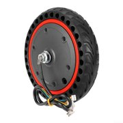 | **Мотор-колесо электросамоката AOVO Pro** 36 В, 350 Вт, шина 8,5″, бесколлекторное, с датчиками Холла *Основание: настройки шасси в бортовом ПО Zapret* | 4 шт. | 7 677,00 | 30 708,00 | 371,08 | медиана из 4: 6 990 – 8 000 |
| 1.02 | 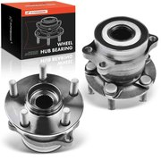 | **Ступица передняя Subaru Forester / Impreza** в сборе с двухрядным подшипником; поворотная опора модуля *Основание: паспорт изделия, раздел 3.3* | 4 шт. | 4 327,00 | 17 308,00 | 209,15 | медиана из 3: 3 943 – 6 591 |
| 1.03 | 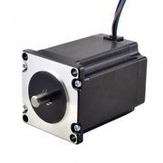 | **Шаговый двигатель NEMA 23 (57HS76-2804)** 1,8°, 2,8 А, 1,9 Н·м, вал 8 мм *Основание: паспорт изделия, раздел 4.1* | 4 шт. | 2 834,50 | 11 338,00 | 137,01 | среднее из 2: 2 690 – 2 979 |
| 1.04 | 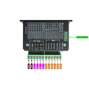 | **Драйвер шагового двигателя TB6600** до 4 А, 9–42 В, оптронные входы *Основание: прошивка колеса: D6, D7, D8* | 4 шт. | 750,00 | 3 000,00 | 36,25 | медиана из 3: 695 – 975 |
| 1.05 | 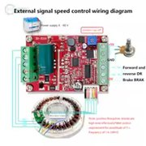 | **Драйвер тяги бесколлекторного мотора ZS-X11H** 6–60 В, 400 Вт, датчики Холла, вход ШИМ *Основание: прошивка колеса: D2–D5, D19* | 4 шт. | 1 144,50 | 4 578,00 | 55,32 | среднее из 2: 980 – 1 309 |
| 1.06 | 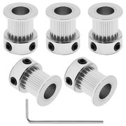 | **Шкив зубчатый GT2, 20 зубьев** под ремень 10 мм, посадочное отверстие 8 мм *Основание: паспорт изделия, раздел 4.1* | 4 шт. | 132,50 | 530,00 | 6,40 | среднее из 2: 120 – 145 |
| 1.07 | 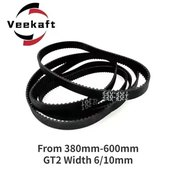 | **Ремень зубчатый GT2 замкнутый** ширина 10 мм, длина 500 мм *Основание: паспорт изделия, раздел 4.1* | 4 шт. | 233,00 | 932,00 | 11,26 | среднее из 2: 169 – 297 |
| 1.08 | 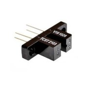 | **Оптический концевой выключатель** щелевой, 5 В, с кабелем; датчик нуля руля *Основание: прошивка колеса: D18* | 4 шт. | 113,00 | 452,00 | 5,46 | медиана из 3: 110 – 120 |
| 1.09 | 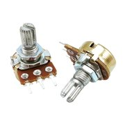 | **Потенциометр 10 кОм, линейный** датчик угла поворота колеса *Основание: прошивка колеса: A0* | 4 шт. | 40,50 | 162,00 | 1,96 | среднее из 2: 25 – 56 |
| 1.10 | 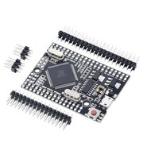 | **Плата Arduino Mega 2560** ATmega2560, 5 В, USB; контроллер модуля колеса *Основание: прошивка колеса* | 4 шт. | 1 640,00 | 6 560,00 | 79,27 | среднее из 2: 1 290 – 1 990 |
| 1.11 | 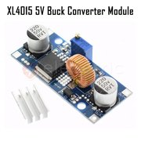 | **Понижающий модуль XL4015** 5 А, вход до 36 В, регулируемый выход *Основание: рендер платы модуля колеса* | 4 шт. | 333,50 | 1 334,00 | 16,12 | среднее из 2: 269 – 398 |
| 1.12 | 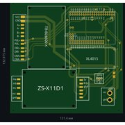 | **Плата-носитель модуля колеса** двухсторонняя печатная плата 131 × 133 мм, изготовление *Основание: рендер платы модуля колеса* | 4 шт. | 1 200,00 | 4 800,00 | 58,00 | оценка |
| 1.13 | 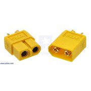 | **Разъём XT60, пара** силовой ввод платы модуля *Основание: рендер платы модуля колеса* | 4 пара | 187,80 | 751,20 | 9,08 | медиана из 3: 150 – 575 |
| 1.14 | 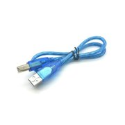 | **Кабель USB A — B** 0,5–0,8 м, плата колеса — USB-хаб *Основание: схема подключений Zapret* | 4 шт. | 220,00 | 880,00 | 10,63 | среднее из 2: 100 – 340 |
| | | **Итого по разделу** | | | **83 333,20** | **1 007,00** | |

Примечания к разделу:

* **1.01.** Три из четырёх предложений — совместимое колесо Xiaomi M365 Pro 350 Вт того же типоразмера.
* **1.02.** Цена неоригинальных ступиц (GMB, Asva, SNR); модель автомобиля и год в документах не названы.
* **1.05.** В документах драйвер назван RioRand ZS-Z11H, на рендере платы — ZS-X11D1; цена взята по плате ZS-X11H того же класса.
* **1.07.** Длина ремня в документах не указана; 500 мм соответствует межосевому расстоянию около 160 мм.
* **1.09.** Модель потенциометра в документах не названа; цена — по WH148 B10K.
* **1.10.** Исполнение платы (Mega 2560 R3 или Mega Pro) в документах названо по-разному; цена — по совместимой Mega 2560 R3.
* **1.12.** Оценка: мелкая партия двух видов плат с доставкой. Изготовлены ли платы, по документам не видно.

### 4.2. Модуль датчиков, свет и доступ

Пятая плата Arduino Mega: компас и инерциальный датчик, считыватель карт, реле света, подсветка пола и замок грузового отсека.

| № | Фото | Наименование и параметры | Кол-во | Цена, ₽ | Сумма, ₽ | Сумма, USD | Откуда цена |
| :---: | :---: | :--- | :---: | ---: | ---: | ---: | :--- |
| 2.01 |  | **Плата Arduino Mega 2560** ATmega2560, 5 В, USB; контроллер модуля датчиков *Основание: прошивка модуля датчиков* | 1 шт. | 1 640,00 | 1 640,00 | 19,82 | среднее из 2: 1 290 – 1 990 |
| 2.02 | 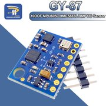 | **Модуль GY-87** MPU6050, HMC5883L и BMP180 на одной шине I²C *Основание: прошивка модуля датчиков: D20, D21* | 1 шт. | 413,70 | 413,70 | 5,00 | среднее из 2: 367 – 460 |
| 2.03 | 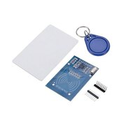 | **Считыватель карт RC522** 13,56 МГц, SPI, питание 3,3 В; в комплекте карта и брелок *Основание: прошивка модуля датчиков: D9, D50–D53* | 1 шт. | 199,00 | 199,00 | 2,40 | медиана из 3: 130 – 219 |
| 2.04 | 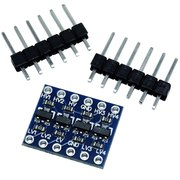 | **Преобразователь логических уровней 5 ↔ 3,3 В** 4 канала, двунаправленный *Основание: руководство по прошивке Zapret* | 2 шт. | 40,00 | 80,00 | 0,97 | медиана из 3: 30 – 60 |
| 2.05 | 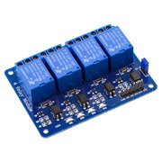 | **Модуль реле, 4 канала** 5 В, включение низким уровнем *Основание: прошивка модуля датчиков: D2–D5* | 1 шт. | 279,50 | 279,50 | 3,38 | среднее из 2: 240 – 319 |
| 2.06 | 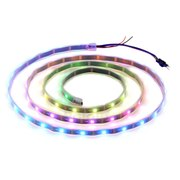 | **Адресная светодиодная лента WS2812B** 5 В, 60 диодов на метр; используется 73 диода (1,22 м) *Основание: прошивка модуля датчиков: D6* | 2 м | 308,50 | 617,00 | 7,46 | среднее из 2: 296 – 321 |
| 2.07 | 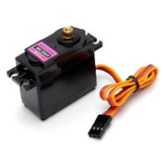 | **Сервопривод MG996R** металлические шестерни, 4,8–7,2 В; привод замка отсека *Основание: прошивка модуля датчиков: D7* | 1 шт. | 498,00 | 498,00 | 6,02 | медиана из 3: 457 – 690 |
| 2.08 | 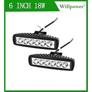 | **Фара светодиодная** 12/24 В, 18 Вт *Основание: прошивка модуля датчиков: реле D2* | 2 шт. | 1 099,00 | 2 198,00 | 26,56 | медиана из 3: 349 – 1 140 |
| 2.09 | 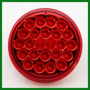 | **Фонарь задний светодиодный (стоп-сигнал)** 12–24 В, круглый *Основание: прошивка модуля датчиков: реле D3* | 2 шт. | 1 709,50 | 3 419,00 | 41,32 | среднее из 2: 1 420 – 1 999 |
| 2.10 | 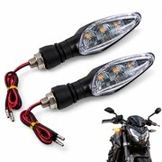 | **Указатели поворота светодиодные** 12 В, пара *Основание: прошивка модуля датчиков: реле D4, D5* | 2 пара | 785,37 | 1 570,74 | 18,98 | медиана из 3: 295 – 1 490 |
| 2.11 | 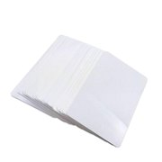 | **Карта доступа Mifare Classic 1K** 13,56 МГц, ISO 14443A *Основание: прошивка модуля датчиков: до 12 карт* | 10 шт. | 15,50 | 155,00 | 1,87 | среднее из 2: 15 – 16 |
| 2.12 |  | **Понижающий модуль XL4015** 5 А, вход до 36 В, регулируемый выход *Основание: рендер платы модуля датчиков* | 1 шт. | 333,50 | 333,50 | 4,03 | среднее из 2: 269 – 398 |
| 2.13 | 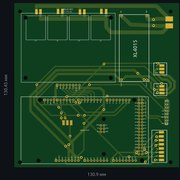 | **Плата-носитель модуля датчиков** двухсторонняя печатная плата 131 × 130 мм, изготовление *Основание: рендер платы модуля датчиков* | 1 шт. | 1 200,00 | 1 200,00 | 14,50 | оценка |
| 2.14 |  | **Кабель USB A — B** 0,5–0,8 м, плата датчиков — USB-хаб *Основание: схема подключений Zapret* | 1 шт. | 220,00 | 220,00 | 2,66 | среднее из 2: 100 – 340 |
| | | **Итого по разделу** | | | **12 823,44** | **154,96** | |

Примечания к разделу:

* **2.04.** Два модуля закрывают пять линий считывателя RC522.
* **2.06.** Плотность ленты в документах не указана; при 60 диодах на метр нужно 1,22 м, лента продаётся кратно метру.
* **2.07.** Модель сервопривода в документах не названа.
* **2.08.** Модель фары в документах не названа.
* **2.09.** Модель фонаря в документах не названа.
* **2.10.** Модель указателей в документах не названа; принято по паре на левый и на правый борт.
* **2.13.** Оценка, как для платы модуля колеса.

### 4.3. Навигация и машинное зрение

Лидар кругового обзора, сенсор глубины и четыре камеры, подключённые к бортовому компьютеру по USB.

| № | Фото | Наименование и параметры | Кол-во | Цена, ₽ | Сумма, ₽ | Сумма, USD | Откуда цена |
| :---: | :---: | :--- | :---: | ---: | ---: | ---: | :--- |
| 3.01 | 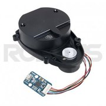 | **Лидар LDS-01 (HLS-LFCD2)** 360°, 0,12–3,5 м, с адаптером USB *Основание: настройки лидара в Zapret* | 1 шт. | 26 000,00 | 26 000,00 | 314,19 | среднее из 2: 26 000 – 26 000 |
| 3.02 | 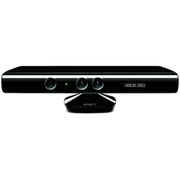 | **Сенсор глубины Kinect для Xbox 360** глубина 640 × 480, USB *Основание: схема подключений Zapret* | 1 шт. | 6 990,00 | 6 990,00 | 84,47 | медиана из 3: 1 990 – 10 270 |
| 3.03 | 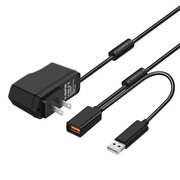 | **Адаптер Kinect: USB и питание** переходник с сетевым блоком питания 12 В *Основание: схема подключений Zapret* | 1 шт. | 930,00 | 930,00 | 11,24 | среднее из 2: 900 – 960 |
| 3.04 | 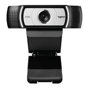 | **Веб-камера Logitech C930e** 1920 × 1080, USB, угол 90° *Основание: схема подключений Zapret* | 4 шт. | 13 202,50 | 52 810,00 | 638,16 | медиана из 4: 10 400 – 15 868 |
| | | **Итого по разделу** | | | **86 730,00** | **1 048,05** | |

Примечания к разделу:

* **3.02.** Снят с производства; цена — середина между объявлением о продаже с рук и магазинами.
* **3.03.** Цена по объявлениям о продаже.

### 4.4. Бортовой компьютер и интерфейс оператора

Компьютер под Ubuntu, экран, чековый принтер и всё, что нужно для подключения девяти устройств с последовательным портом.

| № | Фото | Наименование и параметры | Кол-во | Цена, ₽ | Сумма, ₽ | Сумма, USD | Откуда цена |
| :---: | :---: | :--- | :---: | ---: | ---: | ---: | :--- |
| 4.01 | 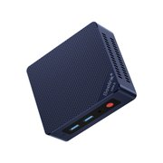 | **Мини-ПК на Intel N100** 16 ГБ ОЗУ, SSD 512 ГБ *Основание: паспорт изделия, раздел 9* | 1 шт. | 32 056,00 | 32 056,00 | 387,37 | медиана из 5: 16 999 – 45 700 |
| 4.02 | 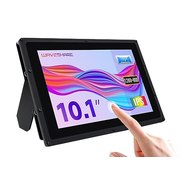 | **Дисплей 10,1″ сенсорный** IPS 1280 × 800, HDMI, ёмкостный сенсор по USB *Основание: схема подключений Zapret* | 1 шт. | 9 410,00 | 9 410,00 | 113,71 | среднее из 2: 7 830 – 10 990 |
| 4.03 | 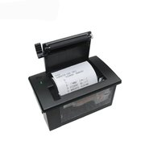 | **Чековый термопринтер 58 мм** встраиваемый, интерфейс TTL, 9600 бод *Основание: схема подключений Zapret* | 1 шт. | 1 719,97 | 1 719,97 | 20,78 | среднее из 2: 1 500 – 1 940 |
| 4.04 | 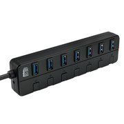 | **USB-хаб на 7 портов с блоком питания** USB 3.0, внешнее питание *Основание: схема подключений Zapret* | 1 шт. | 1 736,00 | 1 736,00 | 20,98 | среднее из 2: 1 592 – 1 880 |
| 4.05 | 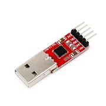 | **Преобразователь USB-UART CP2102** для BMS и для принтера *Основание: схема подключений Zapret* | 2 шт. | 298,00 | 596,00 | 7,20 | медиана из 3: 150 – 540 |
| 4.06 | 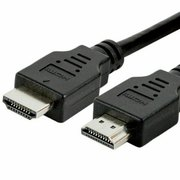 | **Кабель HDMI** 1 м *Основание: схема подключений Zapret* | 1 шт. | 165,00 | 165,00 | 1,99 | среднее из 2: 120 – 210 |
| | | **Итого по разделу** | | | **45 682,97** | **552,04** | |

Примечания к разделу:

* **4.01.** Модель компьютера в документах не названа; разброс цен — от 17 до 46 тыс. ₽.
* **4.02.** Модель и диагональ дисплея в документах не названы.
* **4.03.** Модель принтера в документах не названа; цена — по классу CSN-A2.

### 4.5. Аккумулятор и электропитание

Батарея LiFePO4 12S3P из 36 элементов, зарядное устройство, преобразователи на 24, 12 и 5 В, силовые разъёмы и провод.

| № | Фото | Наименование и параметры | Кол-во | Цена, ₽ | Сумма, ₽ | Сумма, USD | Откуда цена |
| :---: | :---: | :--- | :---: | ---: | ---: | ---: | :--- |
| 5.01 | 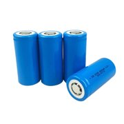 | **Элемент LiFePO4 32700** 3,2 В, 6000 мА·ч *Основание: паспорт изделия, раздел 8* | 36 шт. | 408,00 | 14 688,00 | 177,49 | медиана из 3: 365 – 644 |
| 5.02 | 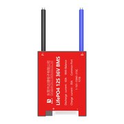 | **Плата BMS LiFePO4 12S** 36 В, 60 А, с балансировкой *Основание: паспорт изделия, раздел 8* | 1 шт. | 5 720,50 | 5 720,50 | 69,13 | среднее из 2: 4 500 – 6 941 |
| 5.03 | 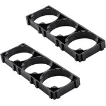 | **Холдер элемента 32700** ABS, наборный *Основание: схема сборки батареи* | 72 шт. | 21,50 | 1 548,00 | 18,71 | среднее из 2: 15 – 28 |
| 5.04 | 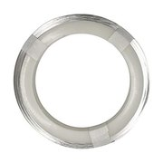 | **Лента никелевая для сварки** 0,2 × 10 мм *Основание: схема сборки батареи* | 5 м | 82,00 | 410,00 | 4,95 | медиана из 3: 40 – 239 |
| 5.05 | 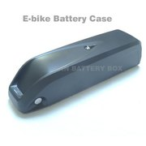 | **Корпус батареи пластиковый** под сборку 12S3P *Основание: схема сборки батареи* | 1 шт. | 1 899,50 | 1 899,50 | 22,95 | среднее из 2: 1 667 – 2 132 |
| 5.06 | 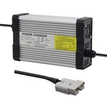 | **Зарядное устройство LiFePO4 12S** 43,8 В, 5 А *Основание: паспорт изделия, раздел 8* | 1 шт. | 5 600,00 | 5 600,00 | 67,67 | среднее из 2: 3 700 – 7 500 |
| 5.07 | 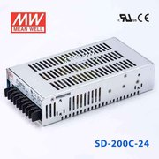 | **Преобразователь DC-DC на 24 В** вход 36–72 В, 8,4 А, 200 Вт (Mean Well SD-200C-24) *Основание: схема питания* | 1 шт. | 7 480,50 | 7 480,50 | 90,39 | среднее из 2: 7 310 – 7 651 |
| 5.08 | 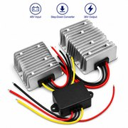 | **Преобразователь DC-DC на 12 В** вход 36–72 В, 10 А *Основание: схема питания* | 1 шт. | 1 369,00 | 1 369,00 | 16,54 | среднее из 2: 1 188 – 1 550 |
| 5.09 | 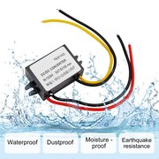 | **Преобразователь DC-DC на 5 В** вход 30–60 В, 10 А *Основание: схема питания* | 1 шт. | 1 548,00 | 1 548,00 | 18,71 | одно предложение |
| 5.10 | 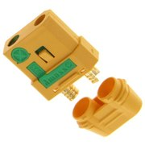 | **Разъём XT90-S антиискровой, пара** силовой разъём батареи *Основание: схема сборки батареи* | 1 пара | 450,00 | 450,00 | 5,44 | медиана из 3: 300 – 960 |
| 5.11 | 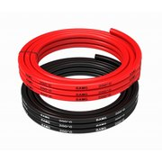 | **Провод силиконовый 8 AWG** медный, сечение 8,3 мм² *Основание: схема сборки батареи* | 2 м | 587,00 | 1 174,00 | 14,19 | медиана из 3: 335 – 590 |
| 5.12 | 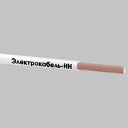 | **Провод монтажный ПуГВ 1 × 0,75** медный, в изоляции ПВХ *Основание: схема питания* | 30 м | 16,61 | 498,30 | 6,02 | медиана из 3: 13 – 26 |
| 5.13 | 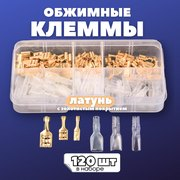 | **Наконечники, клеммы, термоусадка, стяжки** комплект расходных материалов для монтажа *Основание: схема питания* | 1 компл. | 1 500,00 | 1 500,00 | 18,13 | оценка |
| | | **Итого по разделу** | | | **43 885,80** | **530,32** | |

Примечания к разделу:

* **5.02.** На роботе стоит BMS JBD с UART; рублёвых предложений на неё поиск не дал, цена взята по платам 12S 60 А без UART.
* **5.05.** Цена по корпусам батарей электровелосипедов; корпус под конкретную сборку подбирается по месту.
* **5.07.** По схеме питания нужен ток 10 А; рублёвые предложения найдены только на SD-200C-24 (8,4 А).
* **5.12.** Количество оценено.
* **5.13.** Оценка без поиска цен.

### 4.6. Безопасность и сигнализация

Аварийный выключатель, защита силовой цепи, световая и звуковая сигнализация, светоотражающая маркировка.

| № | Фото | Наименование и параметры | Кол-во | Цена, ₽ | Сумма, ₽ | Сумма, USD | Откуда цена |
| :---: | :---: | :--- | :---: | ---: | ---: | ---: | :--- |
| 6.01 | 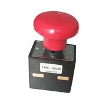 | **Аварийный выключатель силовой цепи ED250** «грибок» с фиксацией, до 250 А *Основание: схема питания* | 1 шт. | 4 237,50 | 4 237,50 | 51,21 | среднее из 2: 3 000 – 5 475 |
| 6.02 | 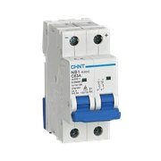 | **Автоматический выключатель постоянного тока** 2 полюса, 63 А, характеристика C *Основание: схема питания* | 1 шт. | 3 272,00 | 3 272,00 | 39,54 | медиана из 3: 1 940 – 3 285 |
| 6.03 |  | **Держатель MAXI с предохранителем** 60 А *Основание: схема сборки батареи* | 1 шт. | 748,00 | 748,00 | 9,04 | среднее из 2: 180 – 1 316 |
| 6.04 |  | **Проблесковый маячок оранжевый** 12–24 В *Основание: пояснительная записка, раздел 2* | 1 шт. | 2 624,50 | 2 624,50 | 31,71 | среднее из 2: 1 799 – 3 450 |
| 6.05 |  | **Оповещатель звуковой** 12 В, 85 дБ *Основание: пояснительная записка, раздел 2* | 1 шт. | 187,44 | 187,44 | 2,27 | среднее из 2: 159 – 215 |
| 6.06 |  | **Лента светоотражающая самоклеящаяся** ширина 50 мм *Основание: пояснительная записка, раздел 2* | 5 м | 69,90 | 349,50 | 4,22 | среднее из 2: 60 – 80 |
| | | **Итого по разделу** | | | **11 418,94** | **137,99** | |

Примечания к разделу:

* **6.01.** В схеме питания указан аварийный «грибок», разрывающий силовую цепь; модель не названа. Кнопка на 22 мм рассчитана на цепь управления (6 А) и одна эту задачу не решает.
* **6.04.** Заявлен в пояснительной записке; ни прошивка, ни бортовое ПО маячком не управляют.
* **6.05.** Заявлен в пояснительной записке; ни прошивка, ни бортовое ПО оповещателем не управляют.
* **6.06.** Количество оценено.

### 4.7. Рама, корпус и крепёж

Металл для сварной рамы и вилок, материал обшивки, покрытие, пластик для печатных деталей и крепёж.

| № | Фото | Наименование и параметры | Кол-во | Цена, ₽ | Сумма, ₽ | Сумма, USD | Откуда цена |
| :---: | :---: | :--- | :---: | ---: | ---: | ---: | :--- |
| 7.01 |  | **Труба профильная 40 × 40 × 2 мм** сталь Ст3, два хлыста по 6 м *Основание: паспорт изделия, раздел 3.2* | 12 м | 165,00 | 1 980,00 | 23,93 | среднее из 2: 155 – 175 |
| 7.02 |  | **Лист стальной горячекатаный 5 мм** вилки колёс и косынки под ступицы *Основание: паспорт изделия, раздел 3.3* | 0,5 м² | 2 644,00 | 1 322,00 | 15,98 | медиана из 4: 1 865 – 2 815 |
| 7.03 |  | **Панель алюминиевая композитная 3 мм** лист 1220 × 2440 мм; обшивка и грузовой отсек *Основание: допущение* | 1 лист | 4 560,00 | 4 560,00 | 55,10 | медиана из 3: 4 320 – 4 740 |
| 7.04 |  | **Шпилька резьбовая М16 × 1000** DIN 975; центральные шпильки поворотных узлов *Основание: паспорт изделия, раздел 3.3* | 1 шт. | 434,50 | 434,50 | 5,25 | среднее из 2: 184 – 685 |
| 7.05 |  | **Грунт-эмаль по ржавчине 3 в 1** 0,9 кг *Основание: пояснительная записка, раздел 5* | 2 банка | 550,00 | 1 100,00 | 13,29 | медиана из 3: 540 – 638 |
| 7.06 |  | **Пластик PETG для 3D-печати** 1,75 мм, катушка 1 кг *Основание: пояснительная записка, раздел 8.1* | 2 шт. | 1 200,00 | 2 400,00 | 29,00 | медиана из 3: 746 – 2 250 |
| 7.07 |  | **Крепёж: болты, гайки, шайбы М4–М16** комплект *Основание: паспорт изделия, раздел 3* | 1 компл. | 2 500,00 | 2 500,00 | 30,21 | оценка |
| | | **Итого по разделу** | | | **14 296,50** | **172,76** | |

Примечания к разделу:

* **7.01.** Расход оценён по габаритам рамы 750 × 600 × 400 мм.
* **7.02.** Площадь оценена.
* **7.03.** Материал обшивки в документах не назван.
* **7.06.** Ведомые шкивы на 150 зубьев (4 шт.) и кронштейны. Готовых шкивов GT2 на 150 зубьев поиск не дал, принята 3D-печать.
* **7.07.** Оценка без поиска цен.

---

## 5. ПРОЧИЕ ЗАТРАТЫ И ПОЛНЫЙ ИТОГ

Эти три статьи перенесены из прежней калькуляции без изменений: по ним нет новых данных.

| Статья | Что входит | Сумма, ₽ | Сумма, USD |
| :--- | :--- | ---: | ---: |
| Работа специалистов | Сварочно-слесарные работы, проектирование, разводка плат, интеграция программного обеспечения | 45 000,00 | 543,78 |
| Амортизация оборудования | Сварочный полуавтомат, станки, 3D-принтер, монтажный инструмент | 11 000,00 | 132,92 |
| Интеграционные расходы | Развёртывание диспетчерского сервиса, нанесение разметки и меток на площадке | 15 000,00 | 181,26 |
| **Прочие затраты** | | **71 000,00** | **857,97** |
| Комплектующие и материалы | разделы 4.1–4.7 | 298 170,85 | 3 603,12 |
| **Всего на один робот** | | **369 170,85** | **4 461,09** |

---

## 6. РАЗБРОС ЦЕН

Одна и та же позиция у разных продавцов стоит по-разному. В таблице — сумма раздела, если по каждой позиции взять самое дешёвое, принятое в смете и самое дорогое из найденных предложений. Позиции с одним предложением и оценки в разброс ничего не добавляют.

| Раздел | По самым дешёвым, ₽ | Принято в смете, ₽ | По самым дорогим, ₽ |
| :--- | ---: | ---: | ---: |
| Поворотно-тяговые модули | 74 924,00 | 83 333,20 | 99 900,00 |
| Модуль датчиков, свет и доступ | 8 983,39 | 12 823,44 | 15 796,00 |
| Навигация и машинное зрение | 70 490,00 | 86 730,00 | 100 702,00 |
| Бортовой компьютер и интерфейс оператора | 28 340,94 | 45 682,97 | 61 800,00 |
| Аккумулятор и электропитание | 37 218,26 | 43 885,80 | 58 124,70 |
| Безопасность и сигнализация | 7 377,79 | 11 418,94 | 14 141,47 |
| Рама, корпус и крепёж | 12 368,50 | 14 296,50 | 17 208,50 |
| **Комплектующие и материалы** | **239 702,88** | **298 170,85** | **367 672,67** |
| **Всего с прочими затратами** | **310 702,88** | **369 170,85** | **438 672,67** |

В долларах США полный итог лежит между 3 754,55 и 5 300,95; принятое значение — 4 461,09.

---

## 7. СРАВНЕНИЕ С ПРЕЖНЕЙ КАЛЬКУЛЯЦИЕЙ

Прежняя калькуляция (пояснительная записка, раздел 8.1 (редакция до 10.11.2026)) состояла из шести укрупнённых статей на комплектующие и давала итог 207 200 ₽. Ниже позиции новой сметы разложены по тем же статьям.

| Статья прежней калькуляции | Было, ₽ | Стало, ₽ | Разница, ₽ | Что изменилось |
| :--- | ---: | ---: | ---: | :--- |
| Металлопрокат и расходные материалы | 17 400 | 16 108,00 | −1 292,00 | добавлены материал обшивки, пластик для печати и светоотражающая лента |
| Опорные узлы | 19 600 | 17 308,00 | −2 292,00 | состав тот же: четыре ступицы |
| Приводы поворота и тяги | 33 500 | 42 046,00 | +8 546,00 | мотор-колёса 350 Вт вместо 260 Вт |
| Электроника и датчики | 27 200 | 123 031,38 | +95 831,38 | добавлены модуль датчиков со светом и замком, четыре камеры вместо одной, сенсор глубины, платы-носители |
| Аккумуляторная батарея | 17 500 | 29 866,00 | +12 366,00 | добавлены зарядное устройство, холдеры и корпус |
| Бортовой компьютер и питание | 21 000 | 69 811,47 | +48 811,47 | добавлены дисплей, принтер, USB-хаб, три преобразователя, аварийный выключатель и защита |
| **Комплектующие и материалы** | **136 200** | **298 170,85** | **+161 970,85** | |
| Работа, амортизация, интеграция | 71 000 | 71 000,00 | 0,00 | не пересчитывались |
| **Всего** | **207 200** | **369 170,85** | **+161 970,85** | |

Новый итог больше прежнего в 1,78 раза. Причина в составе, а не в росте цен: прежняя калькуляция не учитывала модуль датчиков со светом и замком, три камеры из четырёх, сенсор глубины, дисплей, принтер, зарядное устройство, преобразователи напряжения и аварийный выключатель.

---

## 8. ДОПУЩЕНИЯ И ЧТО НЕ ВОШЛО

### 8.1. Позиции, подобранные по допущению

В документах проекта у этих позиций не названа модель или не указано количество. Перед закупкой их нужно сверить с собранным роботом.

| № | Позиция | В чём допущение | Сумма, ₽ |
| :---: | :--- | :--- | ---: |
| 1.07 | Ремень зубчатый GT2 замкнутый | Длина ремня в документах не указана; 500 мм соответствует межосевому расстоянию около 160 мм. | 932,00 |
| 1.09 | Потенциометр 10 кОм, линейный | Модель потенциометра в документах не названа; цена — по WH148 B10K. | 162,00 |
| 2.06 | Адресная светодиодная лента WS2812B | Плотность ленты в документах не указана; при 60 диодах на метр нужно 1,22 м, лента продаётся кратно метру. | 617,00 |
| 2.07 | Сервопривод MG996R | Модель сервопривода в документах не названа. | 498,00 |
| 2.08 | Фара светодиодная | Модель фары в документах не названа. | 2 198,00 |
| 2.09 | Фонарь задний светодиодный (стоп-сигнал) | Модель фонаря в документах не названа. | 3 419,00 |
| 2.10 | Указатели поворота светодиодные | Модель указателей в документах не названа; принято по паре на левый и на правый борт. | 1 570,74 |
| 4.01 | Мини-ПК на Intel N100 | Модель компьютера в документах не названа; разброс цен — от 17 до 46 тыс. ₽. | 32 056,00 |
| 4.02 | Дисплей 10,1″ сенсорный | Модель и диагональ дисплея в документах не названы. | 9 410,00 |
| 4.03 | Чековый термопринтер 58 мм | Модель принтера в документах не названа; цена — по классу CSN-A2. | 1 719,97 |
| 5.05 | Корпус батареи пластиковый | Цена по корпусам батарей электровелосипедов; корпус под конкретную сборку подбирается по месту. | 1 899,50 |
| 5.12 | Провод монтажный ПуГВ 1 × 0,75 | Количество оценено. | 498,30 |
| 6.01 | Аварийный выключатель силовой цепи ED250 | В схеме питания указан аварийный «грибок», разрывающий силовую цепь; модель не названа. Кнопка на 22 мм рассчитана на цепь управления (6 А) и одна эту задачу не решает. | 4 237,50 |
| 6.06 | Лента светоотражающая самоклеящаяся | Количество оценено. | 349,50 |
| 7.01 | Труба профильная 40 × 40 × 2 мм | Расход оценён по габаритам рамы 750 × 600 × 400 мм. | 1 980,00 |
| 7.02 | Лист стальной горячекатаный 5 мм | Площадь оценена. | 1 322,00 |
| 7.03 | Панель алюминиевая композитная 3 мм | Материал обшивки в документах не назван. | 4 560,00 |
| 7.06 | Пластик PETG для 3D-печати | Ведомые шкивы на 150 зубьев (4 шт.) и кронштейны. Готовых шкивов GT2 на 150 зубьев поиск не дал, принята 3D-печать. | 2 400,00 |
| | **Всего по допущениям** | | **69 829,51** |

### 8.2. Позиции, оценённые без поиска цен

| № | Позиция | Пояснение | Сумма, ₽ |
| :---: | :--- | :--- | ---: |
| 1.12 | Плата-носитель модуля колеса | Оценка: мелкая партия двух видов плат с доставкой. Изготовлены ли платы, по документам не видно. | 4 800,00 |
| 2.13 | Плата-носитель модуля датчиков | Оценка, как для платы модуля колеса. | 1 200,00 |
| 5.13 | Наконечники, клеммы, термоусадка, стяжки | Оценка без поиска цен. | 1 500,00 |
| 7.07 | Крепёж: болты, гайки, шайбы М4–М16 | Оценка без поиска цен. | 2 500,00 |
| | **Всего по оценкам** | | **10 000,00** |

### 8.3. Что в смету не вошло

* доставка, таможенные платежи и комиссии площадок;
* запасные части и повторные закупки при браке;
* инструмент и оснастка (учтены одной строкой амортизации);
* программное обеспечение: используется свободное, лицензионных платежей нет;
* чековая лента, расходные материалы сварки, электроэнергия;
* ведомые шкивы на 150 зубьев отдельной строкой: они печатаются из пластика, который учтён в разделе 4.7.

### 8.4. На что обратить внимание при закупке

* **Понижающий модуль XL4015 рассчитан на вход до 36 В,** а полностью заряженная батарея 12S даёт до 43,8 В. Питать такой модуль можно от шины 24 В, но не прямо от батареи. Подробнее — в [`ELECTRICAL_AND_PINOUTS.md`](ELECTRICAL_AND_PINOUTS.md).
* **Преобразователи, подключённые к батарее, должны допускать вход не ниже 48 В.** В смету включены модели с входом до 60–72 В.
* **Считыватель RC522 питается только от 3,3 В.** Поэтому в составе модуля датчиков есть преобразователи уровней.

---

## ПРИЛОЖЕНИЕ А. НАЙДЕННЫЕ ПРЕДЛОЖЕНИЯ

Все предложения, выписанные из поисковой выдачи 10.11.2026. Ссылка ведёт на страницу, которую показал поиск; сама страница не открывалась. В колонке «В расчёте» — «да» или причина, по которой предложение не учтено.

| Позиции | Цена, ₽ | Продавец | Что предлагается | В расчёте |
| :--- | ---: | :--- | :--- | :--- |
| 1.01 | 6 990,00 | [demmer.store](https://demmer.store/motor-koleso-aovo-m365-pro-app-v-sbore/) | Мотор-колесо для электросамоката AOVO M365 Pro App в сборе, 350 Вт, 36 В | да |
| 1.01 | 7 454,00 | [market.yandex.ru](https://market.yandex.ru/card/motor-koleso-xiaomi-m365-pro-350w-36v-s-naduvnoy-shinoy/5909413422) | Мотор-колесо Xiaomi M365 PRO (350W, 36V, с надувной шиной) | да |
| 1.01 | 7 900,00 | [electroskill.ru](https://electroskill.ru/zapchasti/motory-kolesa/motor-koleso-xiaomi-mijia-m365-pro36v-350w/) | Мотор-колесо Xiaomi Mijia M365 Pro 36V 350W | да |
| 1.01 | 8 000,00 | [segway-service.ru](https://segway-service.ru/aksessuari-i-zapchasti/elektrosamokati/zapchasti-dlya-xiaomi-mijia-m365-pro/motor-koleso-dlya-xiaomi-m365-propro2-350w-v-sbore/) | Мотор-колесо для Xiaomi M365 PRO/PRO2 350W в сборе (на заказ) | да |
| 1.02 | 3 943,00 | [port3.ru](https://www.port3.ru/info/GMB/GH33140M) | GMB GH33140M, ступица передняя Subaru Forester SH/SJ, Impreza GH, Legacy | да |
| 1.02 | 4 327,00 | [autocode.ru](https://autocode.ru/price/Asva/sbwhsgf) | Asva SBWH-SGF, ступица колеса передняя Subaru Forester, Impreza, Legacy I–III | да |
| 1.02 | 6 591,00 | [autorus.ru](https://www.autorus.ru/catalog/stupitsy/00-01459626) | SNR HGB35312, ступица передняя в сборе Subaru Forester 08-, Legacy 03-, Impreza 05- | да |
| 1.03 | 1 790,00 | [duxe.ru](https://duxe.ru/catalog/dvigateli/shagovye_dvigateli_1/shagovyy_dvigatel_57hs76_3004b_dva_vala/) | Шаговый двигатель 57HS76-3004B (аналог: 3 А, 20 кгс·см, два вала) | нет: аналог 57HS76-3004B: два вала, ток фазы 3 А |
| 1.03 | 2 690,00 | [ivcnc.ru](https://ivcnc.ru/index.php/kategorii/product/view/95/58) | Шаговый двигатель 57HS76-2804 | да |
| 1.03 | 2 979,00 | [spbcnc.ru](https://spbcnc.ru/komplektujuszie_dlay_chpu/shagovye-dvigateli-i-aksessuary/shagovye-dvigateli/shagovye-dvigateli-serii-nema-23/shagovyj-dvigatel-57hs76-2804) | Шаговый двигатель 57HS76-2804: NEMA 23, 2,8 А, 19 кгс·см, вал 8 мм | да |
| 1.04 | 695,00 | [ltparts.ru](https://ltparts.ru/zap-chasti-dlya-3d-printerov/drajver-dlya-shagovyx-dvigatelej-tb6600-4a-9-42v-ttl-16-micro-step-cnc-1-axis/) | Драйвер для шаговых двигателей TB6600, 4 А, 9–42 В | да |
| 1.04 | 750,00 | [smdx.ru](https://smdx.ru/tb6600) | TB6600, драйвер шагового двигателя (4,0 А, 9–42 В) | да |
| 1.04 | 975,00 | [orion43.ru](https://orion43.ru/28127-tb6600-drayver-shagovogo-dvigatelya-40a-v-korpuse) | TB6600, драйвер шагового двигателя 4,0 А в корпусе | да |
| 1.05 | 980,00 | [taggsm.ru](https://taggsm.ru/index.php?path=13000040_13000061&product_id=131267&route=product%2Fproduct) | EG2134, модуль ZS-X11H драйвера бесщёточного 3-фазного двигателя с датчиком Холла, 6–60 В, 400 Вт | да |
| 1.05 | 1 309,00 | [market.yandex.ru](https://market.yandex.ru/search?text=%D0%BA%D0%BE%D0%BD%D1%82%D1%80%D0%BE%D0%BB%D0%BB%D0%B5%D1%80+%D0%B1%D0%B5%D1%81%D0%BA%D0%BE%D0%BB%D0%BB%D0%B5%D0%BA%D1%82%D0%BE%D1%80%D0%BD%D1%8B%D1%85+%D0%B4%D0%B2%D0%B8%D0%B3%D0%B0%D1%82%D0%B5%D0%BB%D0%B5%D0%B9+%D1%82%D1%80%D0%B5%D1%85%D1%84%D0%B0%D0%B7%D0%BD%D1%8B%D1%85) | Бесщёточный контроллер двигателя BLDC ZS-X11H Dual Capacitors (выдача поиска) | да |
| 1.06 | 120,00 | [creatorplanet.com](https://creatorplanet.com/3d-pritera-i-chpu/zubchatyy-shkiv-gt2-8-mm-20-zubyev-pod-10mm-remen) | Зубчатый шкив GT2-10 мм, 20 зубьев, посадочное 8 мм | да |
| 1.06 | 145,00 | [zona-3d.ru](https://zona-3d.ru/catalog/mekhanika/shkivy_dlya_remney/shkivy_dlya_remney_gt2/dvojnoj-zubchatyj-shkiv-dlya-remnya-gt2-10-d8-mm-20-zubev) | Зубчатый шкив для ремня GT2-10 D8 мм, 20 зуб. (цена в блоке похожих товаров) | да |
| 1.07 | 169,00 | [rc-go.ru](https://rc-go.ru/cat/zubchatiy-remen-10mm-gt2-500mm-zamknutiy/) | Зубчатый ремень 10 мм GT2 500 мм замкнутый | да |
| 1.07 | 297,00 | [zona-3d.ru](https://zona-3d.ru/catalog/mekhanika/zubchatye_remni/zubchatye_remni_gt2/zubchatye_remni_gt2_zamknutye/zamknutyy_zubchatyy_remen_gt2_10_mm_500_2gt) | Замкнутый зубчатый ремень GT2-10 мм (500-2GT) | да |
| 1.08 | 110,00 | [amperkot.ru](https://amperkot.ru/products/opticheskiy_kontsevoy_vyiklyuchatel_dlya_3d_printerov_na_platforme_ramps_14_i_drugih_cnc_stankov/25057484.html) | Оптический концевой выключатель для 3D-принтеров (TCST2103, кабель 500 мм) | да |
| 1.08 | 113,00 | [shop.robotclass.ru](https://shop.robotclass.ru/item/520) | Оптический концевой выключатель для 3D-принтера, с кабелем | да |
| 1.08 | 120,00 | [3drob.ru](https://3drob.ru/elektronika_dlya_3d_printerov/koncevye_vyklyuchateli/) | Оптический концевой выключатель (разъём сзади), Geeetech | да |
| 1.09 | 25,00 | [amperkot.ru](https://amperkot.ru/products/peremennyiy_rezistor__potentsiometr_wh148_10k/24147410.html) | Переменный резистор (потенциометр) WH148 10k, линейный | да |
| 1.09 | 56,00 | [magazin-detaley.ru](https://magazin-detaley.ru/potenciometr-wh148-b10k-15mm-3-pin) | Потенциометр WH148 B10K 15 мм 3-pin | да |
| 1.10, 2.01 | 1 290,00 | [onpad.ru](https://onpad.ru/shop/cubie/arduino/arduino/1465.html) | Плата Mega 2560 R3 (Arduino-совместимая), под заказ | да |
| 1.10, 2.01 | 1 990,00 | [procontact74.ru](https://procontact74.ru/14-arduino-elektronnye-moduli/arduino/arduino-mega-atmega2560-32532/) | Отладочная плата Arduino Mega 2560 R3 (CH340) | да |
| 1.11, 2.12 | 269,00 | [procontact74.ru](https://procontact74.ru/14-arduino-elektronnye-moduli/moduli-pitaniya1/ponijayuschiy-dc-dc-modul-xl4015-5a-s-regulirovkoy-napryajeniya-i-toka/) | Понижающий DC-DC модуль 5 А XL4015 с регулировкой напряжения и тока (тип 1), вход 8–36 В | да |
| 1.11, 2.12 | 398,00 | [procontact74.ru](https://procontact74.ru/14-arduino-elektronnye-moduli/moduli-pitaniya1/56787-ponijayushchiidcdcmodylxl40155asregylirovkoinapryajeniyaitokatip2/) | Понижающий DC-DC модуль 5 А XL4015 (тип 2), вход 8–36 В | да |
| 1.13 | 150,00 | [ардуино.рф](https://xn--80aac7afh3afm.xn--p1ai/para-razyomov-xt60-gnezdo-shteker-mama-papa) | Пара разъёмов XT60, гнездо + штекер | да |
| 1.13 | 187,80 | [vseinstrumenti.ru](https://www.vseinstrumenti.ru/product/razem-silovoj-insparion-xt60-konnektor-pitaniya-dlya-akkum-batarej-gnezdo-shteker-para-mama-papa-5par-s1-00002166-14945902/) | Разъём силовой Insparion XT60, 5 пар за 939 ₽ (187,80 ₽ за пару) | да |
| 1.13 | 575,00 | [goldenmotor.ru](https://goldenmotor.ru/cabeli/razyem-xt60-papa-mama/) | Разъём XT60 («папа» + «мама») | да |
| 1.14, 2.14 | 100,00 | [duino.ru](https://duino.ru/usb-kabel-a-b/) | USB-кабель тип A–B для Arduino Uno/Mega, 50 см | да |
| 1.14, 2.14 | 340,00 | [amperka.ru](https://amperka.ru/product/usb-cable) | Кабель USB (A — B), 80 см | да |
| 2.02 | 367,39 | [aliradar.com](https://aliradar.com/item/32422475985-gy-87-i2c-iic-10dof-mpu6050-hmc5883l-bmp180-modul-datchika-gy87-dlya-arduino-5v-vstroennye-filtry-vysokoy-tochnosti) | GY-87 10DOF MPU6050 HMC5883L BMP180 — сводка цен продавцов AliExpress, 367–578 ₽ | да |
| 2.02 | 460,00 | [amperkot.ru](https://amperkot.ru/products/modul_hw290_gy87_10dof_mpu6050_hmc5883l_bmp180/38970915.html) | Модуль HW-290 (GY-87) 10DOF MPU6050 HMC5883L BMP180 | да |
| 2.03 | 130,00 | [ardp.ru](https://ardp.ru/moduli-i-datchiki-dlya-arduino/moduli-dlya-arduino/rfid/nfc/rfid-modul-rc522-1356mhz-karta-brelok) | RFID-модуль RC522 13,56 МГц + карта + брелок | да |
| 2.03 | 199,00 | [ampero.ru](https://ampero.ru/product/rfid-modul-rc522-dlya-arduino-karta-brelok) | RFID-модуль RC522 для Arduino + карта + брелок | да |
| 2.03 | 219,00 | [procontact74.ru](https://procontact74.ru/14-arduino-elektronnye-moduli/moduli-du-rfid/rfid-modul-rc522-karta-brelok-14151/) | RFID-модуль RC522, карта + брелок | да |
| 2.04 | 30,00 | [duino.ru](https://duino.ru/preobrazovatel-logicheskikh-urovney/) | Преобразователь логических уровней 4-канальный двунаправленный TTL 5 ↔ 3,3 В | да |
| 2.04 | 40,00 | [bhv.ru](https://bhv.ru/product/4-kanalnyj-logicheskij-preobrazovatel-urovnya-i2c-spi-dvunapravlennyj-modul-ot-5-v-do-3-3-v-dlya-arduino-raspberry-pi-intel-edison/) | 4-канальный логический преобразователь уровня (I2C, SPI), 5 В — 3,3 В (нет в наличии) | да |
| 2.04 | 60,00 | [escor.ru](https://escor.ru:443/catalog/moduli_istochnikov_pitaniya/preobrazovatel_logicheskikh_urovney_dvunapravlennyy_4_kanala_3_3_i_5v_tip2_dlya_arduino_/) | Преобразователь логических уровней двунаправленный, 4 канала (3,3 и 5 В) | да |
| 2.05 | 240,00 | [3drob.ru](https://3drob.ru/arduino_moduli/releynye_moduli/elektromehanicheskoe_4_kanalnoe_rele_5v) | Электромеханическое 4-канальное реле 5 В | да |
| 2.05 | 319,00 | [avrobot.ru](https://www.avrobot.ru/product_info.php?products_id=4006) | Модуль реле 4-канальный для Arduino (оптронная развязка, 5 В, low level trigger) | да |
| 2.06 | 296,00 | [giant4.ru](https://giant4.ru/catalog/spi-lenta/ws2812b-60-ip33/) | Адресная лента WS2812B, 60 диодов на метр, IP20 — цена за метр | да |
| 2.06 | 321,00 | [kulibin.su](https://kulibin.su/catalog/osveshchenie/svetodiodnaya-lenta/svetodiodnaya-lenta-adresnaya/adresnaya-svetodiodnaya-lenta-ws2812b-60-diodov-na-metr-ip67.html) | Адресная светодиодная лента WS2812B, 60 диодов на метр, IP67 — цена за метр, под заказ | да |
| 2.07 | 457,00 | [mcustore.ru](https://mcustore.ru/store/privody-mexanika/servoprivod-mg996r-metallicheskie-shesterni/) | Сервопривод MG996R с металлическим редуктором | да |
| 2.07 | 498,00 | [procontact74.ru](https://procontact74.ru/ustanovochnye-izdeliya/29-elektrodvigateli-reduktory/291-reduktory-servoprivody/248829-cervoprivod-mg996r-metallicheckie-shecterni/) | Сервопривод MG996R, металлические шестерни | да |
| 2.07 | 690,00 | [chipdip.ru](https://www.chipdip.ru/product/mg996r-servo-servoprivod-metallicheskaya-waveshare-9001030660) | MG996R Servo (Waveshare), металлическая шестерня, 11 кг·см / 6 В | да |
| 2.08 | 349,00 | [kupifary.ru](https://kupifary.ru/catalog/Svetodiodnye-fary-dopolnitelnogo-sveta-12-volt-2) | Светодиодная фара рабочего света 12 Вт, 18 LED, квадратная, 12/24 В | да |
| 2.08 | 1 099,00 | [goroad.ru](https://goroad.ru/svetodiodnaya-led-fara-rabochego-sveta-18-vt-3-1/) | Светодиодная фара рабочего света 18 Вт, квадратная (Flood), 12/24 В | да |
| 2.08 | 1 140,00 | [airline.su](https://airline.su/catalogue/dopoborudovanie/fary-svetodiodnye/fary-universalnye/fara-svetodiodnaya-pryamougolnaya-6-led-napravlennyy-svet-18w-82kh75kh75-12-24v-aled009/) | Фара светодиодная квадратная Airline ALED009, 6 LED, 18 Вт, 12/24 В | да |
| 2.09 | 1 420,00 | [klassauto.ru](https://klassauto.ru/catalog/6_aksessuary_fonari_fitingi_metizy/fonari/u021-01-12-24led_fonar_zadniy_universalnyy_kruglyy_svetodiodnyy_12_24v_t_a_s.html) | Фонарь задний универсальный (круглый, светодиодный) 12–24 В, ТехАвтоСвет U021-01-12-24LED | да |
| 2.09 | 1 999,00 | [6000k.ru](https://6000k.ru/zadnij-universalnyj-svetodiodnyj-fonar-kruglyj-12-24-volt) | Задний универсальный светодиодный фонарь круглый 12–24 В | да |
| 2.10 | 295,00 | [joom.ru](https://www.joom.ru/ru/best/povorotniki-svetodiodnye) | Пара универсальных светодиодных указателей поворота для мотоцикла (подборка) | да |
| 2.10 | 785,37 | [banggood.com](https://ru.banggood.com/2PCS-12V-Universal-Motorcycle-Scooter-Turn-Signal-Light-Indicator-Lamp-Blinker-p-1775633.html) | 2 шт., универсальные мотоциклетные сигналы поворота 12 В (нет в наличии) | да |
| 2.10 | 1 490,00 | [63moto.ru](https://63moto.ru/catalog/zapchasti/elektrika/povorotniki/ukazateli_povorota_para_tip_2_svetodiodnye_universalnye_na_nozhke/) | Указатели поворота (пара), светодиодные универсальные на ножке, под заказ | да |
| 2.11 | 15,00 | [us-plast.ru](https://us-plast.ru/product/smart-karta-mifare-1k-s-nomerom-premium/) | RFID-карта доступа Mifare 1K S50 Classic ISO 13,56 МГц, тонкая, с номером — за штуку | да |
| 2.11 | 16,00 | [lentalux.ru](https://lentalux.ru/plastikovye-karty/mifare) | Карта доступа Mifare Classic 1K S50 13,56 МГц, тонкая ISO, без номера — за штуку | да |
| 3.01 | 3 799,00 | [iarduino.ru](https://iarduino.ru/shop/Sensory-Datchiki/lazernyy-radar-na-360-gradusov-lidar-hls-lfcd2-b-u.html) | Лидар HLS-LFCD2 (б/у), без платы USB; «скоро в продаже» | нет: бывший в употреблении, без платы USB, в продаже отсутствует |
| 3.01 | 26 000,00 | [robotgeeks.ru](https://robotgeeks.ru/collection/komponenty-dlya-robotis/product/lazernyy-dalnomer-360-laser-distance-sensor-lds-01) | Лазерный дальномер 360 Laser Distance Sensor LDS-01 (Robotis), с интерфейсом USB2LDS | да |
| 3.01 | 26 000,00 | [ir74.ru](https://ir74.ru/catalog/robototekhnika-konstruktory-roboty-3d-drony/konstruktory-i-roboty/robotis/lazernyy-dalnomer-360-laser-distance-sensor-lds-01/) | Лазерный дальномер 360 Laser Distance Sensor LDS-01 (Robotis) | да |
| 3.02 | 1 990,00 | [avito.ru](https://www.avito.ru/moskva/igry_pristavki_i_programmy?q=%D0%A1%D0%B5%D0%BD%D1%81%D0%BE%D1%80+Kinect+%D0%B4%D0%BB%D1%8F+Xbox+360) | Сенсор Kinect (Xbox 360), б/у — объявления, 1 200–2 200 ₽ | да |
| 3.02 | 6 990,00 | [radioritm.ru](https://radioritm.ru/products/sensor-microsoft-kinect-5-igr-adventures-xbox-360) | Сенсор Microsoft Kinect + 5 игр Adventures (Xbox 360), магазин, гарантия 6 месяцев | да |
| 3.02 | 10 270,00 | [nextgame.net](https://nextgame.net/catalog/microsoft-xbox360/accessories/sensor-dvizheniy-microsoft-kinect-dlya-xbox-360-xbox-360-oem-ref/) | Сенсор Microsoft Kinect для Xbox 360 (REF), без блока питания | да |
| 3.03 | 900,00 | [festima.ru](https://festima.ru/docs/58243551/piter/perekhodnik-kinect-dlia-xbox-360-fat) | Переходник (блок питания) Kinect для Xbox 360 и ПК — объявления, 700–1 000 ₽ | да |
| 3.03 | 960,00 | [avito.ru](https://www.avito.ru/all?q=%D0%B0%D0%B4%D0%B0%D0%BF%D1%82%D0%B5%D1%80+%D0%B4%D0%BB%D1%8F+kinect) | Новый адаптер Kinect Xbox 360: переходник USB с блоком питания — объявления, 799–1 200 ₽ | да |
| 3.04 | 10 400,00 | [e2e4online.ru](https://novosibirsk.e2e4online.ru/catalog/item/veb-kamera-logitech-c930e-3-mp-1920x1080-385683/) | Веб-камера Logitech C930e, 1920×1080 (предзаказ) | да |
| 3.04 | 11 880,00 | [yavitrina.ru](https://yavitrina.ru/logitech-960-000972-webcam-c930e) | Веб-камера Logitech Webcam C930e (960-000972) — сводка предложений, от 8 268 до 11 880 ₽ | да |
| 3.04 | 14 525,00 | [unitsolutions.ru](https://unitsolutions.ru/veb-kamery/251--logitech-c930e.html) | Веб-камера Logitech C930e | да |
| 3.04 | 15 868,00 | [indikotrade.ru](https://indikotrade.ru/product/video-audio-konferents-svyaz/videokamery/web-kamery-dlya-konferentsiy/veb-kamera-logitech-c930e/) | Веб-камера Logitech C930e, арт. 960-000972 | да |
| 4.01 | 16 999,00 | [avito.ru](https://www.avito.ru/moskva_i_mo/nastolnye_kompyutery/sistemnye_bloki/intel/processor_n100-ASgBAgICA0S02xKMqY0D4s0ThrzmEfbNE4SL9hE) | Мини-ПК N100, 16 ГБ, SSD 512 ГБ — объявления о новых, 15 800–19 850 ₽ | да |
| 4.01 | 18 461,00 | [market.yandex.ru](https://market.yandex.ru/card/mini-pk-intel-celeron-n100-chatreey-nas-no-storage-16g-without-shell-eu/103690074915) | Мини-ПК Intel N100, 16 ГБ DDR4, SSD 512 ГБ (блок похожих товаров: 16 673–21 567 ₽) | да |
| 4.01 | 32 056,00 | [market.yandex.ru](https://market.yandex.ru/card/mini-pk/103000093943) | Мини-ПК Intel N100, 16 ГБ, SSD 512 ГБ, Windows 11 Pro (блок похожих товаров: 32 056–44 696 ₽) | да |
| 4.01 | 40 499,00 | [dns-shop.ru](https://www.dns-shop.ru/catalog/recipe/ac8b7a6902d25691/s-processorom-intel/) | Мини-ПК DEXP MINI ENTRY: Intel N100, 16 ГБ DDR4, SSD 512 ГБ, Windows 11 Pro | да |
| 4.01 | 45 700,00 | [bee-link.ru](https://bee-link.ru/mini-s12pro) | Beelink Mini S12 Pro: Intel N100, 16 ГБ, SSD 500 ГБ | да |
| 4.02 | 7 830,00 | [amperkot.ru](https://amperkot.ru/products/101_ips_displey_waveshare_s_emkostnyim_sensorom_i_zakalennyim_steklom_1280800_hdmi/40981703.html) | Дисплей Waveshare 10,1″ IPS 1280×800, HDMI, ёмкостный сенсор, бескорпусной | да |
| 4.02 | 10 990,00 | [onpad.ru](https://onpad.ru/catalog/cubie/raspberrypi/displays/3625.html) | Дисплей Waveshare 10,1″ 1280×800 IPS, HDMI/Type-C, ёмкостный сенсор, в корпусе | да |
| 4.03 | 1 499,94 | [aliexpress.com](https://ru.aliexpress.com/store/product/CSN-A2-58mm-Micro-Panel-Thermal-Printer-5-9VDC-RS232-interface/716361_1445110349.html) | CSN-A2, встраиваемый чековый термопринтер 58 мм (12 В, TTL) | да |
| 4.03 | 1 940,00 | [joom.ru](https://www.joom.ru/ru/products/60af1a6e8acdef01636b2e24) | Встраиваемый чековый термопринтер 58 мм с USB/RS232/TTL | да |
| 4.04 | 1 592,00 | [market.yandex.ru](https://market.yandex.ru/category/aktivnyye-usb-khaby-s-blokom-pitaniya) | USB-хаб Ks-is KS-569B, 7 × USB 3.0, с блоком питания (выдача категории: 733–3 628 ₽) | да |
| 4.04 | 1 880,00 | [deltamechanics.ru](https://www.deltamechanics.ru/products/_36705) | USB 3.0 Hub на 7 портов с блоком питания 5 В 2 А и отдельными выключателями (нет в наличии) | да |
| 4.05 | 150,00 | [navipoisk.ru](https://navipoisk.ru/usb-to-ttl-cp2102/) | USB-UART преобразователь CP2102 | да |
| 4.05 | 298,00 | [procontact74.ru](https://procontact74.ru/14-arduino-elektronnye-moduli/preobrazovateli-interfeysov1/cp2102-usb-ttl-32504/) | Модуль преобразователя интерфейсов USB to TTL UART CP2102 | да |
| 4.05 | 540,00 | [chipdip.ru](https://www.chipdip.ru/product/cp2102-module-preobrazovatel-usb-uart-9000197232) | CP2102 MODULE, преобразователь USB-UART | да |
| 4.06 | 120,00 | [dns-shop.ru](https://www.dns-shop.ru/product/e07dec3511b53330/kabel-finepower-hdmi-hdmi-1-m/) | Кабель FinePower HDMI — HDMI, 1 м (нет в наличии) | да |
| 4.06 | 210,00 | [pult.ru](https://www.pult.ru/product/kabeli/hdmi-kabeli/tag/hdmi-kabel-1-metr/) | HDMI-кабель 1 м — нижняя граница цен раздела («от 210 руб.») | да |
| 5.01 | 365,46 | [procontact74.ru](https://procontact74.ru/22-zaryadnye-ustrojstva-bloki-pitaniya/19-elementy-pitaniya/191-akkumulyatory/lifepo4/akkumulyator-lifepo4-32700-wtm-6500mach-32v-5c-30a-fakt-6200-6400mach-new/) | Аккумулятор LiFePO4 32700 6000 мА·ч 3,2 В 3C — цена от 10 шт. (в розницу 549 ₽) | да; взята цена партии от 10 шт.: в батарее 36 элементов |
| 5.01 | 408,00 | [li-force.ru](https://www.li-force.ru/shop/view/lifepo4-32v-32700-6ah-6000-32700) | LiFePO4 3,2 В, 32700, 6000 мА·ч — цена за штуку | да |
| 5.01 | 644,00 | [virtustec.ru](https://virtustec.ru/shop/akkumulyatory-lifepo4/akkumulyator-32700-lifepo4-3-2v-6000mach/) | Аккумулятор 32700 LiFePO4 3,2 В 6000 мА·ч | да |
| 5.02 | 4 500,00 | [lifepo4.ru](https://lifepo4.ru/bms-plata-lifepo4-12s-36v-60a-simmetriya) | BMS-плата LiFePO4 12S 36 В 60 А «симметрия» (без UART — аналог по току и числу банок) | да |
| 5.02 | 6 941,00 | [titanat.ru](https://titanat.ru/shop/bms-smart-bms-balansiry/bsm/lifepo4-bsm/bms-plata-lifepo4-12s-36v-60a-2/) | BMS-плата LiFePO4 12S 36 В 60 А (аналог по току и числу банок) | да |
| 5.03 | 15,00 | [akb.cek.ru](https://akb.cek.ru/product/%D1%85%D0%BE%D0%BB%D0%B4%D0%B5%D1%80-32700-2s/) | Холдер 32700 2P, ABS, 30 ₽ за деталь на два элемента (15 ₽ за гнездо) | да; цена пересчитана на одно гнездо |
| 5.03 | 28,00 | [48volt.ru](https://48volt.ru/catalog/kholdery/9571/) | Холдер 32700, ABS — цена партии 50–99 шт. (в розницу 40 ₽) | да; взята цена партии 50–99 шт.: нужно 72 гнезда |
| 5.04 | 40,00 | [rostovknife.ru](https://rostovknife.ru/catalog/akkumulyatory/nikelevaya_lenta_dlya_akkumulyatorov/78871/) | Никелевая лента для сварки аккумуляторов 0,2 × 10 мм, 10 м за 400 ₽ (40 ₽ за метр) | да |
| 5.04 | 82,00 | [danomsk.ru](https://www.danomsk.ru/shop/720-raskhodnye-materialy/725-prochee/215558-nikelevaya-lenta-0-2mm-10mm-dlya-sborki-akkumulyatornykh-batarey-tsena-za-1-metr-97916-/) | Никелевая лента 0,2 × 10 мм для сборки аккумуляторных батарей — цена за метр | да |
| 5.04 | 239,00 | [zapas-m.ru](https://zapas-m.ru/shop/UID_lenta_svarochnaya_nikelevaya_10mm_kh_0_2mm.html) | Лента сварочная никелевая 10 × 0,2 мм (до 18 А) — цена за метр | да |
| 5.05 | 1 667,00 | [market.yandex.ru](https://market.yandex.ru/search?text=%D0%BA%D0%BE%D1%80%D0%BF%D1%83%D1%81+%D0%B4%D0%BB%D1%8F+%D0%B0%D0%BA%D0%BA%D1%83%D0%BC%D1%83%D0%BB%D1%8F%D1%82%D0%BE%D1%80%D0%B0+%D1%8D%D0%BB%D0%B5%D0%BA%D1%82%D1%80%D0%BE%D0%B2%D0%B5%D0%BB%D0%BE%D1%81%D0%B8%D0%BF%D0%B5%D0%B4%D0%B0+%D0%BD%D0%B0+%D0%B1%D0%B0%D0%B3%D0%B0%D0%B6%D0%BD%D0%B8%D0%BA) | Пластиковый корпус для хранения аккумуляторных батарей 12–60 В (выдача поиска) | да |
| 5.05 | 2 132,00 | [market.yandex.ru](https://market.yandex.ru/search?text=%D0%B1%D0%BE%D0%BA%D1%81+%D0%B4%D0%BB%D1%8F+%D0%B1%D0%B0%D1%82%D0%B0%D1%80%D0%B5%D0%B8+%D1%8D%D0%BB%D0%B5%D0%BA%D1%82%D1%80%D0%BE%D0%B2%D0%B5%D0%BB%D0%BE%D1%81%D0%B8%D0%BF%D0%B5%D0%B4%D0%B0) | Корпус для литиевого аккумулятора электровелосипеда, пустая коробка, пластик (выдача поиска) | да |
| 5.06 | 3 700,00 | [techmakelab.ru](https://techmakelab.ru/zaryadnie-ustroistva/tproduct/965984421-654380742161-zaryadnoe-ustroistvo-lifepo4-438v-12s-5a) | Зарядное устройство LiFePO4 43,8 В (12S) 5 А | да |
| 5.06 | 7 500,00 | [electro-customs.com](https://electro-customs.com/shop/akkumulyatory/zaryadnye-ustrojstva-akkumulyatory/zaryadnye-ustrojstva-elektrovelosipedov-lifepo4/zaryadnoe-ustrojstvo-lifepo4-12s-5a-43-8v/) | Зарядное устройство LiFePO4 12S 5 А 43,8 В | да |
| 5.07 | 7 310,00 | [chipdip.ru](https://www.chipdip.ru/product/sd-200c-24-dc-dc-preobrazovatel-200vt-vhod-36-72v-mean-well-9000075885) | Mean Well SD-200C-24, DC/DC-преобразователь 200 Вт, вход 36–72 В, выход 24 В / 8,4 А | да |
| 5.07 | 7 651,00 | [rlocman.ru](https://www.rlocman.ru/comp/shop.html?q=Well+SD-200C-24) | Mean Well SD-200C-24 — сводка прайсов поставщиков, 7 110–8 070 ₽ | да |
| 5.08 | 1 188,00 | [market.yandex.ru](https://market.yandex.ru/search?text=dc-dc+%D0%BF%D0%BE%D0%BD%D0%B8%D0%B6%D0%B0%D1%8E%D1%89%D0%B8%D0%B9+48v+%D0%B2+12v) | Понижающий преобразователь DC-DC 36/48/60/72 В на 12 В, 10 А (выдача поиска) | да |
| 5.08 | 1 550,00 | [el-velo.ru](https://www.el-velo.ru/battery/dc-dc/dc-dc-36-48v-12v-10a) | DC/DC-преобразователь с гальванической развязкой, вход 36–58 В, выход 12 В, 10 А (нет в наличии) | да |
| 5.09 | 1 548,00 | [market.yandex.ru](https://market.yandex.ru/search?text=dc-dc+%D0%BF%D1%80%D0%B5%D0%BE%D0%B1%D1%80%D0%B0%D0%B7%D0%BE%D0%B2%D0%B0%D1%82%D0%B5%D0%BB%D1%8C+48-5+%D0%92) | WAOHEI, понижающий DC-DC преобразователь 48 В в 5 В, 10 А, 50 Вт, вход 30–60 В (выдача поиска) | да |
| 5.10 | 300,00 | [robot-kit.ru](https://robot-kit.ru/XT90S-Plug/) | Разъём XT90S антиискровой, «папа» + «мама» с заглушками | да |
| 5.10 | 450,00 | [electroskateboards.ru](https://electroskateboards.ru/kabeli-razemy-i-raskhodnye-materialy/166-razem-xt90-s-amass-anti-iskra-komplekt-mama-i-papa.html) | Разъём XT90-S Amass (антиискра), комплект «мама» и «папа» | да |
| 5.10 | 960,00 | [capitalhobbies.com](https://www.capitalhobbies.com/catalog/aksessuary/razemy-i-kontakty/beziskrovoy-razem-xt90-s-papa-mama-uluchshennaya-versiya-xt90/) | Amass, безыскровой разъём XT90-S «папа/мама» | да |
| 5.11 | 335,00 | [gtpiter.ru](https://gtpiter.ru/product/silikonovyy-mednyy-provod-8-awg-krasnyy-chernyy-po-1-metru) | Силиконовый медный провод 8 AWG, красный + чёрный по 1 м за 670 ₽ (335 ₽ за метр) | да |
| 5.11 | 587,00 | [zapas-m.ru](https://zapas-m.ru/shop/UID_awg08_krasnyy_provod_mednyy_mnogozhilnyy_v_silikonovoy_izolyatsii.html) | Провод медный многожильный в силиконовой изоляции AWG 8 — цена за метр | да |
| 5.11 | 590,00 | [chipdip.ru](https://www.chipdip.ru/product0/8023133579) | Провод медный гибкий AWG 8 в силиконовой изоляции, красно-чёрный 2 × 8 мм², 1 м за 1 180 ₽ (590 ₽ за метр жилы) | да |
| 5.12 | 13,29 | [elektrolight.ru](https://www.elektrolight.ru/kabel/provod-pugv-1kh0-75-belyy/) | Провод ПуГВ 1×0,75 — за метр | да |
| 5.12 | 16,61 | [elektrolight.ru](https://www.elektrolight.ru/kabel/provod-pugv-1kh0-75-chernyy-rek-prysmian/) | Провод ПуГВ 1×0,75, РЭК/Prysmian — за метр | да |
| 5.12 | 25,59 | [elektrolight.ru](https://www.elektrolight.ru/kabel/provod-pugv-1kh0-75-belyy-elektrokabel-kolchugino/) | Провод ПуГВ 1×0,75, «Электрокабель Кольчугино» — за метр | да |
| 6.01 | 3 000,00 | [chinaforklift.com.ru](https://chinaforklift.com.ru/catalog/avariynyy-vyklyuchatel-vyklyuchatel-massy/) | Аварийный выключатель (выключатель массы) ED250 для погрузчиков | да |
| 6.01 | 5 475,00 | [promelectrica.ru](https://promelectrica.ru/catalog/raznoe/work_new/ed250a/) | ED250A, аварийная кнопка-выключатель силовой цепи до 250 А | да |
| 6.01 | 12 100,00 | [mixtcar.ru](https://www.mixtcar.ru/product_list/zapchasti-pogruzchikov/elektrooborudovanie-pogruzchika/mikrovyklyuchateli-vyklyuchateli/vyklyuchatel-avariynyy-albright-ed250b/) | Выключатель аварийный Albright ED250B (оригинал, под заказ, предварительная цена) | нет: оригинал Albright под заказ, цена предварительная |
| 6.02 | 1 940,31 | [shop220.ru](https://shop220.ru/182726-avtomaticheskiy-vyklyuchatel-postoyannogo-toka-nb1-63dc-2p-s63a-dc500v-6ka-chint-avtomat-elektricheskiy.htm) | Автоматический выключатель постоянного тока CHINT NB1-63DC 2P C63A DC 500 В | да |
| 6.02 | 3 272,00 | [glavelectric.ru](https://glavelectric.ru/catalog/shchitovoe_oborudovanie/avtomaticheskie_vyklyuchateli/product/avtomaticheskiy_vyklyuchatel_postoyannogo_toka_nb1_63dc_2p_c63a_dc500v_6ka_chint/) | Автоматический выключатель постоянного тока CHINT NB1-63DC 2P C63A DC 500 В | да |
| 6.02 | 3 285,07 | [chint.ru](https://chint.ru/catalog/oborudovanie_nizkogo_napryazheniya/modulnye_apparaty_raspredeleniya_elektroenergii/modulnye_avtomaticheskie_vyklyuchateli/nb1_63_dc/) | Автоматический выключатель NB1-63DC 2P 63 А, 6 кА, характеристика C, DC 500 В | да |
| 6.03 | 180,00 | [kicx.ru](https://test.kicx.ru/katalog/aksessuary/derzhateli1/derzhateli_dlya_predohranitelej/mx860a/) | KICX MX-8-60A, держатель предохранителя MAXI с предохранителем 60 А | да |
| 6.03 | 1 316,00 | [klemma.ru](https://klemma.ru/catalog/detail/derzhatel_predokhranitelya_maxi_vlagostoykiy_mta_s_kronshteynom_i_predokhranitelyami_60_a/) | Держатель предохранителя MAXI влагостойкий (MTA) с кронштейном и предохранителями 60 А | да |
| 6.04 | 1 799,00 | [6000k.ru](https://6000k.ru/avtonomnyj-probleskovyj-mayak-oranzhevyj-svetodiodnyj-75mm-s-pdu-12-24v-na-magnite) | Проблесковый маяк оранжевый светодиодный на магните, 12–24 В (блок похожих товаров: 1 650–1 999 ₽) | да |
| 6.04 | 3 450,00 | [opasniygruz.com](https://www.opasniygruz.com/product/probleskovyj-majak-oranzhevyj-12v-na-magnite-1-rezhim) | Проблесковый маяк оранжевый 12 В на магните, 1 режим (с лампой) | да |
| 6.05 | 159,48 | [etm.ru](https://www.etm.ru/cat/nn/5374704/) | Оповещатель звуковой 85 дБ, 12 В, 15 мА, сирена 2ТК-12 (Зуммер-1-05), «Аврора» | да |
| 6.05 | 215,40 | [rs24.ru](https://rs24.ru/product/2359625) | Оповещатель звуковой Зуммер-1-05 2ТК-12, 85 дБ, 12 В, 15 мА, «Аврора» (заказной) | да |
| 6.06 | 59,80 | [safetystep.ru](https://www.safetystep.ru/lenty-i-skotch-safetystep/svetootrazhayushchaya-samokleyushchayasya-lenta-50mm-h-5m) | Светоотражающая самоклеящаяся лента 50 мм × 5 м за 299 ₽ (59,80 ₽ за метр) | да |
| 6.06 | 80,00 | [luminofor66.ru](https://luminofor66.ru/catalog/lenty-i-plenki/svetootrazhayuschie/svetootrazhayuschie-lenty/lenta-svetootrazhayuschaya-samokleyaschayasya-tsvet-krasnyy-shirina-50mm-dlina-1m_60.html) | Лента светоотражающая самоклеящаяся, ширина 50 мм — за метр | да |
| 7.01 | 155,00 | [ros-met.com](https://ros-met.com/truba-40x40x2/) | Труба профильная 40×40×2, хлыст 6 м — цена за метр | да |
| 7.01 | 175,00 | [karet-stroy24.ru](https://karet-stroy24.ru/catalog/metalloprokat/truba-profilnaya/truba-profilnaya-40kh40kh2/) | Труба профильная 40×40×2 (Северсталь), 6 м — цена за метр | да |
| 7.02 | 1 865,00 | [pkf-m.ru](https://pkf-m.ru/list-goryachekatanyij/list-goryachekatanyij-5-mm-st1-3-1500x6000/) | Лист стальной горячекатаный 5 мм, ст1-3, 1500×6000 — цена за м² (47 520 ₽ за тонну) | да |
| 7.02 | 2 590,00 | [promstal-metall.ru](https://promstal-metall.ru/catalog/list/goryachekatanyij) | Лист горячекатаный 5 мм — цена за м² (23 306 ₽ за лист 1500×6000) | да |
| 7.02 | 2 698,00 | [evraz.market](https://evraz.market/metalloprokat/listy/list_goryachekatanyy_g_k/list_goryachekatanyy_5_st3sp_gost_14637_89_1500kh6000_0adb0cf8f1d2c76f456f42f6f524374e/) | Лист горячекатаный 5 мм Ст3сп, 1500×6000 — цена за м² (67 400 ₽ за тонну) | да |
| 7.02 | 2 815,00 | [rt-metall.ru](https://rt-metall.ru/list-gk-5x1500x3000/) | Лист горячекатаный 5 мм, 1500×3000, Ст3 — цена за м² | да |
| 7.03 | 4 320,00 | [хабаровск-шифер.рф](https://www.xn----7sbadgtuo8atgh6bd8c.xn--p1ai/catalog/k-12446533-kompozitnyye_paneli/ph:1341281_3-mm&1556518_bielyi) | Алюминиевая композитная панель Grossbond 1220×2440×3 мм, слой алюминия 0,05 мм — за лист | да |
| 7.03 | 4 560,00 | [хабаровск-шифер.рф](https://www.xn----7sbadgtuo8atgh6bd8c.xn--p1ai/goods/272762046-alyuminiyevaya_kompozitnaya_panel_1220_2440_3mm_0_1mm_bely_alyukobond) | Алюминиевая композитная панель 1220×2440×3 мм, слой алюминия 0,1 мм, белая — за лист | да |
| 7.03 | 4 740,00 | [хабаровск-шифер.рф](https://www.xn----7sbadgtuo8atgh6bd8c.xn--p1ai/catalog/k-12446533-kompozitnyye_paneli/ph:1341281_3-mm&1556518_bielyi) | Алюминиевая композитная панель 1220×2440×3 мм, слой алюминия 0,21 мм — за лист | да |
| 7.04 | 184,00 | [arion-metal.ru](https://arion-metal.ru/shpilka-rezbovaya-otsinkovannaya/shpilka-rezbovaya-otsinkovannaya-m16kh1000-din-975-klass-prochnosti-8-8/) | Шпилька резьбовая оцинкованная М16×1000, DIN 975, класс прочности 8.8 | да |
| 7.04 | 685,00 | [veskrep.ru](https://veskrep.ru/product/din-975-8-8-m16x1000-rezbovaya-cink/) | Шпилька 8.8 М16×1000, DIN 975, оцинкованная | да |
| 7.05 | 540,00 | [sdvor.com](https://sdvor.com/chelyabinsk/product/grunt-emal-po-rzhavchine-3v1-chernyi-mat-09-kg-marta-629992) | Грунт-эмаль по ржавчине 3 в 1 «Марта», чёрная матовая, 0,9 кг | да |
| 7.05 | 550,00 | [sdvor.com](https://www.sdvor.com/tmn/product/grunt-emal-po-rzhavchine-3v1-chernaia-09-kg-marta-571926) | Грунт-эмаль по ржавчине 3 в 1 MARTA, чёрная, 0,9 кг | да |
| 7.05 | 638,00 | [lemanapro.ru](https://lemanapro.ru/product/grunt-emal-po-rzhavchine-3-v-1-rascvet-bystrosohnushchaya-cvet-chernyy-09-kg-87815562/) | Грунт-эмаль по ржавчине 3 в 1 «Расцвет», быстросохнущая, чёрная, 0,9 кг | да |
| 7.06 | 746,00 | [wildberries.ru](https://www.wildberries.ru/catalog/216917034/detail.aspx) | Пластик для 3D-принтера PETG SK-Plast, 1,75 мм, 1 кг | да |
| 7.06 | 1 200,00 | [agropak.net](https://ekaterinburg.agropak.net/catalog/emkosti-dlya-vody-plastikovye/tingerplast/plastik-dlya-3d-printera/plastik-dlya-3d-printera-petg-1-75-mm-1-kg-korichnevyy/) | Пластик для 3D-принтера PETG «Тингерпласт», 1,75 мм, 1 кг | да |
| 7.06 | 2 250,00 | [chipdip.ru](https://www.chipdip.ru/product/petg-plastik-1.75-mm-1-kg-belyj) | PETG-пластик BESTFILAMENT, 1,75 мм, 1 кг | да |
| — | 408,32 | [shop220.ru](https://shop220.ru/bbg10-ae-k04-knopka-ae-22-gribok-s-fikskrasnd22mm-240v-1z1r-iek.htm) | Кнопка ИЭК AE-22 «грибок» с фиксацией, красная, d22 мм, 1НО+1НЗ | нет: кнопка цепи управления: силовую цепь батареи не разрывает; в смету включён выключатель G01 |
| — | 486,00 | [taucom.ru](https://www.taucom.ru/catalog/knopka-stop-1no-1nc-s-fiksaciey-cjk22-d-la42j-020-04100603.html) | Кнопка-грибок аварийного выключения с фиксацией CJK22, d22, 1НО+1НЗ, 6 А | нет: кнопка цепи управления (6 А): силовую цепь батареи не разрывает; в смету включён выключатель G01 |
| — | 190,00 | [furnitura-art.ru](https://www.furnitura-art.ru/ruchki-128-mm/) | Ручка-скоба 128 мм, металл, BH.04.128.BN | нет: в документах проекта ручка не упоминается; в смету не входит |
| — | 210,00 | [magamax.ru](https://magamax.ru/catalog/ruchki_skoby/183303/) | Ручка-скоба KERRON S-2420-128 ST, 128 мм | нет: в документах проекта ручка не упоминается; в смету не входит |
| — | 347,00 | [magamax.ru](https://magamax.ru/catalog/ruchki_skoby/183309/) | Ручка-скоба KERRON S-2430-128 ST, 128 мм | нет: в документах проекта ручка не упоминается; в смету не входит |

---

## ПРИЛОЖЕНИЕ Б. ИСТОЧНИКИ ФОТОГРАФИЙ

Фотографии уменьшены до 180 × 180 точек и лежат в [`docs/assets/estimate/`](assets/estimate/). Они иллюстрируют тип изделия. Снимки из сети найдены поиском по картинкам; права на них принадлежат их владельцам.

| Файл | Позиции | Источник |
| :--- | :--- | :--- |
| `wheel_hub_motor.jpg` | 1.01 | [36V 350W Scooter Hub Motor for Xiaomi M365 Pro, 8.5 inch, solid tyre (Amazon)](https://www.amazon.com/xiaomi-m365-pro-wheel-motor/s?k=xiaomi+m365+pro+wheel+motor) |
| `subaru_hub.jpg` | 1.02 | файл репозитория [`docs/assets/images/subaru_hub_bearing.jpg`](../docs/assets/images/subaru_hub_bearing.jpg) |
| `nema23.jpg` | 1.03 | файл репозитория [`docs/assets/images/nema23_motor.jpg`](../docs/assets/images/nema23_motor.jpg) |
| `tb6600.jpg` | 1.04 | файл репозитория [`docs/assets/images/tb6600_driver.jpg`](../docs/assets/images/tb6600_driver.jpg) |
| `bldc_driver.jpg` | 1.05 | [ZS-X11H 400W 3 Phase Brushless Motor Speed Controller, 6–60 V (AliExpress)](https://aliexpress.us/item/3256805820281283.html) |
| `pulley_gt2_20.jpg` | 1.06 | [GT2 Pulley 20 Teeth 8mm Bore Fit 10mm Belt Width (Amazon)](https://www.amazon.com/gt2-pulley-8mm/s?k=gt2+pulley+8mm) |
| `belt_gt2.jpg` | 1.07 | [GT2 6mm/10mm Closed Loop Rubber Timing Belt (AliExpress)](https://aliexpress.us/w/wholesale-gt2-10mm-closed-loop-timing-belt.html) |
| `opto_endstop.jpg` | 1.08 | [TCST2103 Optical Endstop Switch for RepRap 3D printer (eBay)](https://www.ebay.com/p/881541659) |
| `pot_10k.jpg` | 1.09 | [10K Ohm Linear Potentiometer WH148 B10K (phippselectronics.com)](https://www.phippselectronics.com/product/10k-ohm-potentiometer-wh148-b10k-pack-of-2/) |
| `mega2560.jpg` | 1.10, 2.01 | файл репозитория [`docs/assets/images/arduino_mega_pro.jpg`](../docs/assets/images/arduino_mega_pro.jpg) |
| `xl4015.jpg` | 1.11, 2.12 | [XL4015 5A Buck Converter (eleberric.com)](https://eleberric.com/product/xl4015-5a-buck-converter-module/) |
| `carrier_wheel.jpg` | 1.12 | файл репозитория [`pcb/images/wheel_module_render.png`](../pcb/images/wheel_module_render.png) |
| `xt60.jpg` | 1.13 | [Yellow XT60 connector male-female pair (robotgear.com.au)](https://www.robotgear.com.au/Product.aspx/Details/4183-XT60-Connector-Male-Female-Pair-Yellow) |
| `usb_ab.jpg` | 1.14, 2.14 | [USB A to B Cable, Arduino USB Cable (tinkersphere.com)](https://tinkersphere.com/cables-wires/143-usb-a-to-b-cable-arduino-usb-cable.html) |
| `gy87.jpg` | 2.02 | [GY-87 10DOF Module MPU6050 HMC5883L BMP180 (daraz.lk)](https://www.daraz.lk/products/gy-87-10dof-module-mpu6050-hmc5883l-bmp180-gy87-sensor-module-3v-5v-gy87-for-arduino-power-high-accurancy-i244301019.html) |
| `rc522.jpg` | 2.03 | [RFID-RC522 13.56MHz with Key Fob and Card (uraltone.com)](https://en.uraltone.com/rfid-rc522-1356mhz-key-fob-card-mkh-005.html) |
| `level_shifter.jpg` | 2.04 | [4 Channel 3.3V to 5V Bi-Directional Logic Level Converter (rajivelectronics.com)](https://rajivelectronics.com/product/i2c-4-channel-3-3v-to-5v-bi-directional-logic-level-converter/) |
| `relay4.jpg` | 2.05 | [4 Channel 5V Relay Module with Optocoupler (robocomp.in)](https://robocomp.in/product/4-channel-5v-relay-module-with-optocoupler/) |
| `ws2812b.jpg` | 2.06 | [WS2812B Addressable RGB LED Strip, 5V, 60 LEDs per meter (vishaworld.com)](https://vishaworld.com/products/ws2812b-addressable-rgb-led-strip-5v-60-leds-meter-inbuilt-chip-black-pcb-ip20-non-waterproof-1-meter) |
| `servo_mg996r.jpg` | 2.07 | [MG996R Metal Gear High Torque Servo Motor (bluepacknova.com)](https://bluepacknova.com/product/servo-motor-mg996r%EF%BC%88metal-gear%EF%BC%89/) |
| `headlight.jpg` | 2.08 | [18W LED Work Light, 12–24 V (Amazon)](https://www.amazon.com/Willpower-Tractor-Driving-Waterproof-12-24V/dp/B01MDUY1I3) |
| `stop_light.jpg` | 2.09 | [4-inch Round Red Stop, Turn, Tail Light, 24 LED (thetrailershoppe.com)](https://thetrailershoppe.com/product/4-round-red-stop-turn-tail-light-24-led) |
| `turn_signal.jpg` | 2.10 | [Universal 12V LED Motorcycle Turn Signals, Amber, Pair (Amazon)](https://us.amazon.com/gp/new-releases/automotive/404801011) |
| `mifare_card.jpg` | 2.11 | [Blank PVC cards, 13.56 MHz MIFARE Classic 1K (eBay)](https://www.ebay.com/itm/198487082417) |
| `carrier_sensor.jpg` | 2.13 | файл репозитория [`pcb/images/sensor_module_render.png`](../pcb/images/sensor_module_render.png) |
| `lds01.jpg` | 3.01 | [360 Laser Distance Sensor LDS-01 (robot-advance.com)](https://www.robot-advance.com/EN/art-360-laser-distance-sensor-lds-01-2352.htm) |
| `kinect360.jpg` | 3.02 | [Kinect Sensor for Xbox 360, Black (powerupgaming.ca)](https://www.powerupgaming.ca/products/360-acc-kinsnsblk) |
| `kinect_adapter.jpg` | 3.03 | [Xbox 360 Kinect Adapter for PC with USB AC Power Supply (Amazon)](https://www.amazon.com/Power-Adapter-Supply-Cord-Cable-Kinect/dp/B01M0T5NJD) |
| `c930e.jpg` | 3.04 | [Logitech C930e HD Webcam, 1080p (Walmart)](https://www.walmart.com/ip/Logitech-C930e-USB-2-0-HD-Webcam-1920-x-1080-Video-with-Auto-focus-960-000971/24727514) |
| `mini_pc.jpg` | 4.01 | [Beelink Mini S12, Intel N100, 16 GB, 500 GB SSD (Amazon)](https://www.amazon.com/intel-n100-mini-pc/s?k=intel+n100+mini+pc) |
| `display_10.jpg` | 4.02 | [Waveshare 10.1 inch Capacitive Touch Screen LCD, IPS, 1280x800 (Amazon)](https://www.amazon.com/Waveshare-Capacitive-1280x800-Hardware-Resolution/dp/B01M7RRBUT) |
| `thermal_printer.jpg` | 4.03 | [CSN-A2 58mm Thermal Embedded Kiosk Printer, TTL/RS232 (Alibaba)](https://www.alibaba.com/product-detail/CSN-A2-2-Inch-58mm-Thermal_1600948480312.html) |
| `usb_hub.jpg` | 4.04 | [7-Port USB 3.0 Hub with Individual Power Switch and Power Adapter (bciimage.com)](https://bciimage.com/product/7-port-usb-3-0-hub-with-individual-power-switch-power-adapter/) |
| `cp2102.jpg` | 4.05 | [CP2102 USB to TTL UART Serial Converter Module (phippselectronics.com)](https://www.phippselectronics.com/product/cp2102-usb-to-ttl-uart-serial-converter-module-with-jumper-wires/) |
| `hdmi_cable.jpg` | 4.06 | [HDMI cable, High Speed, 1 m (eBay)](https://www.ebay.com/itm/224267752976) |
| `lifepo4_32700.jpg` | 5.01 | файл репозитория [`docs/assets/images/lifepo4_32700.png`](../docs/assets/images/lifepo4_32700.png) |
| `bms_12s.jpg` | 5.02 | [DALY 12S 36V LiFePO4 BMS 60A (Amazon)](https://www.amazon.com/DALY-Lifepo4-Battery-Protection-Electronic/dp/B0B4JWSQG5) |
| `holder_32700.jpg` | 5.03 | [Battery Spacer Holders 32650/32700 LiFePO4 Cell (Amazon)](https://www.amazon.in/32700-battery-holder/s?k=32700+battery+holder) |
| `nickel_strip.jpg` | 5.04 | [Pure nickel strip 0.2 x 10 mm for battery spot welding (eBay)](https://ebay.com/itm/147566642997) |
| `battery_box.jpg` | 5.05 | [36V 48V Empty Ebike battery box, lithium battery case (eBay)](https://ebay.ca/itm/173637225434) |
| `charger_12s.jpg` | 5.06 | [43.8V LiFePO4 Battery Charger for 12S 36V batteries (Amazon)](https://amazon.com/clp/B0GCZW9M6X) |
| `dcdc_24v.jpg` | 5.07 | [Mean Well SD-200C-24 DC-DC Converter, 36–72 V in, 24 V out, 8.4 A (wellforces.com)](https://wellforces.com/products/mean-well-sd-200c-24-dc-dc-converter-200w-36-72v-in-24v-out) |
| `dcdc_12v.jpg` | 5.08 | [Step-down DC-DC converter in aluminum case (eBay)](https://ebay.com/itm/135499151713) |
| `dcdc_5v.jpg` | 5.09 | [5V 10A Step Down DC/DC 50W Power Converter, waterproof — изделие того же типа (madhornets.com)](https://www.madhornets.com/12-24v-to-5v-10a-step-down-dc-dc-50w-power-converter-regulator-waterproof/) |
| `xt90s.jpg` | 5.10 | [Amass XT90-S Anti-Spark Connectors, 1 pair (phaserfpv.com.au)](https://phaserfpv.com.au/products/xt90-s-anti-spark-connectors) |
| `wire_8awg.jpg` | 5.11 | [8 AWG Silicone Wire, red and black (Amazon)](https://amazon.com/Wire%EF%BC%88Red-Electrical-Flexible-Temperature-Resistant/dp/B0DK57SLHZ) |
| `wire_pugv.jpg` | 5.12 | [Провод ПуГВ 1х0,75, бухта (energomost.ru)](https://energomost.ru/1732/) |
| `terminals.jpg` | 5.13 | [Набор обжимных клемм с изоляцией в пластиковом кейсе (Яндекс Маркет)](https://market.yandex.ru/search?text=%D0%9D%D0%B0%D0%B1%D0%BE%D1%80+%D0%BE%D0%B1%D0%B6%D0%B8%D0%BC%D0%BD%D1%8B%D1%85+%D0%BA%D0%BB%D0%B5%D0%BC%D0%BC+%D1%81+%D0%B8%D0%B7%D0%BE%D0%BB%D1%8F%D1%86%D0%B8%D0%B5%D0%B9+%D0%B2+%D0%BF%D0%BB%D0%B0%D1%81%D1%82%D0%B8%D0%BA%D0%BE%D0%B2%D0%BE%D0%BC+%D0%BA%D0%B5%D0%B9%D1%81%D0%B5) |
| `estop_switch.jpg` | 6.01 | [ED250 Emergency Stop, red mushroom head (Amazon)](https://amazon.ca/Emergency-Mushroom-Button-Switches-Control/dp/B0FPWZNNB3) |
| `dc_breaker.jpg` | 6.02 | [CHINT NB1-63DC C63A 2P (chintglobal.com)](https://www.chintglobal.com/global/en/products/low-voltage/iec/final-power-distribution/nb1-63dc.html) |
| `maxi_fuse.jpg` | 6.03 | [Waterproof MAXI inline fuse holder with fuses (eBay)](https://ebay.com/itm/407213114869) |
| `beacon.jpg` | 6.04 | [12-24V Amber LED Strobe Light, magnetic (Amazon)](https://www.amazon.com/Magnetic-Rechargeable-Waterproof-Portable-Emergency/dp/B0F1MR1JSG) |
| `buzzer.jpg` | 6.05 | [Оповещатель звуковой Зуммер-1-05 2ТК-12, 85 дБ, 12 В (rs24.ru)](https://rs24.ru/product/2359625) |
| `reflective_tape.jpg` | 6.06 | [Reflective tape 50 mm, red/white, vehicle conspicuity (fowkes.co.za)](https://www.fowkes.co.za/product/tape-reflective-50mm-x-50m-red-50m-roll-vehicle-conspicuity-e-mark) |
| `tube_40x40x2.jpg` | 7.01 | [Steel square tube 40x40x2 mm (tubefittings.eu)](https://tubefittings.eu/en/tubes/275-steel-square-tube-galvanized-40x40x2-mm.html) |
| `steel_sheet_5.jpg` | 7.02 | [Hot rolled carbon steel sheet, 5 mm (Alibaba)](https://alibaba.com/showroom/steel-sheet-5mm-thick.html) |
| `acp_3mm.jpg` | 7.03 | [ACP white aluminium composite panel (plasticsheetsshop.co.uk)](https://plasticsheetsshop.co.uk/aluminium-composite-panels/white) |
| `stud_m16.jpg` | 7.04 | [Threaded Rod, zinc plated, 1 m, DIN 975, M16 (Amazon)](https://www.amazon.fr/Tige-filet%C3%A9e-zingu%C3%A9e-m%C3%A8tre-Qualit%C3%A9/dp/B01EMAEHZW) |
| `primer_enamel.jpg` | 7.05 | [Грунт-эмаль по ржавчине 3 в 1, чёрная, 0,9 кг (vashdom24.ru)](https://vashdom24.ru/catalog/emali_antikorroziynye_gladkie/grunt_emal_po_rzhavchine_3_v_1_glyants_chernaya_0_9kg_prestizh/) |
| `petg.jpg` | 7.06 | [Black PETG Filament 1.75mm 1kg (Walmart)](https://walmart.com/ip/Black-PETG-Filament-1-75mm-1kg/712721010) |
| `fasteners.jpg` | 7.07 | [M6 M8 Metric Bolt Assortment Kit with washers and nuts (Amazon)](https://amazon.com/Metric-Assortment-228-Piece-Stainless-Washers/dp/B0F9WHYBVG) |
