# ВЕБ-ПУЛЬТ, БОРТОВОЙ ЭКРАН И ИНЖЕНЕРНЫЙ ПУЛЬТ BULKA_v1

> **Состояние на 16.11.2026.** Все скриншоты в этом документе сняты с работающего
> кода бортового ПО [danilka-revin/Zapret](https://github.com/danilka-revin/Zapret)
> на коммите `71a7c26`: два процесса Flask подняты на одном стенде
> (`scripts/preview_remote.py`), браузер — Chromium 153, окно 1600 × 1000.
> Показано то, что программа действительно рисует, включая честные состояния
> «нет связи» и «нет данных»: на стенде нет ни четырёх плат колёс, ни камер.
> Что перенесено из Zapret и какие расхождения остались —
> [ZAPRET_SYNC.md](ZAPRET_SYNC.md).

Бортовым ПО управляют **три интерфейса**, и все три — это один и тот же код
`robot_control`, запущенный двумя процессами:

| Интерфейс | Адрес | Файл | Для чего | Доступ |
| :--- | :--- | :--- | :--- | :--- |
| **Веб-пульт оператора** | `http://<IP>:8080` | `slam_gui/main.html` | планирование, карта, порты, АКБ, настройка шасси, журнал | вход оператора, CSRF |
| **Бортовой экран (киоск)** | `http://<IP>:8090/kiosk` | `slam_gui/robot.html` | телеметрия на дисплее робота, свайпы, движение | без входа; PIN только для отсека |
| **Инженерный пульт** | `http://<IP>:8080/console` | `slam_gui/index.html` | семь вкладок: отладка, ручная подача команд, окно «Сервис» | вход оператора |

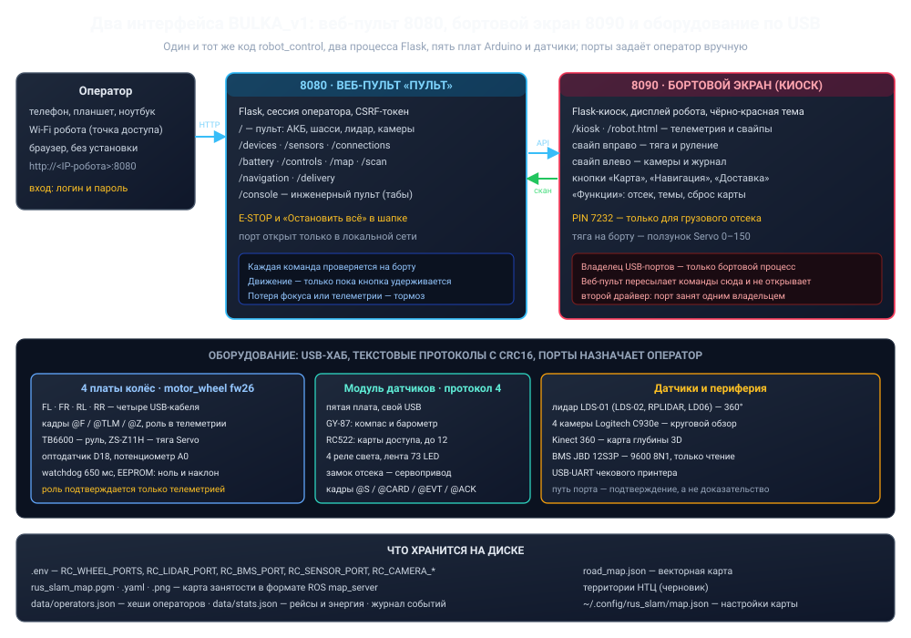

Портами владеет **киоск**: пульт создаёт источник данных в роли `peer` и без
запущенного процесса 8090 честно показывает «сервер робота не подключён», а
кнопки движения не работают. Это не дефект стенда, а разделение ролей: один
владелец USB, остальные — через HTTP.

Кроме них есть нативное окно на Tkinter (`gui/native_display.py`) — оно описано
в [MAIN_SCREEN.md](MAIN_SCREEN.md) и повторяет основной экран без браузера.

---

## 1. Как это выглядит

### 1.1. Веб-пульт — главный экран «Пульт»

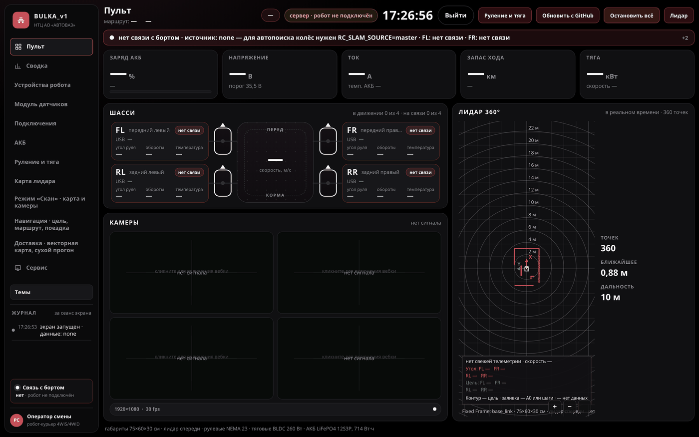

Что на экране, сверху вниз и слева направо:

* **шапка** — маршрут («маршрут: —», когда цели нет), состояние канала
  «сервер · робот не подключён», часы бортового компьютера, кнопки
  **«Выйти»**, **«Руление и тяга»**, **«Обновить с GitHub»**,
  **«Остановить всё»** и **«Лидар»**;
* **строка предупреждений** — «нет связи с бортом · источник: none · для
  автопоиска колёс нужен `RC_SLAM_SOURCE=master` … FL: нет связи · FR: нет
  связи»; справа счётчик скрытых сообщений (`+2`);
* **пять карточек питания и хода** — заряд АКБ, напряжение (порог 35,5 В),
  ток с температурой АКБ, запас хода, тяга (кВт и скорость);
* **«Шасси»** — четыре карточки FL, FR, RL, RR: порт USB, угол руля, обороты,
  температура и плашка состояния («нет связи»); в центре схема робота сверху,
  направление «ПЕРЕД · ЛИДАР», скорость корпуса в м/с и счётчик «в движении 0
  из 4 · на связи 0 из 4»;
* **«Лидар 360°»** — сетка дальности, живой скан, число точек, ближайшее
  препятствие, дальность; ниже — блок свежести телеметрии (углы и лидары колёс,
  контур цели, заливка A0, шаги) и подпись габаритов `base_link`;
* **«Камеры»** — четыре плитки по бортам робота, каждая «кликните — нет сигнала
  камеры», подпись разрешения и частоты (`1920×1080 · 30 fps`);
* **правая колонка и низ** — журнал за сеанс экрана, состояние связи с бортом,
  «Оператор смены» и рабочая подпись «робот-курьер 4WIS/4WID».

Пустые плитки — это не заглушка: карточка АКБ, шасси и камер честно пишут «нет
связи» / «нет данных», пока на порту нет устройства. Демонстрационных чисел в
интерфейсе нет — на стенде видно ровно это.

### 1.2. «Сводка» работы робота

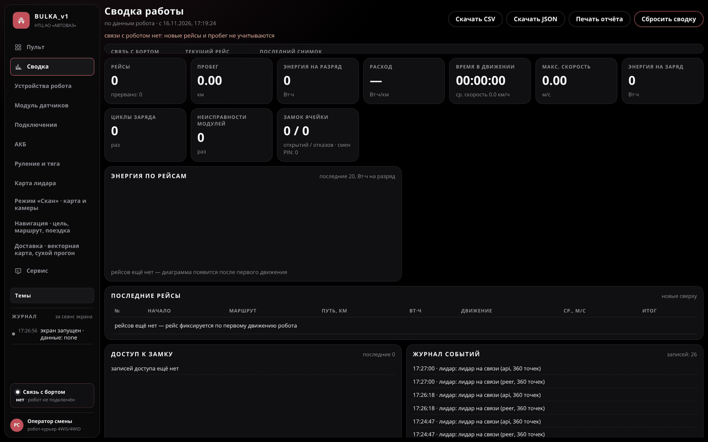

Экран `/#summary` собирает итоги смены: рейсы (в том числе прерванные), пробег,
энергия на разряд, расход Вт·ч/км, время в движении, максимальная скорость,
энергия на заряд, циклы заряда, неисправности модулей, открытия замка и отказы
PIN. Ниже — диаграмма энергии по рейсам (последние 20), таблица последних рейсов,
журнал доступа к замку и журнал событий с фильтром по группам. Кнопки
**«Скачать CSV»**, **«Скачать JSON»**, **«Печать отчёта»** и
**«Сбросить сводку»** — единственный способ очистить статистику: она пишется в
`data/stats.json` и переживает перезапуск.

Пока робот не двигался, экран показывает нули и подпись «результатов ещё нет — рейс
фиксируется по первому движению робота». Это ожидаемое состояние, а не сбой.

### 1.3. Вход оператора

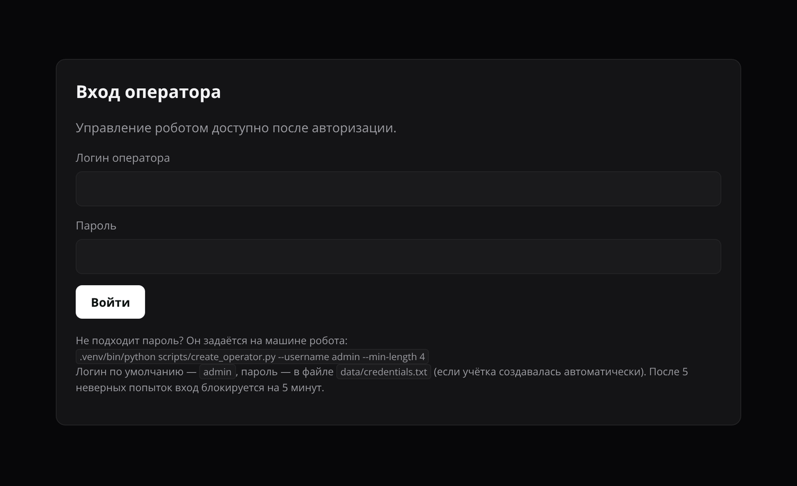

Пароль хранится только как PBKDF2-хеш (200 000 итераций) в
`data/operators.json`. Пять неверных попыток блокируют вход на пять минут
(`RC_MAX_FAILED_ATTEMPTS`, `RC_LOCKOUT_SECONDS`). Учётки создаются на роботе:

```bash
.venv/bin/python scripts/create_operator.py --username operator
.venv/bin/python scripts/create_operator.py --list
```

Если cookie не сохраняются (встроенный предпросмотр в iframe), приложение
подставляет подписанный токен `st` в URL — сессия продолжает работать, но
по-настоящему защищённым такой канал не становится: не публикуйте 8080 в
интернет.

---

## 2. Карта экранов

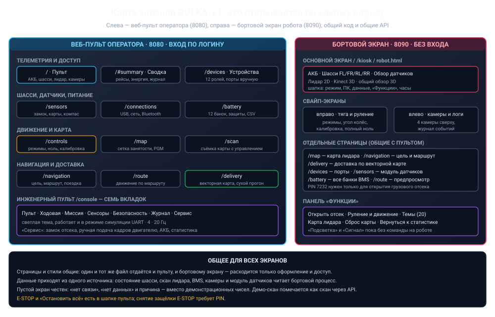

| Адрес | Экран | Что делает |
| :--- | :--- | :--- |
| `/` | Пульт | телеметрия, лидар 360°, камеры, журнал, E-STOP |
| `/#summary` | Сводка | рейсы, энергия, доступ к замку, журнал |
| `/devices` | Устройства робота | 12 ролей, ручное назначение портов |
| `/sensors` | Модуль датчиков | замок отсека, карты доступа, компас, свет |
| `/connections` | Подключения | USB, сеть, Bluetooth, периферия, соседи по ARP |
| `/battery` | АКБ | 12 банок, защиты, ключи, CSV, печать отчёта |
| `/controls` | Руление и тяга | режимы, пресеты, калибровка, полный ноль |
| `/map` | Карта лидара | сетка занятости, PGM/YAML, настройки, автообследование |
| `/scan` | Режим «Скан» | съёмка карты с управлением и heartbeat |
| `/navigation` | Навигация | цель, маршрут, поездка, E-STOP |
| `/route` | Движение по маршруту | предпросмотр пути колеи |
| `/delivery` | Доставка | векторная карта, маршрут по графу, сухой прогон |
| `/console` | Инженерный пульт | семь вкладок, ручная подача кадров |

Страницы `/map`, `/route`, `/devices`, `/sensors`, `/battery`, `/connections`
отдаёт и борт (8090), и пульт (8080): файл один, различаются оформление
(киоск крупнее) и доступ.

---

## 3. Устройства робота: порты назначает оператор

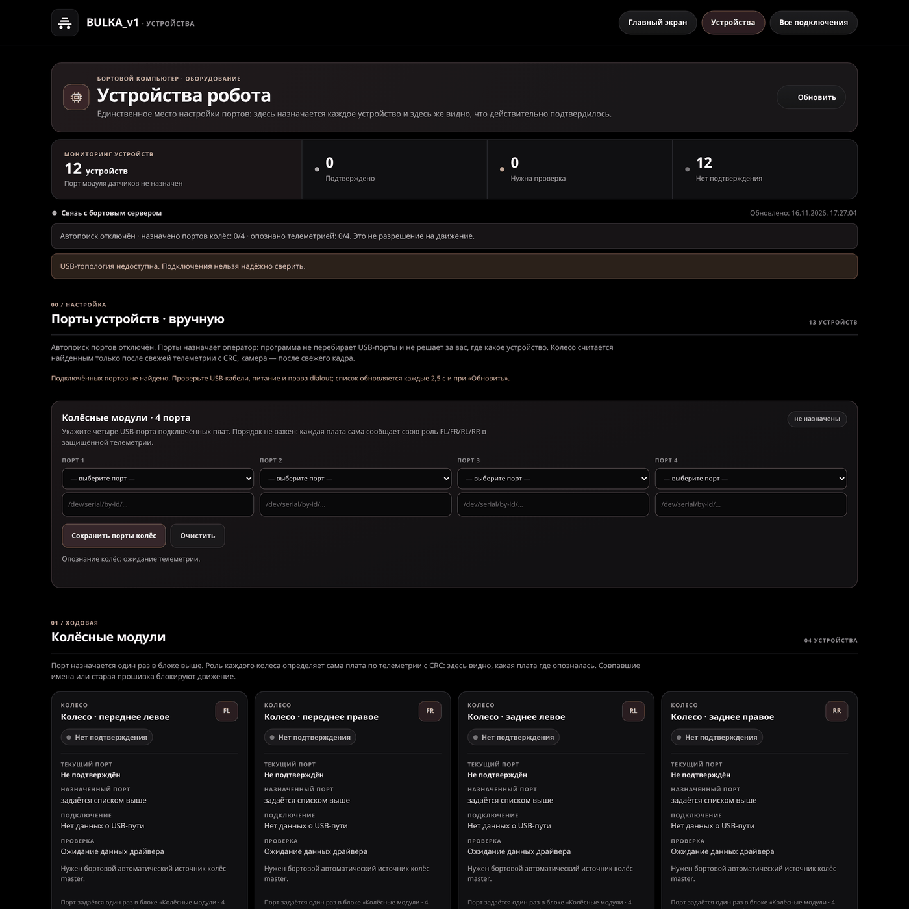

Страница `/devices` — **единственное** место настройки портов. Автопоиска нет:
программа не перебирает USB-устройства и не решает за оператора, где какое
колесо. Назначаются четыре порта колёсных плат (одним списком), четыре видеопорта
камер, порт лидара, USB-топология Kinect, USB-UART принтера и порт BMS.

Что видно на скриншоте и что это значит:

* «Мониторинг устройств: **12** устройств, подтверждено **0**, нужна проверка
  **0**, нет подтверждения **12**» — назначенных портов нет, поэтому ни одно
  устройство не подтверждено;
* «Автопоиск отключён · назначено портов колёс: 0/4 · опознано телеметрией:
  0/4. Это не разрешение на движение» — назначение порта не включает тягу;
* «USB-топология недоступна» — на стенде нет sysfs-узлов робота; на борту здесь
  же появляется список гнёзд вида `1-2.1 · /dev/ttyUSB0 · CH340`;
* ниже — формы «Колёсные модули · 4 порта», «Камеры», «Лидар», «Kinect»,
  «Принтер», «BMS».

Правила, которые важно помнить:

* **роль колеса доказывает только телеметрия.** Порядок портов роли не
  назначает: плата сама сообщает FL/FR/RL/RR в защищённом CRC кадре. Чужая,
  старая или молчащая плата блокирует движение;
* **камера подтверждается свежим кадром** и заявлением оператора о расположении;
  путь сверяется с серийным номером и гнездом;
* **занятый порт не отдаётся**: список помечает `занят: лидар`, а ошибка
  называет владельца и ключ `.env`;
* назначения сохраняются в `.env` (`RC_WHEEL_PORTS`, `RC_CAMERA_*`,
  `RC_LIDAR_PORT`, `RC_KINECT_PORT`, `RC_BMS_PORT`, `RC_SENSOR_PORT`) и
  применяются к работающим подсистемам.

---

## 4. Модуль датчиков: замок, карты, компас, свет

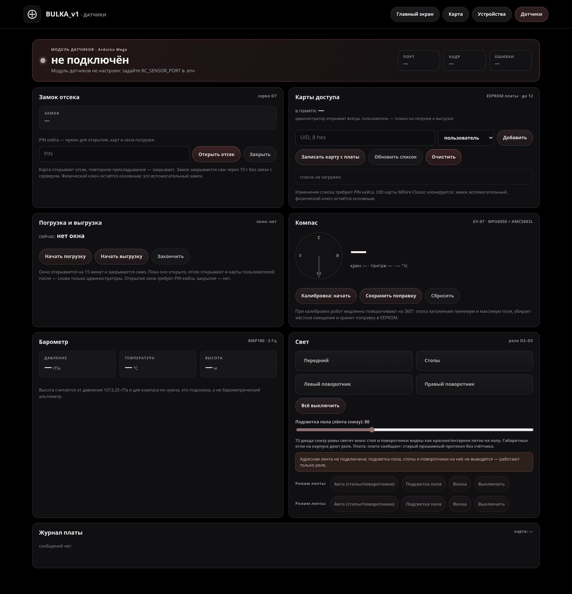

Пятая плата (`firmware/sensor_module`, протокол 4) отвечает за грузовой отсек и
свет. На странице `/sensors`:

* **замок отсека** — сервопривод D7, PIN кейса (по умолчанию 7232), кнопки
  «Открыть отсек» и «Закрыть»; карта открывает отсек, повторное прикладывание
  закрывает; замок запирается сам через 10 с без связи;
* **карты доступа** — до 12 карт MIFARE в EEPROM платы, роли «администратор»
  (открывает всегда) и «пользователь» (только на погрузке и выгрузке); кнопки
  «Записать карту с платы», «Обновить список», «Очистить»;
* **погрузка и выгрузка** — окно на 15 минут открывается PIN и закрывается само;
  пока окно открыто, отсек открывают карты пользователей, после — снова только
  администраторы;
* **компас** GY-87 (MPU6050 + HMC5883L) с калибровкой (робот медленно
  поворачивают на 360°, плата запоминает минимум и максимум поля);
* **барометр** BMP180 и **свет** (четыре реле D2–D5 и адресная лента 73 LED).

Если `RC_SENSOR_PORT` не задан, страница так и пишет: «не подключён · задайте
`RC_SENSOR_PORT` в `.env`». Порт, кадр и счётчик ошибок в шапке — единственный
источник правды о связи.

---

## 5. Подключения к бортовому компьютеру

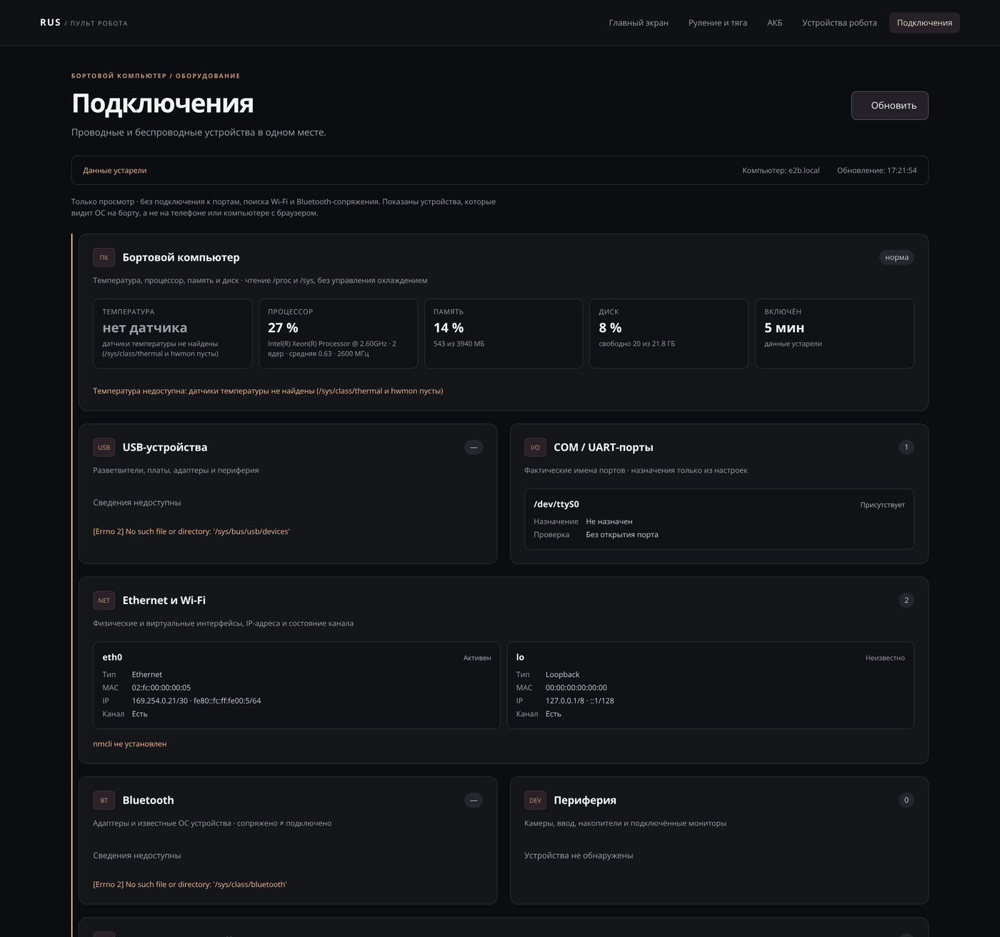

`/connections` — диагностика канала: USB-устройства с драйверами и правами,
сетевые интерфейсы и адреса, Bluetooth, периферия и «соседи» из ARP/NDP. Запись
в ARP — не доказательство, что устройство на связи; страница так и подписывает
источник. Здесь же видно, свободен ли порт и не занят ли он другим процессом.

---

## 6. АКБ: 12 банок и защиты

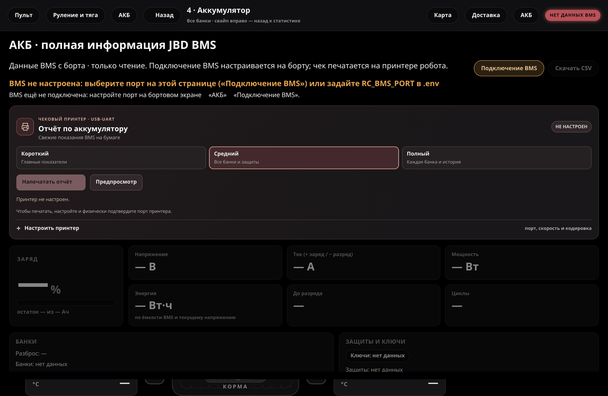

`/battery` читает BMS JBD (LiFePO4 12S3P, 9600 8N1, только запросы чтения) и
показывает заряд, ток со знаком и словом «заряд/разряд», мощность, ≈ Вт·ч, время
до разряда или заряда, циклы, карту всех банок плиткой и таблицу точных значений
(минимум и максимум с номером банки, разброс, сумма, балансировка), ключи,
активные защиты и счётчики срабатываний, температуры, имя платы и версию
прошивки, пороги защит.

Кнопка **«Скачать CSV»** отдаёт снимок всех значений. Пока BMS не подключена,
страница раскрывает «Подключение BMS»: выбрать физический USB-UART и нажать
«Проверить выбранный», затем «Сохранить и подключить» (запишет `RC_BMS_PORT` в
`.env`). Автопоиск BMS отключён так же, как и для остальных устройств.

---

## 7. Руление и тяга

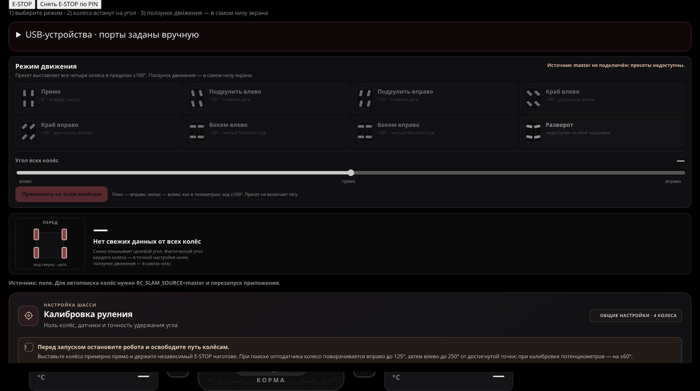

`/controls` — экран настройки шасси. Порядок работы подписан в шапке: «1)
выберите режим · 2) колёса встанут на угол · 3) ползунок движения — в самом низу
экрана».

**Режимы движения.** Восемь карточек-пресетов: «Прямо» (0°), «Подрулить влево» и
«Подрулить вправо» (±15°), «Краб влево» и «Краб вправо» (±45°), «Боком влево» и
«Боком вправо» (±90°) и «Разворот» (52,77°, недоступен на части прошивок).
Пресет выставляет все четыре колеса в пределах ±100° и **не включает тягу**.
Ползунок «Угол всех колёс» задаёт общий угол вручную, кнопка «Применить ко всем
колёсам» отправляет его на платы.

**Схема робота сверху** показывает целевой угол (сплошные колёса) и фактический
угол из телеметрии (пунктир). Если телеметрии нет, экран пишет «Нет свежих данных
от всех колёс» и подписывает источник (`none`, `master`, `auto`, `serial`, `ros`).

**Калибровка руления.** Три способа найти ноль: оптодатчик D18 (флажок),
потенциометр A0 и «0° вручную». Перед запуском экран требует остановить робота и
освободить колёсам путь: при поиске оптодатчика колесо уходит до 125° вправо и
250° влево, при калибровке потенциометров — до ±60°. Мастер «Общие настройки ·
4 колеса» проходит все колёса по очереди, а автокалибровка по ярлыку сначала
проверяет связь FL/FR/RL/RR и только потом вращает колёса.

**Удержание угла (активная доводка, fw24).** Включённая доводка держит заданный
угол и медленно возвращает колесо, отведённое рукой до 15°; ручной сдвиг больше
15° её выключает. Работает только с потенциометром и выполненной калибровкой;
после перезапуска платы удержание выключено.

**Руление и тяга на борту и на пульте различаются.** На бортовом экране тяга —
ползунок `Servo 0–150`: одно нажатие «Вперёд»/«Назад» включает движение, которое
продолжается после отпускания кнопки, «СТОП» останавливает. На пульте `/controls`
сохраняются кнопки направления **с удержанием** (dead-man) и процентный протокол,
который требует ноль и остановленный руль. Отпускание кнопки, уход со страницы,
скрытие вкладки и потеря телеметрии отправляют тормоз; аппаратный watchdog платы
выключает выход через 650 мс.

Снятие защёлки E-STOP требует PIN.

---

## 8. Карта лидара

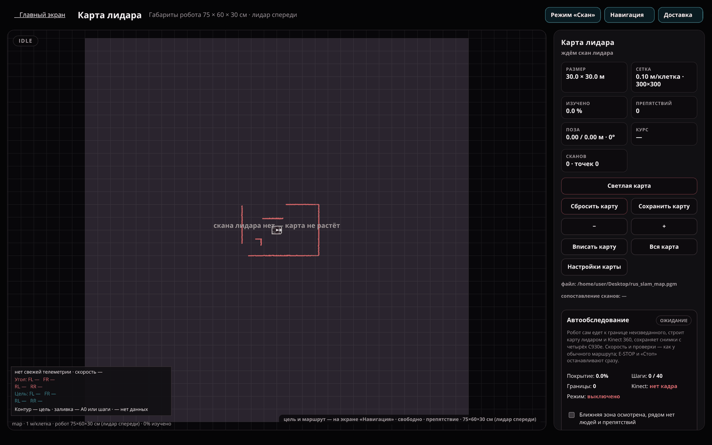

`/map` показывает сетку занятости в стиле RViz: 30 × 30 м, сетка 0,10 м/клетка
(300 × 300 клеток), робот-треугольник с курсом, живой скан поверх карты, плашку
`MAPPING`/`IDLE`, изученную площадь, число препятствий, позу, число сканов.
Кнопки: «Светлая карта», «Сбросить карту», «Сохранить карту», масштаб `−`/`+`,
«Вписать карту», «Вся карта», «Настройки карты». Карту строит сервер
(`robot_control/slam_map.py`): клетки вдоль луча свободны, конец луча —
препятствие, поза считается сопоставлением соседних сканов.

Сохранение пишет на рабочий стол пару `rus_slam_map.pgm` + `rus_slam_map.yaml`
(формат ROS `map_server`) и `rus_slam_map.png` для просмотра. Каталог меняется
`RC_MAP_DIR`, настройки живут в `~/.config/rus_slam/map.json`.

На скриншоте карта пустая — «скана лидара нет · карта не растёт». Это принцип:
**карту строят только доверенные сканы** (физический лидар или ROS `/scan`).
Скан, отправленный через `POST /api/lidar` (демонстрационный скрипт
`scripts/demo_scan.py`), помечается как `api` и в карту не попадает — иначе
карта робота могла бы вырасти из чужих точек.

---

## 9. Режим «Скан»: сначала карта, потом по ней ездим

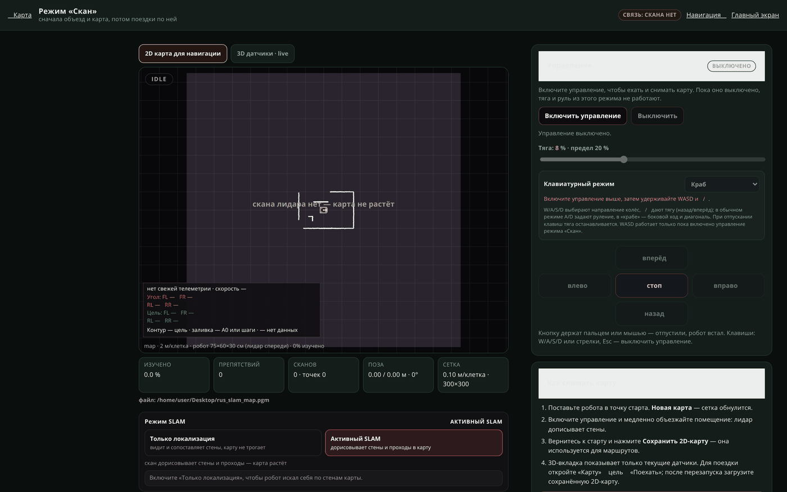

`/scan` — режим съёмки: живая карта, камеры и управление, которое оператор
**включает и выключает вручную**. Включение сначала отправляет STOP, затем
выдаёт токен; управление продлевается heartbeat-ом и без него снимается через
5 секунд. Ноль разрешён всегда. Порядок работы как в связке ROS 2 «сначала SLAM,
потом навигация»: объехали помещение, сохранили карту, дальше `/navigation`.

---

## 10. Навигация по карте

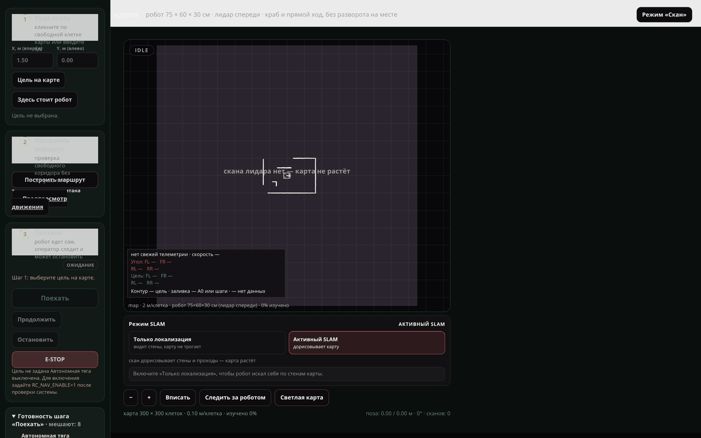

`/navigation` устроен как привычная связка SLAM + Nav2, только без ROS:

1. **Куда ехать** — клик по свободной клетке (как «2D Goal Pose» в RViz),
   координаты X/Y вручную или «Здесь стоит робот»;
2. **Построить маршрут** — считается подтверждённый участок, привод выключен,
   рядом предпросмотр на `/route`;
3. **Поехали** — открывается только при `canStart` от сервера и сверенном
   маршруте, с подтверждением и предупреждением о слепой зоне.

Рядом — блок «Готовность шага Поехали»: те же проверки, что решает сервер, с
подписью, что именно мешает. E-STOP, «Остановить» и «Продолжить» остались на
экране; планировщик и проверки — `robot_control/navigation.py`.

---

## 11. Доставка по векторной карте: сухой прогон

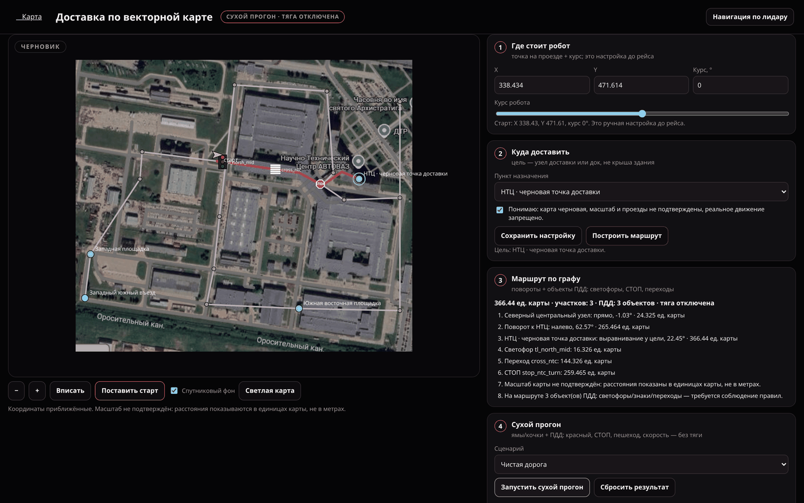

`/delivery` — единственный экран, который работает с **векторной** картой
территории НТЦ АВТОВАЗ (спутниковый снимок + граф дорог). Порядок из четырёх
шагов подписан на самом экране и повторён на схеме:

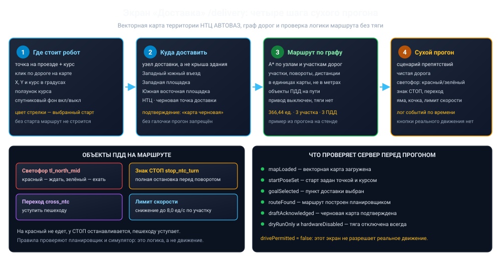

* **шаг 1** — «Где стоит робот»: клик по проезду ставит точку, курс задаётся
  ползунком или перетаскиванием стрелки; координаты X, Y и курс видны в полях;
* **шаг 2** — «Куда доставить»: список узлов (Западный южный въезд, Западная
  площадка, Южная восточная площадка, НТЦ · черновая точка доставки) и
  обязательная галочка «Понимаю: карта черновая, масштаб и проезды не
  подтверждены, реальное движение запрещено»;
* **шаг 3** — «Маршрут по графу»: A\* по узлам и участкам, перечень участков с
  типом манёвра, дистанцией и объектами ПДД. Расстояния — **в единицах карты**,
  а не в метрах: масштаб не подтверждён, и экран это пишет;
* **шаг 4** — «Сухой прогон»: сценарии «Чистая дорога», «Светофор: красный»,
  «Светофор: зелёный», «Знак СТОП», «Пешеходный переход», «Ограничение
  скорости», «Яма», «Кочка», «Приближающийся объект», «Потеря локализации».
  Прогон возвращает лог по времени: где снижена скорость, где ожидание, где
  полная остановка.

На скриншоте прогон выполнен: маршрут 366,44 ед. карты, 3 участка, 3 объекта ПДД
(светофор `tl_north_mid`, переход `cross_ntc`, СТОП `stop_ntc_turn`), красная
линия пути и лог «Ограничение скорости 8,0 ед/с — снижение скорости»,
«Узел north_mid подтверждён».

**Тяги на этом экране нет.** Кнопки реального движения не существует, колёса и
аппаратный E-STOP не вызываются, сервер отвечает `drivePermitted: false` и
`hardwareDisabled: true`. Экран проверяет только логику маршрута и реакций.
Подробности: `docs/DELIVERY_DRY_RUN.md` и `docs/ROAD_NAV_PROPOSAL.md` в
репозитории Zapret.

---

## 12. Инженерный пульт `/console`

Инженерный пульт — отдельная страница со своими семью вкладками. Она светлее
основного пульта, живёт на том же 8080 и требует того же входа.

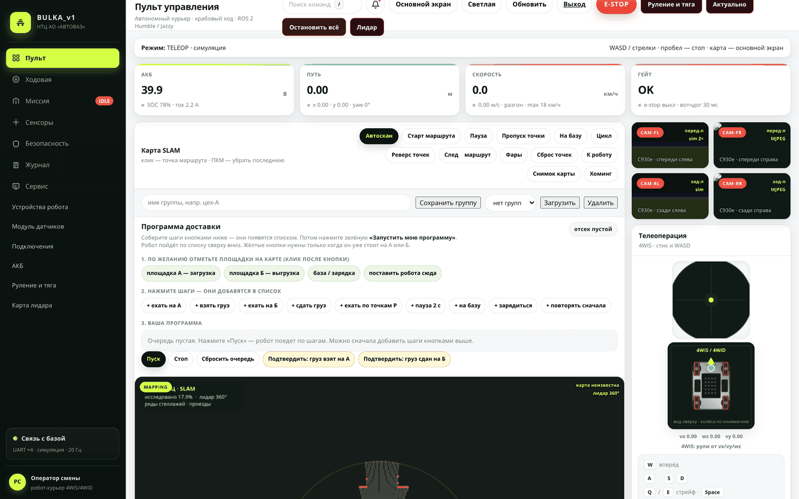

| Вкладка | Содержимое |
| :--- | :--- |
| Пульт | карточки АКБ, пути и скорости, гейт `/cmd_vel`, карта SLAM, программа шагов, телеоперация |
| Ходовая | четыре модуля 4WIS/4WID: углы, шаги, драйверы |
| Миссия | конечный автомат доставки, шаги и подтверждения |
| Сенсоры | радар лидара и лог детекций |
| Безопасность | E-STOP, watchdog, порог АКБ, CRC-контроль |
| Журнал | события пульта |
| Сервис | окно обслуживания: замок, ручная подача кадров, АКБ, статистика |

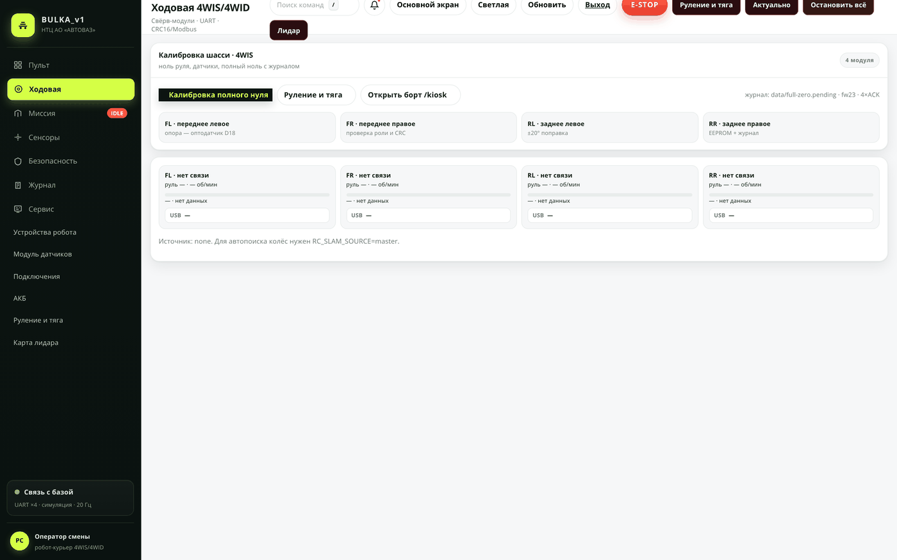

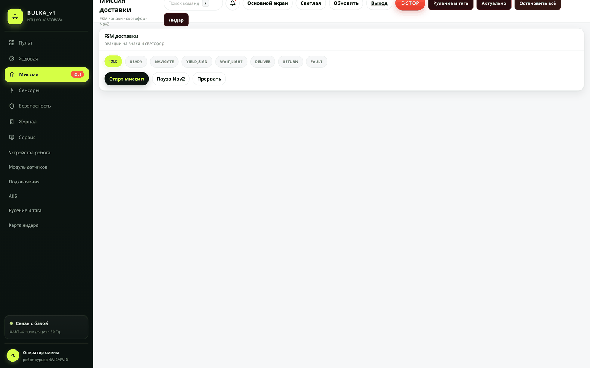

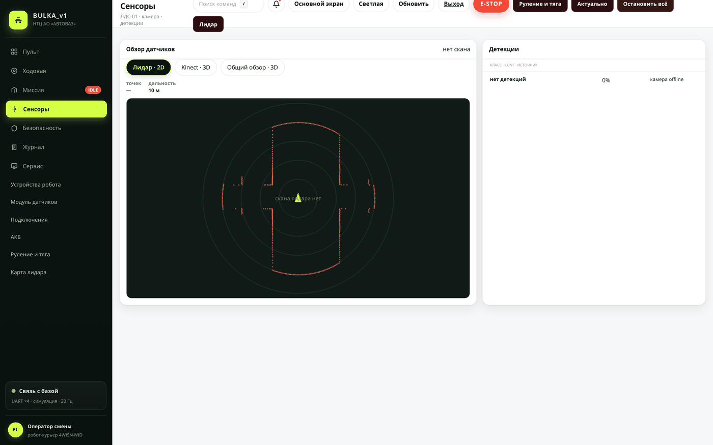

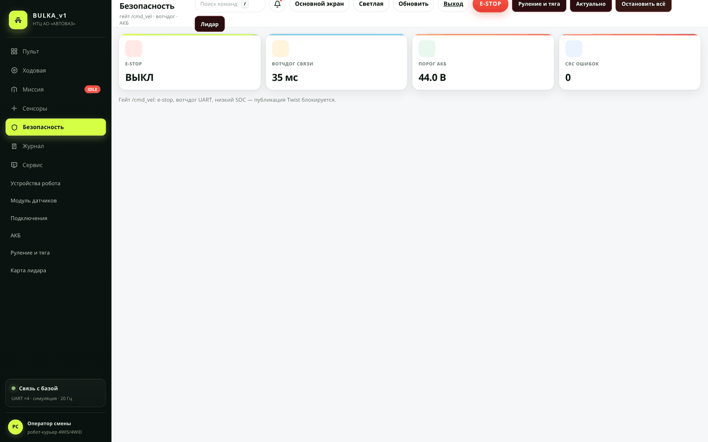

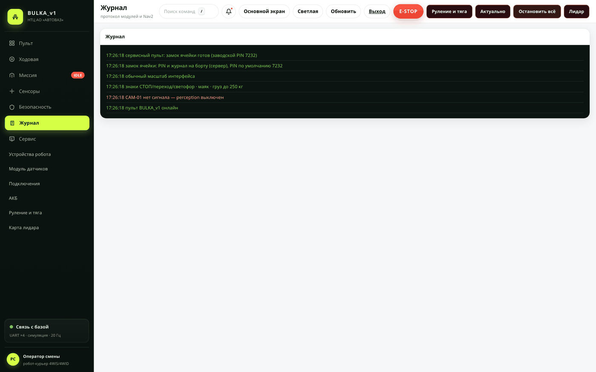

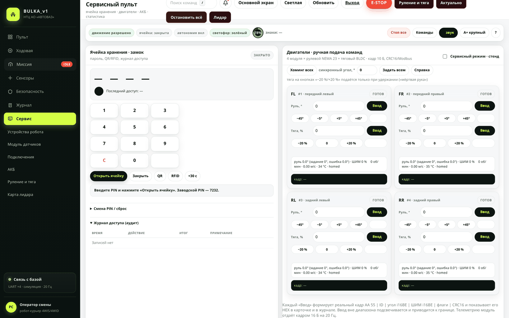

Две вещи, которые нельзя не заметить на этих скриншотах:

1. **В шапке вкладок стоит «Режим: TELEOP · симуляция», в боковой панели —
   «UART ×4 · симуляция · 20 Гц».** Инженерный пульт умеет работать без железа:
   он показывает синтетическую телеметрию, чтобы можно было проверить вёрстку и
   логику. Числа на этих скриншотах — не показания робота;
2. **В окне «Сервис» ручная подача команд показывает кадр `AA 55 · ID · угол
   i16BE · ШИМ i16BE · флаги · CRC16`.** Это прежний бинарный протокол
   `0xAA 0x55` / `0xBB 0x44`, который **удалён из прошивки**: `motor_wheel` fw26
   общается текстовыми кадрами `@F`/`@TLM`/`@Z` с CRC16 (см.
   [SERIAL_PROTOCOL.md](SERIAL_PROTOCOL.md)). Ручная подача кадров в этой
   вкладке — наследие прежней связки и к текущим платам не относится; для
   реальной отладки используйте текстовые команды и `/api/control/*`.
   Расхождение зафиксировано в [ZAPRET_SYNC.md](ZAPRET_SYNC.md).

Подробное описание вкладок и окна «Сервис» — в
[SERVICE_CONSOLE.md](SERVICE_CONSOLE.md).

---

## 13. Как всё запускается

```bash
# 1. зависимости (Ubuntu 22.04/24.04, офлайн-набор vendor/)
./scripts/ensure_deps.sh

# 2. веб-пульт оператора: gunicorn, 0.0.0.0:8080
.venv/bin/python run.py

# 3. бортовой экран: 0.0.0.0:8090, окно киоска открывается само
.venv/bin/python run_kiosk.py

# 4. оба интерфейса на одном стенде без робота (то, что на скриншотах)
.venv/bin/python scripts/preview_remote.py
```

Порты и адреса задаются в `.env`: `RC_PORT`, `RC_KIOSK_PORT`, `RC_BIND_HOST`,
`RC_SLAM_SOURCE` (`master` — реальные платы, `none` — без оборудования,
`serial` — заданные вручную порты, `ros` — ROS 2). Полные инструкции по
установке, автозапуску и восстановлению доступа — в
[RUN_AND_ACCESS.md](RUN_AND_ACCESS.md).

---

## 14. Чего интерфейс не делает

* **Не ищет порты сам.** Ни колесо, ни камеру, ни BMS, ни лидар: порт назначает
  оператор на `/devices`. Пустой список — заблокированное движение.
* **Не двигает робота без свежей телеметрии.** Нет связи, нет нуля, нет
  подтверждённой роли — кнопки тяги не работают, и экран пишет причину.
* **Не строит карту из чужих точек.** Скан через API помечается и в карту не
  идёт; демонстрационный прогон не является испытанием навигации.
* **Не заменяет физический E-STOP.** Программная защёлка и «Остановить всё»
  останавливают процессы, но аварийный выключатель должен быть под рукой.
* **Не является пультом доставки.** `/delivery` — сухой прогон логики по
  черновой карте; реального движения по векторной карте в текущей версии нет.
* **Не распознаёт знаки и светофоры по камере.** В статистике прямо написано:
  события от перцепции по знакам и светофору не приходят; ПДД в сухом прогоне —
  модель графа, а не зрение.
