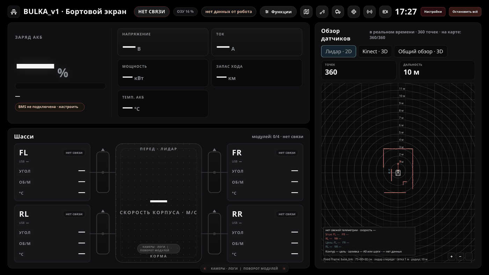
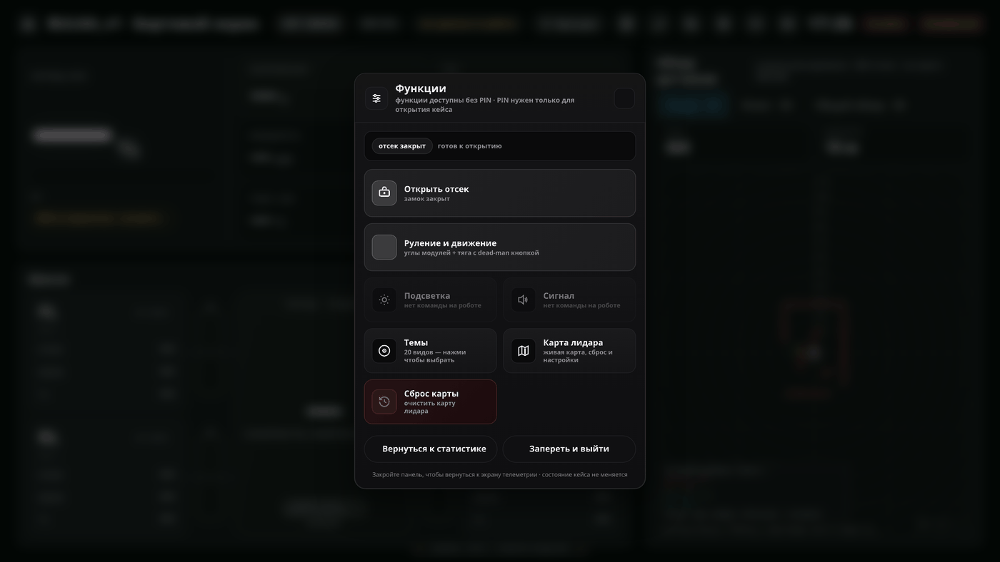
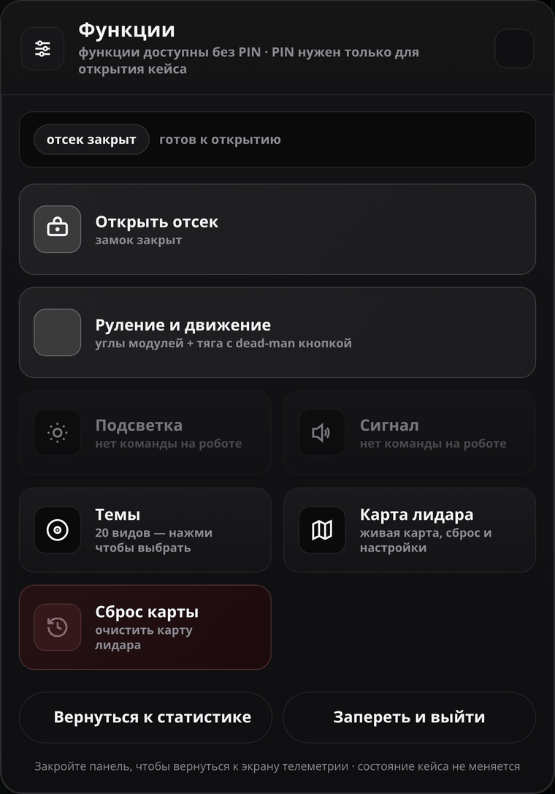
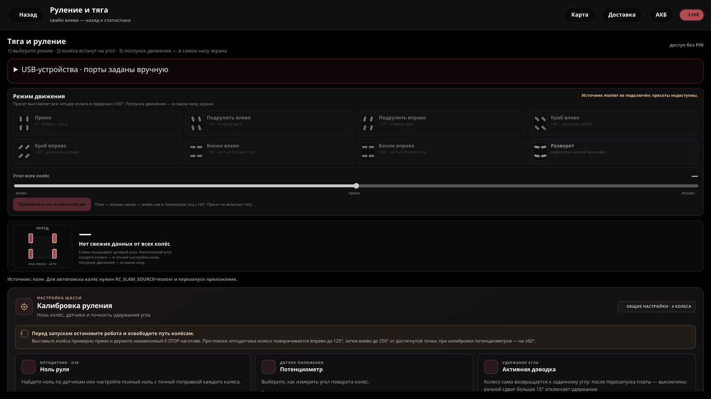
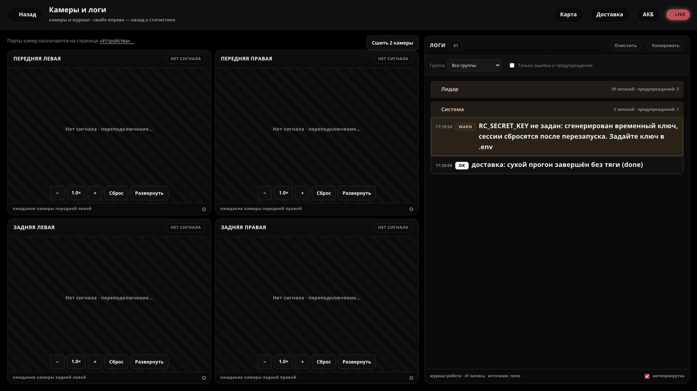
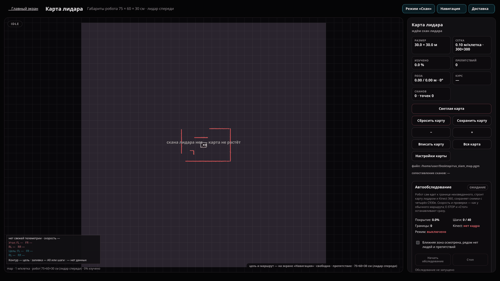
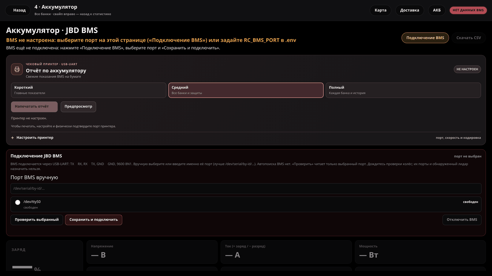

# БОРТОВОЙ ЭКРАН РОБОТА (КИОСК): ТЕЛЕМЕТРИЯ, ШАССИ, АКБ, ОТСЕК

> **Состояние на 16.11.2026.** Скриншоты сняты с бортового процесса
> [danilka-revin/Zapret](https://github.com/danilka-revin/Zapret) на коммите
> `71a7c26` (`scripts/preview_remote.py`, порт 8090, страница `robot.html`,
> браузер Chromium 153, окно 1920 × 1080 — размер дисплея робота). На стенде нет
> четырёх плат колёс, камер и BMS, поэтому экран честно показывает «НЕТ СВЯЗИ» и
> прочерки: это не заглушка, а настоящее состояние программы без оборудования.

Бортовой экран — это веб-страница, которую отдаёт второй процесс Flask на
**порту 8090**, а на дисплее робота её открывает Chromium в режиме киоска:

```bash
.venv/bin/python run_kiosk.py                 # 0.0.0.0:8090 + окно киоска на дисплее
.venv/bin/python run_kiosk.py --no-open       # только сервер, без окна
```

Страница крупная: её смотрят с руки, стоя перед роботом. Отсюда все решения —
большие цифры, минимум мелкого текста, свайпы вместо вложенных меню.

---

## 1. Основной экран



| Зона | Что показывает | Источник |
| :--- | :--- | :--- |
| **шапка** | режим связи (`НЕТ СВЯЗИ` / режим работы), загрузка бортового компьютера (`ОЗУ 14 %`), состояние данных (`нет данных от робота`), кнопка **«Функции»**, иконки «Карта», «Навигация», «Доставка», «Устройства», «Датчики», «Камеры и логи», часы, «Настройки», «Остановить всё» | состояние процесса, `system_monitor` |
| **АКБ** | заряд кольцом и полосой, «BMS не подключена · настроить», подпись состояния | BMS JBD через `battery.py` |
| **питание** | напряжение (порог 35,5 В), ток, мощность кВт, запас хода км, температура АКБ | BMS |
| **обзор датчиков** | переключатель **«Лидар · 2D»**, **«Kinect · 3D»**, **«Общий обзор · 3D»**; число точек (360/360), дальность, сетка дальности, блок свежести телеметрии, габариты `base_link` | `lidar.py`, `kinect.py`, `slam_map.py` |
| **шасси** | четыре карточки FL/FR/RL/RR: USB-порт, угол, об/мин, °C, плашка связи; схема робота сверху, «ПЕРЕД · ЛИДАР», скорость корпуса м/с, счётчик «модулей: 0/4 · нет связи» | `slam.py`, платы fw26 |
| **нижний док** | «КАМЕРЫ · ЛОГИ» (свайп влево) и «ПОВОРОТ МОДУЛЕЙ» (свайп вправо) — подсказка свайпов | `robot.js` |

Правила экрана:

* **всё, кроме отсека, доступно без PIN.** PIN (по умолчанию 7232, задаётся
  `RC_SLAM_PIN`) спрашивается только при открытии грузового кейса; закрыть отсек
  можно без кода;
* **карта свайпом не открывается** — только кнопкой «Карта» в шапке или карточкой
  «Функции → Карта лидара». Свайп вправо — тяга и руление, свайп влево —
  камеры и журнал;
* **прочерк — это ответ.** Пока нет свежей телеметрии, экран показывает «—» и
  причину, а не последние известные числа: устаревшее значение опаснее пустого.

---

## 2. Панель «Функции»



Открывается кнопкой «Функции» в шапке и остаётся без PIN: код нужен только на
шаге открытия отсека. Внутри — крупные карточки:

| Карточка | Действие |
| :--- | :--- |
| **Открыть отсек** | запрос PIN и открытие замка; подпись «замок закрыт / открыт» |
| **Руление и движение** | переход к экрану тяги и руления («углы модулей + тяга с dead-man кнопкой») |
| **Подсветка** | карточка выключена: «нет команды на роботе» |
| **Сигнал** | карточка выключена: «нет команды на роботе» |
| **Темы** | 20 вариантов оформления экрана |
| **Карта лидара** | живая карта, сброс и настройки |
| **Сброс карты** | очистить карту лидара (опасное действие, красная карточка) |
| **Вернуться к статистике** | закрыть панель без изменения состояния |
| **Запереть и выйти** | свернуть экран в исходное состояние |



Две карточки намеренно неактивны: подсветки и звукового сигнала в прошивке
робота нет, и экран об этом пишет прямо, а не делает вид, что команда ушла.
Сверху панели — плашка состояния отсека («отсек закрыт · готов к открытию»),
снизу — подсказка: «закройте панель, чтобы вернуться к экрану телеметрии ·
состояние кейса не меняется».

---

## 3. Свайп вправо: тяга и руление



Порядок работы подписан в шапке: «1) выберите режим · 2) колёса встанут на угол ·
3) ползунок движения — в самом низу экрана».

* **«Режим движения»** — восемь пресетов: Прямо, Подрулить влево/вправо (±15°),
  Краб влево/вправо (±45°), Боком влево/вправо (±90°), Разворот (52,77°,
  «недоступен на этой прошивке»). Пресет выставляет все четыре колеса в пределах
  ±100° и **не включает тягу**;
* **«Угол всех колёс»** — общий ползунок; «Применить ко всем колёсам» отправляет
  угол на платы. Плюс — вправо, минус — влево, как в телеметрии;
* **схема робота сверху** — целевой угол сплошными колёсами, фактический —
  пунктиром; без телеметрии экран пишет «Нет свежих данных от всех колёс» и
  подписывает источник (`none` / `master` / `auto` / `serial` / `ros`);
* **«Калибровка руления»** — три способа: оптодатчик D18, потенциометр A0 и
  «0° вручную». Перед запуском экран требует освободить путь колёсам: поиск
  оптодатчика уводит колесо до 125° вправо и 250° влево, калибровка
  потенциометров — до ±60°. «Общие настройки · 4 колеса» проходит все колёса
  подряд;
* **тяга на борту** — ползунок `Servo 0–150`: одно нажатие «Вперёд»/«Назад»
  включает движение, которое продолжается после отпускания кнопки, «СТОП»
  останавливает. Ползунок мотора не запускает, а задаёт команду D3; направление
  задаётся отдельно. Уход со страницы, потеря фокуса или связи останавливают
  тягу, а watchdog платы выключает выход через 650 мс.

Правее в шапке — «Карта», «Доставка», «АКБ» и плашка `LIVE`: это переходы, а не
дублирующие органы управления.

---

## 4. Свайп влево: камеры и журнал



Четыре камеры Logitech C930e показаны как вид сверху: передние — сверху, задние —
снизу, левая колонка — левый борт, правая — правый борт. Подписи называют место
(«передняя левая», «задняя правая»), а не номер порта: номер кадра `0…3` не
совпадает с порядком на экране. Кнопка «Сброс» на карточке возвращает масштаб и
заново запрашивает кадр — зависший поток оживает без перезагрузки экрана.

Ниже — журнал событий: настоящие записи процесса (старт экрана, смена источника,
подключение и потеря лидара, ошибки портов), а не демонстрационный поток.
Фильтры по группам и кнопка «Скачать» есть и здесь.

---

## 5. Отдельные страницы с борта

Кнопки шапки открывают те же страницы, что и веб-пульт, только в оформлении
киоска. Они описаны в [GUI.md](GUI.md):

| Кнопка | Адрес | Что там |
| :--- | :--- | :--- |
| Карта | `/map` | сетка занятости, темы карты, PGM/YAML, настройки |
| Навигация | `/navigation` | цель, маршрут, поездка, E-STOP |
| Доставка | `/delivery` | векторная карта, маршрут по графу, сухой прогон |
| Устройства | `/devices` | 12 ролей, ручное назначение портов |
| Датчики | `/sensors` | замок отсека, карты доступа, компас, свет |
| Камеры и логи | свайп | четыре камеры и журнал |



Карта на борту пустая при том же условии, что и на пульте: доверенных сканов нет.
Точки, отправленные через `POST /api/lidar` (демо-скрипт `scripts/demo_scan.py`),
помечаются как скан через API и в карту не попадают — иначе карта робота росла бы
из чужих точек.

---

## 5.1. Страница «Аккумулятор»: все банки и подключение BMS



Нажатие на панель АКБ (или кнопка «АКБ» в шапке) открывает четвёртую страницу —
подробности по всем банкам. Если BMS ещё не подключена, страница сама
раскрывает то, что нужно сделать:

* **«Отчёт по аккумулятору»** — короткий, средний или полный чек на USB-UART
  принтера, с предпросмотром; пока принтер не настроен, кнопки «Напечатать
  отчёт» и «Предпросмотр» выключены и подписаны «Принтер не настроен»;
* **«Подключение JBD BMS»** — выбор порта вручную (`/dev/serial/by-id/…`),
  кнопки «Проверить выбранный» (читает только этот порт) и «Сохранить и
  подключить» (запишет `RC_BMS_PORT` в `.env`); автопоиск BMS отключён, как и
  для остальных устройств;
* ниже — заряд, напряжение, ток со знаком («+ заряд / − разряд») и мощность;
  когда BMS ответит, здесь появятся карта банок, разброс, защиты, счётчики и
  температуры.

Правая плашка шапки показывает состояние данных: на снимке — «НЕТ ДАННЫХ BMS»,
и это ожидаемый ответ на стенде без батареи.

---

## 6. Замок грузового отсека и PIN

* отсек открывается PIN-кодом (по умолчанию **7232**) или картой MIFARE с ролью
  администратора; повторное прикладывание карты закрывает отсек;
* окно «Погрузка и выгрузка» открывается PIN на 15 минут и закрывается само; пока
  окно открыто, отсек открывают карты пользователей, после — снова только
  администраторы. Открытие окна требует PIN, закрытие — нет;
* замок запирается сам через 10 секунд без связи с платой модуля датчиков;
* **физический ключ остаётся основным**: сервопривод — вспомогательный замок, и
  так написано на самой странице `/sensors`;
* каждое открытие, отказ и смена PIN попадают в журнал доступа и в «Сводку»
  (число открытий и отказов).

Порт модуля датчиков (`RC_SENSOR_PORT`) назначается на `/devices`; пока он не
задан, страница «Датчики» честно показывает «не подключён».

---

## 7. Кнопка «Остановить всё»

Кнопка есть в шапке бортового экрана и в шапке веб-пульта. Она гасит оба
процесса (`robot-kiosk` и `robot-control`) — ровно то же, что делают
`./scripts/stop.sh`, `systemctl stop` или Ctrl+C. Это **не** аварийный
останов: за мгновенную остановку тяги отвечают физический E-STOP, watchdog платы
(650 мс) и снятие команды при потере связи.

---

## 8. Как экран получает данные

| Данные | Источник |
| :--- | :--- |
| углы, обороты, температуры, роли колёс | текстовые кадры `@F`/`@TLM` четырёх плат fw26 по USB |
| заряд, напряжение, ток, банки | BMS JBD по USB-UART, 9600 8N1, только чтение |
| карта и поза | `slam_map.py`: лучи лидара вписываются в сетку занятости |
| скан 360° | лидар (LDS-01/LDS-02, RPLIDAR, LD06/LD19) или ROS `/scan`, либо скан соседнего процесса |
| глубина Kinect | отдельный драйвер `robot-kinect-depth`, кадр в `/api/kinect/preview` |
| камеры | V4L2 каждого борта, назначенные порты на `/devices` |
| загрузка процессора и ОЗУ | `system_monitor.py` |
| журнал | `eventlog.py` — записи процесса, а не демо-поток |

Экран опрашивает состояние несколько раз в секунду и **не открывает порты сам**:
владелец USB — бортовой процесс. Веб-пульт пересылает команды сюда же, поэтому
второго драйвера, который «поделил» бы порт, не появляется.

---

## 9. Справочная копия интерфейса в этом репозитории

В каталоге [`gui/`](../gui/README.md) лежит **справочная** копия интерфейса и
независимый сервер `gui/backend.py`: он умеет отдавать экран и JSON API без
робота (`--source sim`) и служит описанием формата данных. Рабочий софт — в
Zapret; здесь — прошивка и документация.

```bash
python3 gui/backend.py                 # только сервер (окон не открывает)
python3 gui/backend.py --kiosk         # + страница на дисплее робота
python3 gui/native_display.py --url http://127.0.0.1:8080   # нативный экран Tkinter
```

`gui/native_display.py` — полноэкранное приложение на Tkinter/Canvas, которое не
загружает HTML и не запускает браузер: оно получает JSON из `gui/backend.py`.
Сборка: `gui/tools/build-native-linux.sh` или `gui/tools/build-native-windows.bat`.
Автозапуск — `deploy/systemd/rus-slam-*.service`.

Ограничения справочной копии:

* `gui/backend.py` написан под **бинарные** кадры `0xAA 0x55` / `0xBB 0x44`
  (`--source serial`), которых прошивка fw26 не выдаёт; реальный протокол —
  текстовый (см. [SERIAL_PROTOCOL.md](SERIAL_PROTOCOL.md)). Источник `serial`
  этой копии с платами робота не работает, а `sim` — работает всегда;
* PIN-замок этой копии хранится в `gui/state/lock.json` как
  `SHA-256(salt + pin)`, а не как PIN в плате модуля датчиков;
* нативный экран не заменяет сервер: без `backend.py` он показывает отсутствие
  связи и не разрешает менять состояние замка.

---

## 10. Что проверить перед первым включением на роботе

1. Дисплей и разрешение: экран рассчитан на 1920 × 1080; на 1600 × 1000 нижний
   док подсказок подрезается.
2. Тач: свайпы вправо и влево, кнопка «Функции», PIN-клавиатура.
3. Связь: пока не назначены порты на `/devices`, экран будет показывать «НЕТ
   СВЯЗИ» — это ожидаемо.
4. E-STOP: проверьте физический выключатель до первого движения колёс.
5. «Остановить всё»: убедитесь, что кнопка гасит оба процесса и что после
   перезапуска экран возвращается сам.
