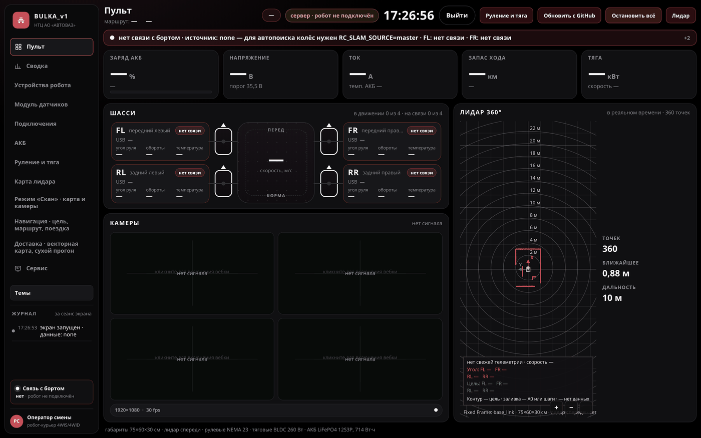
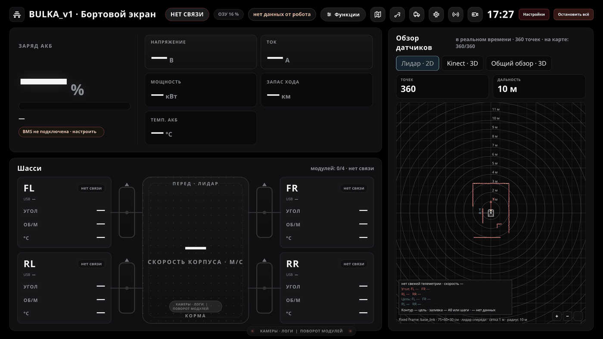

# КОНЦЕПТ ИСПОЛЬЗОВАНИЯ: ЭКРАНЫ РОБОТА, ЗАПУСК И ДОСТУП

> **Документ:** `docs/RUN_AND_ACCESS.md`
> **Версия:** 2.0 · **Дата:** 16.11.2026
> **Связанные документы:** [`GUI.md`](GUI.md) · [`MAIN_SCREEN.md`](MAIN_SCREEN.md) ·
> [`SERVICE_CONSOLE.md`](SERVICE_CONSOLE.md) · [`SERIAL_PROTOCOL.md`](SERIAL_PROTOCOL.md) ·
> [`SOFTWARE_ARCHITECTURE.md`](SOFTWARE_ARCHITECTURE.md) · [`ZAPRET_SYNC.md`](ZAPRET_SYNC.md)

Документ отвечает на вопросы: **какие интерфейсы есть у робота**, **как их
запустить на Ubuntu**, **кто и откуда имеет доступ**, **что такое PIN отсека и
учётка оператора**, и **как остановить всё одной командой**.

Главное в одной строке: **веб-пульт оператора (8080) — удалённо с телефона или
ноутбука; бортовой экран-киоск (8090) — на дисплее робота; инженерный пульт
(`/console`) — для наладки.** Оба сервера — это одно приложение
`robot_control`, запущенное двумя процессами.

---

## 1. Три интерфейса — три уровня доступа

| Интерфейс | Адрес | Где показывается | Кому | Что даёт |
| :--- | :--- | :--- | :--- | :--- |
| **Веб-пульт оператора** | `http://<IP-робота>:8080` | телефон, планшет, ноутбук в сети робота | оператор смены | телеметрия, лидар 360°, камеры, карта, навигация, доставка, порты, АКБ, настройка шасси |
| **Бортовой экран (киоск)** | `http://127.0.0.1:8090/kiosk` | дисплей робота, полноэкранный Chromium | оператор и получатель груза | телеметрия, свайпы «тяга и руление» / «камеры и логи», отсек по PIN |
| **Инженерный пульт** | `http://<IP-робота>:8080/console` | ноутбук инженера в сети робота | инженер-наладчик | семь вкладок: отладка, ручная подача кадров, окно «Сервис» |

Логика разделения:

* **бортовой экран доступен без входа**: к нему подходят руками, и требовать
  логин на дисплее робота бессмысленно. PIN (по умолчанию **7232**) нужен только
  для открытия грузового отсека;
* **веб-пульт требует входа оператора** и CSRF-токен для команд. Он меняет
  поведение робота, поэтому живёт за авторизацией;
* **USB-портами владеет только бортовой процесс (8090).** В коде это видно
  буквально: киоск создаёт источник данных с ролью мастера, а веб-пульт — с
  `master_role="peer"`, то есть читает телеметрию и пересылает команды на борт
  (`/api/control/…`) по HTTP. Поэтому в комментарии `robot_control/app.py` и
  написано: «порт держит бортовой экран, иначе два процесса читают его
  вперемешку». Практический вывод: без запущенного киоска пульт покажет «сервер
  робота не подключён», а команды движения работать не будут.

### 1.1. Скриншоты

Сняты с работающих процессов (`scripts/preview_remote.py`, коммит `71a7c26`):
пульт — 1600 × 1000, бортовой экран — 1920 × 1080 (дисплей робота).





Остальные экраны: [GUI.md](GUI.md) и [MAIN_SCREEN.md](MAIN_SCREEN.md).

---

## 2. Установка одной командой

```bash
git clone https://github.com/danilka-revin/Zapret.git robot-control
cd robot-control
./scripts/install_ubuntu.sh          # зависимости, .env, оператор, ярлык, запуск
```

Что делает установщик:

* проверяет версию системы и **Python** — если он старше 3.9 (Ubuntu 20.04),
  вызывает `scripts/install_python.sh`; отключается `RC_PYTHON_AUTO=0`;
* ставит зависимости из офлайн-набора `vendor/`, если сети нет;
* ставит ROS 2 с драйверами лидаров и собирает `ros2_ws` (`--no-ros2` отключает,
  тогда лидар читается напрямую по USB);
* создаёт `.env` с постоянным `RC_SECRET_KEY` и учётку оператора;
* делает один ярлык «Запустить робот» и запускает пульт (8080) и экран (8090).

Полезные флаги: `--no-run` (поставить, не запускать), `--autostart` (systemd для
серверов), `--ap` и `--ap-autostart` (точка доступа Wi-Fi), `--ros2` /
`--no-ros2`.

### 2.1. Python 3.9+ одной командой

```bash
./scripts/install_python.sh --check     # что есть, что можно поставить (без root)
sudo ./scripts/install_python.sh        # поставить подходящий Python
```

Скрипт проверяет версию, ставит `python3.11` / `python3.12` из apt (на 20.04 и
22.04 — через PPA deadsnakes), а если apt недоступен — готовую сборку CPython в
`/usr/local/pythonX.Y`. Повторный запуск безопасен. Флаги: `--min`, `--apt`,
`--from-source`.

### 2.2. Минимальный запуск без установщика

```bash
./scripts/ensure_deps.sh    # зависимости (офлайн из vendor/, если сети нет)
./scripts/serve.sh          # только веб-пульт: сам поставит зависимости и поднимет 8080
./scripts/kiosk.sh          # бортовой экран на 8090 + окно киоска
```

`run.py` при первом старте сам создаёт `.env` и учётку `admin` с паролем из
`data/credentials.txt` (пароль по умолчанию — `1234`; **смените его** до выезда).

---

## 3. Запуск и остановка

| Команда | Что делает |
| :--- | :--- |
| `./scripts/start_robot.sh` | всё сразу: пульт 8080 + экран 8090 + лидар через ROS 2; повторный запуск не создаёт вторую копию |
| `.venv/bin/python run.py` | только веб-пульт, gunicorn, `0.0.0.0:8080` |
| `.venv/bin/python run_kiosk.py` | только бортовой экран, 8090, окно киоска открывается само |
| `.venv/bin/python run_kiosk.py --no-open` | сервер экрана без окна (для службы) |
| `.venv/bin/python scripts/preview_remote.py` | оба интерфейса на одном стенде без робота |
| `./scripts/stop.sh` | гасит оба сервера, сторож экрана, лидар и службы systemd |
| `./scripts/autostart.sh status` / `off` / `on` | посмотреть, выключить или вернуть автозапуск |
| `./scripts/setup_ap.sh` | поднять точку доступа Wi-Fi на роботе |

Логи: `var/server.log`, `var/kiosk.log`, `var/demo-kiosk.log`. PID-файлы лежат в
`var/` — по ним `stop.sh` и находит процессы (гасится вся группа, поэтому
закрывается и окно браузера).

**Автозапуск по умолчанию выключен.** Включается `install_ubuntu.sh
--autostart` (службы `robot-control`, `robot-kiosk`, `robot-lidar`) или
одноимёнными юнитами из `scripts/`. Обратная операция —
`./scripts/autostart.sh off`, она же остановит всё запущенное.

### 3.1. Кнопка «Остановить всё»

Кнопка есть в шапке пульта и бортового экрана. Она гасит оба процесса — ровно
то же, что `./scripts/stop.sh`. Это **не аварийный останов**: тягу мгновенно
снимают физический E-STOP, watchdog платы (650 мс) и потеря связи.

---

## 4. Сеть: как попасть на пульт с телефона

1. Робот поднимает свою точку доступа Wi-Fi (`sudo ./scripts/setup_ap.sh`,
   `--autostart` — при каждой загрузке). Параметры и пароль показывает
   `./scripts/setup_ap.sh --status`.
2. Телефон или ноутбук подключается к этой сети.
3. В браузере — `http://<IP-робота>:8080`, вход оператором, дальше «Руление и
   тяга» или нужный экран.

На роботе должны работать **оба процесса**: пульт (8080) и бортовой экран
(8090). Второй можно поднять без окна: `./run_kiosk.py --no-open`.

`RC_BIND_HOST=0.0.0.0` (по умолчанию) разрешает вход с других устройств. Если
включён UFW, откройте 8080 только для доверенной локальной сети.

> **Не публикуйте порты робота в интернет.** Вход оператора, CSRF и PIN — это
> защита от ошибки и случайного нажатия, а не от целенаправленной атаки в
> открытой сети.

### 4.1. Если не открывается с другого устройства

| Симптом | Что проверить |
| :--- | :--- |
| страница не грузится | оба устройства в одной сети; `RC_BIND_HOST=0.0.0.0`; UFW пропускает 8080 |
| «Неверный логин или пароль» | `data/credentials.txt`, `scripts/create_operator.py --list`; после 5 попыток вход блокируется на 5 минут |
| вход есть, данных нет | источник шасси: `RC_SLAM_SOURCE=none` даёт пустые карточки, для плат нужен `master` |
| бесконечный редирект на вход | cookie не сохраняются: откройте пульт в новой вкладке, а не в iframe |

---

## 5. Учётки операторов

```bash
.venv/bin/python scripts/create_operator.py --username operator   # спросит пароль
.venv/bin/python scripts/create_operator.py --list
.venv/bin/python scripts/create_operator.py --username operator --disable
```

* пароль хранится только как **PBKDF2-хеш** (200 000 итераций) в
  `data/operators.json`; сам файл в git не попадает;
* после **5** неверных попыток вход блокируется на **5 минут**
  (`RC_MAX_FAILED_ATTEMPTS`, `RC_LOCKOUT_SECONDS`);
* сессия живёт 60 минут (`RC_SESSION_MINUTES`) и сбрасывается кнопкой «Выйти»;
* если cookie не сохраняются (встроенный предпросмотр), приложение подставляет
  подписанный токен `st` в URL — сессия работает, но полагаться на это в бою
  нельзя.

---

## 6. PIN грузового отсека и карты доступа

| Что | Как задаётся | Где проверить |
| :--- | :--- | :--- |
| PIN отсека | `RC_SLAM_PIN` в `.env`, по умолчанию `7232` | `/sensors` → «Замок отсека» |
| Карты MIFARE | записываются кнопкой «Записать карту с платы», до 12 карт | `/sensors` → «Карты доступа» |
| Роли карт | «администратор» (открывает всегда) и «пользователь» (только в окне погрузки) | там же, выпадающий список |
| Окно погрузки | «Начать погрузку» / «Начать выгрузку» по PIN, живёт 15 минут | `/sensors` → «Погрузка и выгрузка» |

Замок запирается сам через 10 секунд без связи с платой модуля датчиков.
**Физический ключ остаётся основным** — сервопривод вспомогательный. Каждое
открытие, отказ и смена PIN попадают в журнал доступа и в «Сводку» на пульте.

PIN-механизм справочной копии в этом репозитории (`gui/backend.py`,
`gui/state/lock.json`, `SHA-256(salt + pin)`) — отдельная реализация, с платой
модуля датчиков не связанная. См. [MAIN_SCREEN.md](MAIN_SCREEN.md), раздел 9.

---

## 7. Роли в смене

| Роль | Что делает | Что открывает |
| :--- | :--- | :--- |
| **Оператор смены** | запускает робота, ведёт рейсы, следит за связью | бортовой экран; веб-пульт под своей учёткой |
| **Инженер-наладчик** | порты, калибровка, лидар, карта, обновление | всё, включая `/devices`, `/controls`, `/console` |
| **Получатель груза** | забирает груз | отсек по PIN или карте на бортовом экране |
| **Судья / наблюдатель** | смотрит | бортовой экран; в пульт не входит |

---

## 8. Быстрая проверка доступа

```bash
# 1. поднять оба интерфейса на стенде (робота нет)
.venv/bin/python scripts/preview_remote.py

# 2. живость и источник данных
curl -s http://127.0.0.1:8080/healthz
curl -s http://127.0.0.1:8090/api/health

# 3. вход оператора (без него API команд отвечает редиректом на /login)
curl -s -c /tmp/c.txt http://127.0.0.1:8080/login -o /tmp/login.html
#    далее — форма с csrf_token; проще открыть страницу в браузере

# 4. состояние шасси: источник и роли колёс
curl -s http://127.0.0.1:8090/api/kiosk_state | head -c 400

# 5. скан лидара: есть ли точки
curl -s http://127.0.0.1:8090/api/lidar | head -c 200

# 6. остановить всё
./scripts/stop.sh
```

Если `api/kiosk_state` отдаёт `source: none`, а карточки шасси — «нет связи»,
это нормальный ответ на вопросе «а робот подключён?». Пустой экран не маскирует
отсутствие железа.

---

## 9. Конфигурация в одном месте

| Ключ `.env` | Значение |
| :--- | :--- |
| `RC_PORT`, `RC_KIOSK_PORT`, `RC_BIND_HOST` | адреса пульта (8080), экрана (8090) и интерфейс привязки |
| `RC_SLAM_SOURCE` | `master` (реальные платы), `none` (без оборудования), `serial` (порты вручную), `ros` |
| `RC_WHEEL_PORTS` | до четырёх портов колёсных плат; порядок не важен |
| `RC_LIDAR_PORT`, `RC_SENSOR_PORT`, `RC_BMS_PORT`, `RC_KINECT_PORT`, `RC_CAMERA_*` | порты остальных устройств |
| `RC_SLAM_PIN`, `RC_SLAM_MAX_ATTEMPTS`, `RC_SLAM_LOCK_SEC` | PIN отсека и защита от подбора |
| `RC_SECRET_KEY`, `RC_SESSION_MINUTES` | подпись сессий и время жизни |
| `RC_MAP_DIR` | куда сохранять карту (`rus_slam_map.pgm/.yaml/.png`) |
| `RC_ROS_AUTO`, `RC_LIDAR_AUTOSTART` | ставить ROS 2 автоматически; ранний старт чтения лидара |

Полный список с пояснениями — в `README.md` Zapret и `.env.example`.

---

## 10. Лицензия и авторы

Проект — комплект документации и прошивок робота **BULKA_v1** для НТЦ АО
«АВТОВАЗ»; бортовой софт развивается в
[danilka-revin/Zapret](https://github.com/danilka-revin/Zapret), прошивки и
железо — в этом репозитории. Порядок синхронизации двух репозиториев описан в
[ZAPRET_SYNC.md](ZAPRET_SYNC.md).
