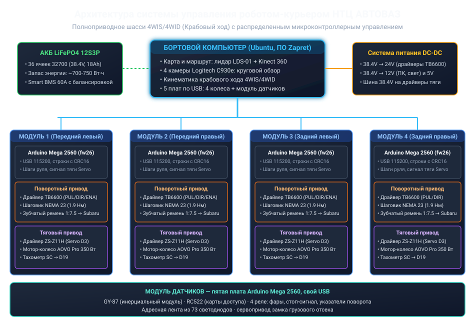
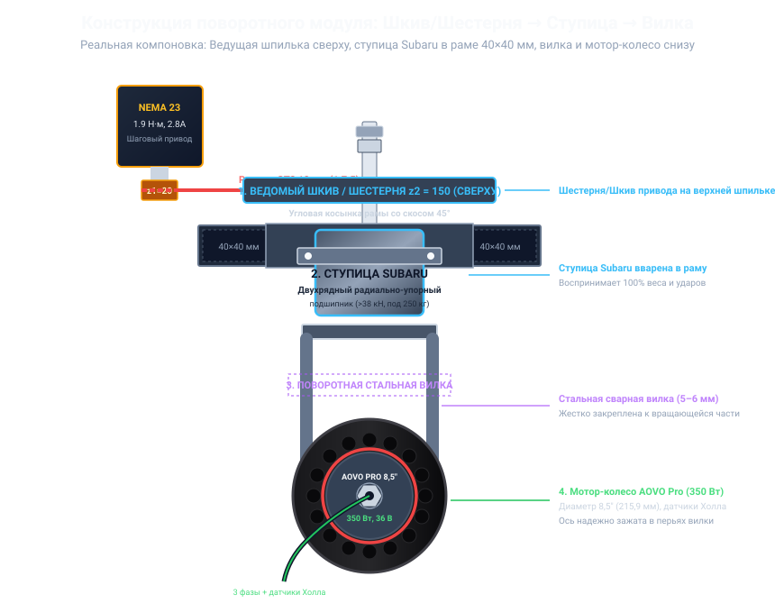
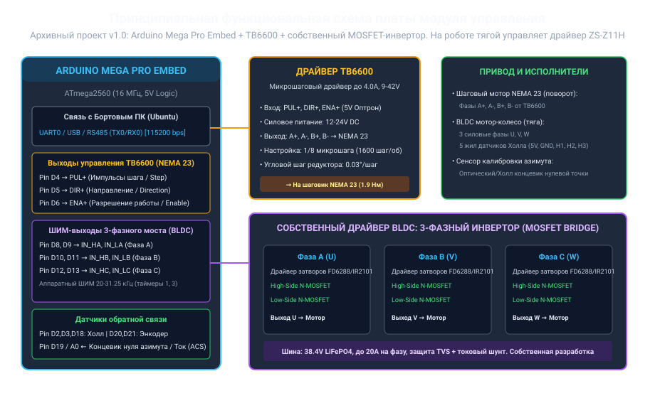

# ТЕХНИЧЕСКАЯ ДОКУМЕНТАЦИЯ И ПАСПОРТ ИЗДЕЛИЯ

## Автономная роботизированная платформа с крабовым ходом (4WIS / 4WID) для внутризаводской логистики НТЦ АО «АВТОВАЗ»

> **Редакция от 10.11.2026.** Паспорт приведён к фактическому роботу: мотор-колёса
> AOVO Pro 350 Вт, база 500 × 380 мм, лидар LDS-01, Kinect 360 и четыре камеры,
> прошивка колёс **fw26**, пятая плата — модуль датчиков. Источник —
> бортовое ПО [Zapret](https://github.com/danilka-revin/Zapret) (коммит `973f9ba`);
> перечень изменений — [`ZAPRET_SYNC.md`](ZAPRET_SYNC.md). Стоимость комплекта —
> **369 170,85 ₽ (4 461,09 USD)**, см. раздел 11 и [смету](COST_ESTIMATE.md).

---

## 1. НАЗНАЧЕНИЕ И ОБЩИЕ СВЕДЕНИЯ

Роботизированный комплекс представляет собой тяжелую высокоманевренную мобильную платформу с полноуправляемым шасси типа **4WIS / 4WID** (*Four-Wheel Independent Steering / Four-Wheel Independent Drive*), предназначенную для автоматизированной транспортировки тяжелых комплектующих, узлов в сборе, штампов, технологической оснастки и документации по территории Научно-технического центра (НТЦ) АО «АВТОВАЗ» (площадью от 20 гектаров) в рамках конкурсного задания № 2.

Платформа спроектирована под повышенную **грузоподъемность 250 кг** и сочетает в себе сверхвысокую маневренность (крабовый ход, разворот на месте с нулевым радиусом, диагональное перемещение) и исключительную механическую прочность благодаря применению автомобильных ступиц Subaru в качестве поворотных опор и сварной рамы из стального профиля 40×40×2 мм.



---

## 2. ОСНОВНЫЕ ТЕХНИЧЕСКИЕ ХАРАКТЕРИСТИКИ

| Параметр | Значение | Примечание |
| :--- | :--- | :--- |
| **Габариты платформы (Д × Ш × В)** | **750 × 600 × 400 мм** | Точно соответствует регламенту (норматив: 600–1200 × 400–800 × 400–800 мм) |
| **Колесная база (L) / Колея (W)** | 500 мм / 380 мм | Между осями поворота колёс. Значения из настроек шасси бортового ПО Zapret; сверить рулеткой на роботе |
| **Снаряженная масса платформы** | 39.5 кг | С учетом АКБ, 4 модулей и защитного металлокаркаса |
| **Номинальная грузоподъемность** | **250.0 кг** | Расчетная прочность рамы и ступиц с запасом до 350 кг |
| **Полная масса с грузом** | **289.5 кг** | Нагрузка на один модуль: ~72.4 кг (для ступиц Subaru это менее 15% от номинала) |
| **Клиренс (дорожный просвет)** | 100 мм | Беспрепятственный проезд через искусственные неровности |
| **Тип привода поворота колес** | 4 × шаговый двигатель NEMA 23 | С редуктором 1:7.5 (ремень GT2 10 мм, шкивы 20 и 150 зубьев) |
| **Тип тягового привода** | 4 × мотор-колесо электросамоката AOVO Pro (BLDC, 36 В) | 8,5 дюйма (215,9 мм), номинальная мощность **350 Вт** на колесо, датчики Холла |
| **Суммарная мощность тяги** | **1400 Вт** (номинал) | Полноприводная схема 4WD с раздельным управлением; пиковая мощность ограничена током батареи и драйверов |
| **Скорость движения** | 0,625 м/с (2,25 км/ч) при `Servo.write(30)` | Замер оператора, записанный в тестах Zapret. Скорость на полном ходу не измерялась |
| **Минимальный радиус разворота** | 0.0 м (разворот на месте) | Вращение вокруг геометрического центра платформы |
| **Упорно-поворотные узлы** | Оригинальные ступицы Subaru | Двухрядные радиально-упорные подшипники качения |
| **Тип аккумуляторной батареи** | LiFePO4, 12S 3P | 36 цилиндрических банок типоразмера 32700 |
| **Номинальное напряжение АКБ** | 38.4 В (диапазон 30.0 В – 43.8 В) | Повышенная безопасность и долговечность (>2500 циклов) |
| **Емкость батарейного блока** | 18.6 А·ч (~714 Вт·ч) | 3 параллельных цепочки по 6200 мА·ч |
| **Расчетный запас хода** | до 20–25 км | В зависимости от нагрузки и рельефа |
| **Бортовой управляющий компьютер** | Мини-ПК с ОС Ubuntu | Бортовое ПО Zapret: веб-пульт, карта по лидару, собственный планировщик маршрута. Nav2 не используется |
| **Сенсоры навигации и безопасности** | **Лидар LDS-01** (360°, 0,12–3,5 м) + Kinect 360 + 4 × Logitech C930e | Карта и препятствия — лидар и Kinect, камеры — круговой обзор. Распознавание знаков и светофора не реализовано |
| **Локальные контроллеры** | 5 × Arduino Mega 2560 | Четыре платы колёс (прошивка fw26) и плата модуля датчиков, каждая на своём USB |
| **Драйверы приводов** | TB6600 (руль, D6/D7/D8) + RioRand ZS-Z11H (тяга, Servo D3) | Раздельное управление на каждом колесе; мост MOSFET — архивный проект |
| **Модуль датчиков, свет и доступ** | GY-87, RC522, 4 реле, лента из 73 светодиодов, сервопривод замка | Свет, доступ к отсеку по картам MIFARE, инерциальный модуль; раздел 7 |
| **Стоимость комплекта** | **369 170,85 ₽ (4 461,09 USD)** | [Смета](COST_ESTIMATE.md): 64 позиции, курс 82,7536 ₽ за доллар; раздел 11 |

---

## 3. МЕХАНИЧЕСКАЯ ЧАСТЬ И СИЛОВАЯ КОНСТРУКЦИЯ

### 3.1. Фотографии изготовленного шасси (Промежуточный конструктив)

Ниже представлены фотографии сваренного несущего металлокаркаса и механической сборки шасси без установленной электроники (промежуточный конструктив механической части):

| Вид сверху (Рама 40×40 мм, скосы 45°, ступицы Subaru) | Вид сбоку (Вертикальный стек: шпилька → ступица → вилка) | Перспектива 3/4 (Шасси в сборе на 4 колесах) |
| :---: | :---: | :---: |
|  |  |  |

> **Примечание:** файлы `chassis_*.jpg` в репозитории отсутствуют (фотографии
> изготовленной рамы не коммитились). Ссылки оставлены как место для них;
> в PDF вместо изображений будет пустое место.

---

### 3.2. Сварная пространственная рама под нагрузку 250 кг

Рама робота представляет собой цельносварную пространственную конструкцию, изготовленную из **стальной профильной трубы 40×40 мм с толщиной стенки 2.0 мм** (сталь Ст3сп по ГОСТ 8639-82).

- **Особенности геометрии рамы (750 × 600 мм):**
  - Передняя и задняя поперечины рамы выполнены со **скошенными под 45° углами (октагональная форма контура)**. Данная форма предотвращает задевание колес за раму при повороте на предельные углы, увеличивает жесткость на кручение и снижает вероятность зацепления за препятствия при маневрировании;
  - Поперечные балки и центральные вертикальные стойки образуют жесткую ферму для размещения грузового отсека под полезную нагрузку 250 кг;
  - Момент сопротивления профиля 40×40×2 мм составляет $W \approx 3.71 \text{ см}^3$, обеспечивая более чем 6-кратный запас прочности относительно предела текучести стали Ст3сп.

---

### 3.3. Вертикальная компоновка поворотного модуля: Шкив/Шестерня → Ступица → Вилка

В конструкции строго реализован следующий вертикальный порядок сборки поворотного узла:

```text
  [1. ВЕДОМЫЙ ШКИВ / ШЕСТЕРНЯ z2=150] (СВЕРХУ на центральной шпильке М16/М20)
                  │
  [2. АВТОМОБИЛЬНАЯ СТУПИЦА SUBARU] (ПОСЕРЕДИНЕ, закреплена в сварной раме 40×40 мм)
                  │
  [3. ПОВОРОТНАЯ СТАЛЬНАЯ ВИЛКА] (СНИЗУ, прикреплена к вращающейся части ступицы)
                  │
  [4. МОТОР-КОЛЕСО AOVO PRO 8,5″, 350 Вт] (В ВИЛКЕ, датчики Холла)
```



#### Инженерные преимущества компоновки:
1. **Шестерня/Шкив сверху:** Приводная шестерня (ведомый шкив GT2 $z_2 = 150$) и шаговый двигатель NEMA 23 располагаются **в верхней защищенной зоне** над рамой. Зубчатый ремень и шкивы защищены от попадания грязи, песка, камней и луж с дорожного полотна.
2. **Ступица Subaru в плоскости рамы:** Воспринимает все осевые (вертикальный вес 250 кг) и радиальные нагрузки (удары о бордюры и неровности). Двухрядный радиально-упорный подшипник ступицы Subaru обладает динамической грузоподъемностью свыше 38 кН, что исключает возникновение люфта поворотной стойки.
3. **Стальная вилка снизу:** Сварная конструкция из листовой стали толщиной 5–6 мм жестко охватывает мотор-колесо с двух сторон, надежно фиксируя силовую ось и предотвращая проворот оси в дропаутах.
4. **Шины:** Цельнолитая перфорированная шина не боится прокола металлической стружкой или гвоздями на территории цехов и склада НТЦ «АВТОВАЗ», пневматическая мягче на неровностях, но требует контроля давления. Тип шины установленных колёс в документах не зафиксирован — его нужно сверить на роботе.

---

## 4. ПОВОРОТНЫЙ ПРИВОД: NEMA 23, РЕМЕНЬ GT2 10 ММ И ШКИВЫ 150/20

Поворот каждого из 4 модулей осуществляется шаговым двигателем NEMA 23 через зубчато-ременную передачу.

### 4.1. Параметры компонентов привода:
- **Шаговый двигатель:** NEMA 23 (двухфазный биполярный 57×57×76 мм):
  - Угловой шаг: $1.8^\circ$ (200 шагов/оборот);
  - Номинальный ток фазы: $2.8 \text{ А}$;
  - Удерживающий момент: $M_{hold} = 1.9 \text{ Н}\cdot\text{м}$;
- **Зубчато-ременная передача:**
  - Тип профиля ремня: **GT2** (шаг 2.0 мм, ширина ремня **10 мм**, стекловолоконный силовой корд);
  - Ведущий шкив (на валу NEMA 23): **$z_1 = 20$ зубьев** (делительный диаметр $d_1 = 12.73 \text{ мм}$);
  - Ведомый шкив (на ступице Subaru): **$z_2 = 150$ зубьев** (делительный диаметр $d_2 = 95.49 \text{ мм}$);
  - Передаточное отношение:
    $$i = \frac{z_2}{z_1} = \frac{150}{20} = 7.5$$


### 4.2. Расчет крутящего момента поворота под нагрузкой 250 кг

1. **Результирующий момент поворота поворотного узла:**
   При КПД зубчатой передачи $\eta \approx 0.96$:
   $$M_{pivot} = M_{nema} \times i \times \eta = 1.9 \text{ Н}\cdot\text{м} \times 7.5 \times 0.96 \approx 13.68 \text{ Н}\cdot\text{м}$$

2. **Момент сопротивления повороту колеса на месте:**
   При полной нагрузке 250 кг вертикальная реакция на одно колесо составляет $N \approx 720 \text{ Н}$. При коэффициенте трения покоя резины об асфальт $\mu = 0.75$ и радиусе пятна контакта $r_{c} \approx 0.028 \text{ м}$:
   $$M_{turn\_resist} \approx \frac{2}{3} \cdot \mu \cdot N \cdot r_{c} \approx \frac{2}{3} \times 0.75 \times 720 \times 0.028 \approx 10.08 \text{ Н}\cdot\text{м}$$
   Результирующий момент $M_{pivot} = 13.68 \text{ Н}\cdot\text{м}$ превышает сопротивление поворота даже на сухом шероховатом асфальте при максимальной загрузке 250 кг (запас по моменту составляет более 35%). При движении робота сопротивление повороту падает в 3–5 раз.

3. **Точность позиционирования:**
   - Прошивка [`motor_wheel`](../firmware/motor_wheel/motor_wheel.ino) задаёт **`STEPS_PER_DEGREE = 133.333333`** — число снято с проверенного на железе скетча;
   - На полный оборот поворотного модуля ($360^\circ$) приходится:
     $$N_{steps} = 133.333333 \times 360 = 48\,000 \text{ шагов}$$
   - Угловая дискретность:
     $$\Delta \theta = \frac{1}{133.333333} = 0.0075^\circ \text{ на шаг}$$
   - Дробление TB6600, редукция GT2 и число шагов ротора должны вместе давать ровно это число; после смены DIP-переключателей пересчитайте константу и проверьте угол транспортиром.

---

## 5. ТЯГОВЫЙ ПРИВОД: 4 МОТОР-КОЛЕСА AOVO PRO 350 ВТ


### Технические параметры привода:
- 4 бесщеточных мотор-колеса от электросамоката **AOVO Pro** диаметром **8,5 дюйма** ($D = 215.9 \text{ мм}$, радиус $R \approx 0.108 \text{ м}$). Модель и диаметр взяты из настроек шасси бортового ПО Zapret (`DEFAULT_CHASSIS` в `robot_control/maneuvers.py`);
- Номинальная мощность каждого колеса: **350 Вт** при 36 В (данные продавцов);
- Суммарная мощность 4WD шасси: $4 \times 350 = \mathbf{1400 \text{ Вт}}$;
- Крутящий момент мотор-колеса для расчёта: $M_{mot} \approx 11.5 \text{ Н}\cdot\text{м}$. Это оценка: на роботе момент не измерялся, продавцы AOVO Pro заявляют до 16 Н·м;
- **Датчики мотор-колеса и схема управления:**
  1. **3 цифровых датчика Холла** используются **драйвером RioRand ZS-Z11H**, который сам выполняет коммутацию фаз; Arduino к ним не подключена;
  2. **Выход тахометра SC** драйвера идёт на **D19** платы (`INPUT_PULLUP`, оба фронта, INT2): прошивка считает переходы (по умолчанию **90 на оборот**) и публикует `sc_rpm`/`sc_hz`/`sc_count` в телеметрии;
  3. **Замкнутого контура по скорости и ПИД-регулирования в прошивке нет** — это заявленное направление развития, а не реализованная функция. Тяга задаётся прямым значением `Servo.write(0…150)`, а `SC` используется сервером для контроля вращения и одометрии манёвров, но **не** для регулирования.
- Суммарное тяговое усилие на ободах 4 колес:
  $$F_{traction} = 4 \times \frac{M_{mot}}{R} = 4 \times \frac{11.5 \text{ Н}\cdot\text{м}}{0.108 \text{ м}} \approx 426 \text{ Н} \approx 43 \text{ кгс}$$
- Сила сопротивления качению робота с полной массой 289.5 кг по ровному асфальту ($f_{roll} = 0.02$):
  $$F_{roll} = m_{total} \cdot g \cdot f_{roll} = 289.5 \text{ кг} \times 9.81 \text{ м/с}^2 \times 0.02 \approx 56.8 \text{ Н}$$
- Тягового усилия **426 Н** хватает для разгона платформы с полезным грузом 250 кг: после вычета сопротивления качению остаётся около 369 Н. Это ускорение до $1.3 \text{ м/с}^2$ на ровной площадке или подъём без разгона по уклону до $7^\circ$ (около $13\%$).

---

## 6. КИНЕМАТИКА КРАБОВОГО ХОДА (4WIS / 4WID)


Для каждого из 4 колес $i \in \{1, 2, 3, 4\}$ с координатами $(x_i, y_i)$ относительно центра масс платформы при задании глобальной скорости робота $(V_x, V_y, \omega_z)$ вычисляются составляющие вектора скорости:

$$V_{x, i} = V_x - \omega_z \cdot y_i$$
$$V_{y, i} = V_y + \omega_z \cdot x_i$$

Требуемый угол поворота колеса $\delta_i$ и модуль линейной скорости $V_i$ определяются выражениями:
$$\delta_i = \arctan\left(\frac{V_{y, i}}{V_{x, i}}\right) \quad (\text{с учетом квадранта через функцию atan2})$$
$$V_i = \sqrt{V_{x, i}^2 + V_{y, i}^2}$$

### Основные режимы маневрирования:
1. **Крабовый ход (Crab / Omnidirectional):**
   При $\omega_z = 0$, $V_x \ne 0, V_y \ne 0$:
   - Все 4 колеса ориентируются строго под одним углом:
     $$\delta_1 = \delta_2 = \delta_3 = \delta_4 = \arctan\left(\frac{V_y}{V_x}\right)$$
   - Линейные скорости всех колес равны:
     $$V_1 = V_2 = V_3 = V_4 = \sqrt{V_x^2 + V_y^2}$$
   - Платформа выполняет поступательное диагональное или чисто боковое перемещение без изменения курсового угла корпуса.

2. **Разворот на месте с нулевым радиусом (Zero-Radius Spin, $R = 0$):**
   При $V_x = 0, V_y = 0$, $\omega_z = \Omega \ne 0$:
   - Координаты модулей: $x = \pm L/2 = \pm 250 \text{ мм}$, $y = \pm W/2 = \pm 190 \text{ мм}$;
   - Центр мгновенного вращения (ICR) находится строго в геометрическом центре платформы $(0, 0)$;
   - Радиус описанной окружности траектории колес:
     $$R_{turn} = \frac{1}{2}\sqrt{L^2 + W^2} = \frac{1}{2}\sqrt{500^2 + 380^2} \approx 314.0 \text{ мм}$$
   - Угол установки колёс от продольной оси: $\arctan(L / W) = \arctan(500 / 380) \approx 52.77^\circ$ — это значение бортовое ПО выставляет в манёвре разворота;
   - **Геометрическое правило установки колес:** Плоскость качения каждого из 4 колес ориентируется **строго по касательной к окружности радиуса $R_{turn}$** (то есть строго перпендикулярно диагональному лучу, проведенному из центра платформы к оси ступицы данного колеса);
   - Составляющие скорости для каждого колеса:
     $$V_{x, i} = -\Omega \cdot y_i, \quad V_{y, i} = +\Omega \cdot x_i$$
   - Линейные скорости всех 4 колес согласованы по модулю:
     $$V_i = |\Omega| \cdot R_{turn}$$
   - Направление векторов скорости образует замкнутый круговой контур: передние и задние колеса согласованно создают чистый вращающий момент вокруг вертикальной оси. Колеса катятся по дуге без паразитного бокового юза и повышенного износа протектора!

---

## 7. РАСПРЕДЕЛЕННАЯ ЭЛЕКТРОНИКА И ПЛАТЫ МОДУЛЕЙ



Управление распределено по **5 платам Arduino Mega 2560**: четыре платы поворотных модулей (по одной на колесо, прошивка fw26) и плата модуля датчиков. Каждая плата подключена к бортовому компьютеру своим USB-кабелем. Пункты 1–3 относятся к плате колеса, пункт 4 — к модулю датчиков:

1. **Микроконтроллер Arduino Mega 2560 / Mega Pro (Embed, ATmega2560):**
   - Тактовая частота 16 МГц, 54 цифровых I/O, 4 аппаратных UART;
   - Генерация импульсов шага PUL/DIR/ENA для TB6600 на **D6/D7/D8** (Timer2, 10 кГц);
   - Тяга: сигнал Servo на **D3** (вход «P» драйвера), DIR **D4**, BRAKE **D5**, STOP **D2**;
   - Чтение оптодатчика нуля **D18**, потенциометра положения **A0**, тахометра **D19**;
   - Приём команд и передача телеметрии по USB (115200 бит/с, текстовые кадры с CRC16).
2. **Драйвер шагового двигателя TB6600:**
   - Дробление подбирается под `STEPS_PER_DEGREE = 133.333` (проверяется транспортиром);
   - Рабочий ток: 2.8 А;
   - Силовое питание: линия 24 В DC.
3. **Драйвер тяги RioRand ZS-Z11H (фактический, вне платы контроллера):**
   - Готовый 3-фазный драйвер BLDC с датчиками Холла; Arduino задаёт только скважность, сторону, тормоз и разрешение;
   - Watchdog 650 мс: нет команды — выход 0 и тормоз;
   - Собственный MOSFET-инвертор (6 × IRFB4110 + FD6288) остаётся **проектным архивом** `pcb/` и прошивкой не используется.
4. **Модуль датчиков (пятая плата Arduino Mega 2560):**
   - Инерциальный модуль GY-87 по шине I²C и считыватель карт RC522 по SPI (питание и уровни 3,3 В);
   - 4 реле света: фары, стоп-сигнал, левый и правый указатели поворота;
   - Адресная лента из 73 светодиодов на **D6**, сервопривод замка грузового отсека на **D7**;
   - До 12 карт доступа MIFARE с ролями «администратор» и «пользователь»;
   - Прошивка [`firmware/sensor_module`](../firmware/sensor_module/sensor_module.ino), протокол 4.


> **Сверка с прошивкой:** распиновка платы модуля, уровни сигналов и таймауты —
> [`ELECTRICAL_AND_PINOUTS.md`](ELECTRICAL_AND_PINOUTS.md) (модуль датчиков — раздел 6,
> карта USB — раздел 7); поведение скетчей и команды —
> [`../firmware/README.md`](../firmware/README.md).

---

## 8. АККУМУЛЯТОРНАЯ БАТАРЕЯ (LiFePO4 12S 3P, 36 БАНОК 32700)


Батарея собрана из **36 элементов LiFePO4 типоразмера 32700** по схеме **12S 3P** (12 последовательных троек).

| Параметр | Значение |
| :--- | :--- |
| **Количество ячеек** | 36 шт. (32700 LiFePO4) |
| **Номинальное напряжение** | 38.4 В ($12 \times 3.2 \text{ В}$) |
| **Диапазон рабочего напряжения** | 30.0 В (разряд) — 43.8 В (полный заряд) |
| **Емкость сборки** | 18.6 А·ч ($3 \times 6200 \text{ мА}\cdot\text{ч}$) |
| **Запас энергии** | ~714.2 Вт·ч |
| **Плата защиты (BMS)** | Smart BMS 12S LiFePO4 60A с балансировкой |
| **Пожаробезопасность** | Полная термическая стабильность LiFePO4 химии |
| **Срок службы** | Более 2500 циклов (до падения емкости до 80%) |

---

## 9. НАВИГАЦИЯ, БОРТОВОЙ КОМПЬЮТЕР И СЕНСОРЫ

Раздел описывает рабочее бортовое ПО робота — [Zapret](https://github.com/danilka-revin/Zapret) (коммит `973f9ba`). Пакеты ROS 2 из каталога `ros2_ws/` этого репозитория — справочные: их мост рассчитан на двоичный протокол, которого в платах нет.

- **Бортовой компьютер:** мини-ПК под управлением **Ubuntu**. На нём работают веб-пульт оператора (порт 8080) и бортовой сервер (порт 8090); USB-портами плат владеет только бортовой сервер. Модель мини-ПК в документах не названа, в смете принят класс Intel N100, 16/512 ГБ;
- **Лидар LDS-01** (HLS-LFCD2 от TurtleBot3 Burger): круговой сканер 360°, обмен на скорости 230400 бод, паспортная дальность 0,12–3,5 м. Скан читает драйвер ROS 2 `hls_lfcd_lds_driver` и публикует в тему `/scan`, откуда его берут пульт и бортовой сервер;
- **Kinect 360** (спереди по центру): глубина ближней зоны. Его лучи добавляют препятствия в ту же карту, но положение робота определяется только по лидару. Питание 12 В — см. [`ELECTRICAL_AND_PINOUTS.md`](ELECTRICAL_AND_PINOUTS.md), раздел 1;
- **4 камеры Logitech C930e:** две спереди (FL, FR) и две сзади по бокам (RL, RR). Дают круговой обзор на пульте и кадры-ориентиры с привязкой к положению робота;
- **Карта и локализация:** карта занятости строится по сканам лидара с их совмещением. Режимов два: построение карты и езда по готовой карте, когда скан только ищется на ней;
- **Маршрут:** собственный планировщик `robot_control/navigation.py`, не Nav2. Цель задаётся не дальше 12 м от текущего положения, маршрут — до 18 м. Отрезки прямые или крабовые, в пределах ±28° от курса; на маршруте корпус на месте не разворачивается. Неизвестные клетки и край карты считаются препятствиями;
- **Препятствие на пути:** робот тормозит и перестраивает маршрут стоя. Если точка скана в коридоре движения ближе 0,35 м — только остановка;
- **Автономное обследование:** робот ищет границу неизведанного, едет к ней и достраивает карту;
- **Не реализовано:** распознавание дорожных знаков («Стоп», «Пешеходный переход», «Искусственная неровность») и сигналов светофора. Детектора в рабочем ПО нет.

Бортовое ПО не является сертифицированной системой безопасности: физический аварийный выключатель обязателен.

---

## 10. ПРОГРАММА И МЕТОДИКА ПЛАНИРУЕМЫХ КОНТРОЛЬНЫХ ИСПЫТАНИЙ

> **Примечание:** В текущий момент робототехнический комплекс находится на этапе изготовления, стендовой сборки и лабораторной калибровки подсистем. Натурные полигонные испытания запланированы к проведению в рамках очного этапа соревнований на специально оборудованной площадке по регламенту Задания № 2.

### Методика проведения испытаний (согласно Регламенту):
1. **Тест прямолинейного движения 50 м с одной остановкой:**
   - Отрезок прямой трассы длиной 50 метров;
   - Автономный старт, проезд участка цепочкой целей (одна поездка в ПО — не длиннее 18 м), остановка в заданной точке, возобновление движения и финиш за время менее 3 минут (норматив высшего балла). При измеренной скорости 0,625 м/с 50 м — около 80 с хода;
   - Остановка по сигналу светофора или перед знаком «Стоп» возможна только после реализации распознавания (п. 3).
2. **Тест транспортировки груза (до 250 кг):**
   - Проверка геометрических параметров грузового отсека (соответствие требованиям: коробка $\ge 300\times 250\times 60$ мм, цилиндр $\ge 200\times 100$ мм);
   - Контроль стабильности движения под нагрузкой и надежности фиксации замка грузового отсека.
3. **Тест распознавания дорожной инфраструктуры (в бортовом ПО не реализовано; ниже — требования регламента, которые предстоит закрыть):**
   - Распознавание дорожного знака «Стоп» (2.5) с остановкой перед стоп-линией;
   - Распознавание цветовой индикации светофора (остановка на красный, проезд на зеленый);
   - Проезд искусственной неровности на пониженной скорости. Саму неровность робот не распознаёт: скорость задаёт оператор.
4. **Тест автономного объезда препятствий:**
   - Обнаружение статического/динамического препятствия лидаром **LDS-01** в коридоре движения;
   - Торможение, перестроение маршрута и продолжение движения крабовым ходом (боковой уход без изменения курсового угла); при препятствии ближе 0,35 м — только остановка.

---

## 11. СТОИМОСТЬ КОМПЛЕКТА

Полный расчёт — в [смете](COST_ESTIMATE.md): 64 позиции с фотографиями, количеством, ценой в рублях и долларах США и ссылками на продавцов.

| Раздел сметы | Позиций | Сумма, ₽ | Сумма, USD |
| :--- | ---: | ---: | ---: |
| Поворотно-тяговые модули | 14 | 83 333,20 | 1 007,00 |
| Модуль датчиков, свет и доступ | 14 | 12 823,44 | 154,96 |
| Навигация и машинное зрение | 4 | 86 730,00 | 1 048,05 |
| Бортовой компьютер и интерфейс оператора | 6 | 45 682,97 | 552,04 |
| Аккумулятор и электропитание | 13 | 43 885,80 | 530,32 |
| Безопасность и сигнализация | 6 | 11 418,94 | 137,99 |
| Рама, корпус и крепёж | 7 | 14 296,50 | 172,76 |
| **Комплектующие и материалы** | **64** | **298 170,85** | **3 603,12** |
| Работа, амортизация оборудования, интеграция | — | 71 000,00 | 857,97 |
| **Всего на один робот** | | **369 170,85** | **4 461,09** |

- Цены собраны 10.11.2026 из поисковой выдачи, страницы магазинов не открывались. Курс — 82,7536 ₽ за доллар (официальный курс Банка России на эту дату).
- Цена позиции — медиана найденных предложений. По самым дешёвым предложениям итог равен 310 702,88 ₽, по самым дорогим — 438 672,67 ₽. Доставка не учтена.
- 18 позиций — допущения о модели или количестве, 4 — оценки без поиска цен. Работа, амортизация и интеграция перенесены из прежней калькуляции без пересчёта.
