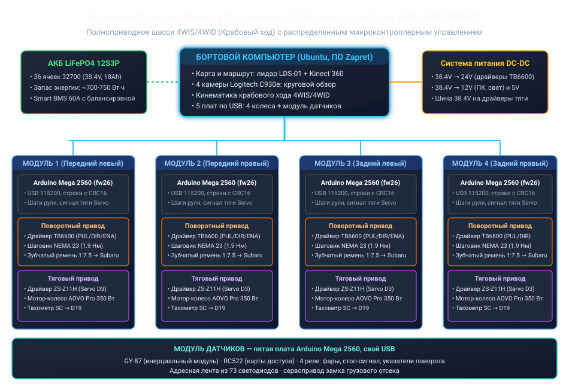

# BULKA_v1 — техническая книжка для защиты проекта

**Автономный робот-курьер с крабовым ходом (4WIS / 4WID) для внутренней логистики НТЦ АО «АВТОВАЗ»**

> Короткая версия инженерной документации: конструкция, кинематика, электроника, архитектура ПО, интерфейсы, информационная безопасность, смета и подтверждённость решений.
> Полные документы — в [`docs/`](.) и в PDF рядом с исходниками. Смета собирается из таблиц, прошивка проверяется тестами, поэтому все числа ниже воспроизводимы из репозитория.

---

## 0. ВИЗИТНАЯ КАРТОЧКА

| Параметр | Значение |
| :--- | :--- |
| Изделие | Мобильная роботизированная платформа-курьер, шасси 4WIS / 4WID (независимый поворот и тяга каждого колеса) |
| Назначение | Перевозка узлов, штампов, оснастки и документов по территории НТЦ АО «АВТОВАЗ» (более 20 га) |
| Задание | Конкурс «Первые в профессии», направление «Автомобильный транспорт», задание № 2 |
| Габариты (Д × Ш × В) | 750 × 600 × 400 мм (норматив: 600–1200 × 400–800 × 400–800 мм) |
| Масса снаряжённая / полная | 39,5 кг / 289,5 кг |
| Грузоподъёмность | 250 кг (расчётный запас рамы и ступиц — до 350 кг) |
| Грузовой отсек | 420 × 340 × 200 мм; замок на сервоприводе, доступ по PIN и картам MIFARE |
| Клиренс / база / колея | 100 мм / 500 мм / 380 мм |
| Рабочая скорость | до 0,625 м/с (2,25 км/ч); 50 м — около 80 с хода |
| Ходовая часть | 4 мотор-колеса AOVO Pro 8,5″ по 350 Вт; 4 ступицы Subaru; вилки из стали 5–6 мм |
| Поворот колёс | NEMA 23 (1,9 Н·м) + ремень GT2 10 мм, шкивы 20/150, редукция 1:7,5, момент 13,68 Н·м |
| Питание | LiFePO4 12S3P, 36 элементов 32700, 38,4 В, 18,6 А·ч, 714 Вт·ч, Smart BMS 60 А |
| Сенсоры | Лидар LDS-01 (360°, 0,12–3,5 м), Kinect 360, 4 камеры Logitech C930e |
| Управление | Бортовой мини-ПК Ubuntu + 5 × Arduino Mega 2560, по одному USB на плату |
| Прошивка | `motor_wheel` fw26 (4 платы колёс), `sensor_module` протокол 4 (пятая плата) |
| Стоимость опытного образца | **384 519,91 ₽ (4 646,56 USD)** — 63 позиции + работа 71 000,00 ₽ |

---

## 1. ЧТО РЕШАЕТ ПРОЕКТ

* **Тяжёлый груз.** 250 кг полезной нагрузки при собственной массе 39,5 кг — запас по тяге и прочности проверен расчётом (раздел 3).
* **Манёвр в узком проезде.** Крабовый ход (движение вбок и по диагонали без поворота корпуса) и разворот на месте с нулевым радиусом без бокового юза шин.
* **Автономность без Nav2.** Собственная карта занятости по лидару, свой планировщик и собственный контур безопасности; ROS 2 используется только как драйвер лидара.
* **Защищённая доставка.** Грузовой отсек с замком, доступ по карте MIFARE и PIN, журнал открытий и отказов, физический ключ остаётся основным.
* **Промышленная ремонтопригодность.** Автомобильные ступицы Subaru, готовые драйверы, стандартные Arduino-платы, текстовый протокол с CRC.

### Соответствие регламенту задания № 2

| Требование | Как выполнено | Статус |
| :--- | :--- | :---: |
| Габариты 600–1200 × 400–800 × 400–800 мм | 750 × 600 × 400 мм | ✅ |
| Грузовой отсек: коробка ≥ 300 × 250 × 60 мм, цилиндр ≥ 200 × 100 мм | 420 × 340 × 200 мм | ✅ |
| Грузоподъёмность и устойчивость | 250 кг; рама 40×40×2 мм, ступицы Subaru, тяга 426 Н | ✅ |
| Маневренность: крабовый ход, разворот на месте | 4WIS / 4WID, R = 0, без бокового юза | ✅ |
| Автономное движение по маршруту | карта + планировщик + safety-гейт; поездка до 18 м, цель до 12 м | ✅ |
| Объезд препятствий | лидар + Kinect; ближе 0,35 м — только остановка | ✅ |
| Распознавание знаков и светофора камерой | не реализовано; ПДД только как граф в сухом прогоне | ❌ |
| Защита груза и разграничение доступа | замок, PIN, карты MIFARE с ролями, журнал | ✅ |
| Информирование оператора | веб-пульт, бортовой экран, печатный отчёт по АКБ | ✅ |
| Стоимость и обоснование | смета на 63 позиции с ценами и продавцами | ✅ |

---

## 2. МЕХАНИКА И КОНСТРУКЦИЯ

| Узел | Решение | Обоснование |
| :--- | :--- | :--- |
| Рама | сварная пространственная, стальная профильная труба 40 × 40 × 2 мм (Ст3сп), скосы углов 45°, косынки под ступицы | прочность под 250 кг с запасом до 350 кг |
| Корпус | углепластик: 3 слоя углеткани 200 г/м², пропитанной эпоксидной смолой; 7 м² на обшивку и грузовой отсек | лёгкая обшивка без стального листа, ремонтопригодная ручная выкладка |
| Опорно-поворотный узел | ступица Subaru Forester / Impreza с двухрядным подшипником (> 38 кН), вварена в раму | автомобильный ресурс, доступность запчастей |
| Вертикальная компоновка | сверху шкив z = 150 на шпильке М16 → ступица → снизу вилка из листовой стали 5–6 мм → мотор-колесо | минимум плеч и люфтов, разнесение приводов |
| Поворот колеса | NEMA 23 1,9 Н·м → ремень GT2 10 мм → шкивы 20/150, редукция 1:7,5 | момент на ступице 13,68 Н·м, запас > 35 % при развороте с грузом |
| Тяга | 4 мотор-колеса AOVO Pro 8,5″, 36 В, 350 Вт, датчики Холла | суммарно 1400 Вт; тяга на ободах 426 Н против 56,8 Н сопротивления качению |
| Дискретность руля | 133,33 шага/град (0,0075°) | 48 000 шагов на оборот, проверяется транспортиром при калибровке |

**Силовой расчёт.** Тяга 4 × 11,5 Н·м / 0,108 м ≈ 426 Н ≈ 43 кгс. Сопротивление качению при полной массе: 289,5 × 9,81 × 0,02 ≈ 56,8 Н. Остаток ≈ 369 Н даёт разгон до 1,3 м/с² или подъём по уклону до 7° (около 13 %).

---

## 3. КИНЕМАТИКА 4WIS / 4WID

Для каждого колеса i с координатами (x_i, y_i) относительно центра масс при заданной скорости корпуса (Vx, Vy, ω):

```text
Vx_i = Vx − ω · y_i
Vy_i = Vy + ω · x_i
δ_i  = atan2(Vy_i, Vx_i)          — требуемый угол колеса
V_i  = sqrt(Vx_i² + Vy_i²)        — линейная скорость колеса
```

| Режим | Условие | Что делает шасси |
| :--- | :--- | :--- |
| Крабовый ход | ω = 0, Vx ≠ 0, Vy ≠ 0 | все 4 колеса под одним углом δ = atan2(Vy, Vx); корпус не поворачивается |
| Разворот на месте | Vx = Vy = 0, ω ≠ 0 | колёса по касательным к окружности R = 314 мм; углы ±52,77° от продольной оси; Vi = ω · R |
| Криволинейное движение | Vx, Vy, ω ≠ 0 | каждое колесо получает свой угол и скорость; траектория без бокового скольжения |

Оптимизация в коде: при перекладке угла больше 90° колесо разворачивается на 180° и едет «задом» — быстрее и без лишнего доворота. Если максимальная скорость колеса выше лимита, все скорости масштабируются с сохранением траектории. Одометрия — МНК-решение переопределённой системы по четырём колёсам, устойчивое к шуму отдельного энкодера.

---

## 4. ЭЛЕКТРОНИКА И ПИТАНИЕ

### 4.1. Дерево питания

```text
АКБ LiFePO4 12S3P (36 × 32700, 38,4 В ном. / 43,8 В макс.)
   │
   ├─ автомат 63 А + аварийный «грибок» + BMS 60 А + предохранитель MAXI 60 А
   │
   ├─ силовая шина 38,4 В ──> 4 × драйвер тяги RioRand ZS-Z11H ──> мотор-колёса 350 Вт
   │
   ├─ DC-DC 38 → 24 В ──> 4 × TB6600 ──> NEMA 23
   ├─ DC-DC 38 → 12 В ──> мини-ПК, дисплей, свет через 4 реле, Kinect 360
   └─ DC-DC 38 → 5 В  ──> лента 73 диода, серво замка, USB-хаб:
                          5 × Arduino Mega, оптодатчики D18, потенциометры A0,
                          лидар LDS-01, USB-UART BMS и принтера
```

### 4.2. Платы и распиновка (ключевое)

| Плата | Что на ней | Ключевые выводы |
| :--- | :--- | :--- |
| Плата колеса × 4 (Arduino Mega 2560) | TB6600 (руль), драйвер тяги ZS-Z11H, оптодатчик, потенциометр | PUL/DIR/ENA — D6/D7/D8; STOP D2, Servo D3, DIR D4, BRAKE D5; опто D18; потенциометр A0; тахометр SC D19 |
| Модуль датчиков (пятая Mega) | GY-87 (I²C-D20/D21), RC522 (SPI: D9, D50–D53, 3,3 В), 4 реле (D2–D5), лента 73 диода (D6), серво замка (D7) | D8 свободен: концевика отсека нет |

Правила, которые нельзя нарушать: RC522 питается только от 3,3 В, линии SS/SCK/MOSI/RST идут через преобразователь уровней; лента и серво — от отдельного 5 В (полная яркость 73 диодов ≈ 4,4 А, прошивка ограничивает ≈ 1,65 А); общая земля обязательна; после сброса реле выключены, лента погашена, замок закрыт.

### 4.3. Протокол обмена (текстовый, с CRC)

| Свойство | Значение |
| :--- | :--- |
| Физика | USB CDC, 115200 8N1, одна плата — один кабель |
| Команды ПК → плата | строки: `w FL 12.5`, `v 40 f`, `t FL -8`, `k`, `q`, `lock open`, `cargo load 15` |
| Телеметрия | `@F` (снимок 20 полей, 20–30 мс), `@TLM` (200 мс), `@Z`, `@S`, `@CARD`, `@EVT`, `@ACK` |
| Целостность | CRC16/Modbus, полином 0xA001, init 0xFFFF, по всем байтам строки |
| Сторожевой таймер | нет команды тяги 650 мс → тяга 0, BRAKE включён, STOP снят |
| Ошибки | кадр с неверной CRC отбрасывается и не обновляет «свежесть» данных |

---

## 5. АРХИТЕКТУРА ПО И НАВИГАЦИЯ



**Два уровня управления.**

1. **Верхний:** мини-ПК Ubuntu, бортовое ПО Zapret — два процесса Flask: веб-пульт оператора (8080) и бортовой экран-киоск (8090). USB-портами владеет **только бортовой процесс**; пульт пересылает команды через `/api/control/…`. Поэтому нет второго драйвера и двух разных картин состояния.
2. **Нижний:** 5 × Arduino Mega. Четыре платы колёс считают шаги TB6600, читают оптодатчик, потенциометр и тахометр; пятая плата управляет светом, замком, картами и компасом. Каждая плата — на своём USB.

| Слой | Что делает | Файлы и факты |
| :--- | :--- | :--- |
| Веб и доступ | вход оператора, CSRF, страницы, `.env` | `app.py`, `auth.py`, `kiosk_app.py` |
| Шасси | порты и роли, калибровка, полный ноль, манёвры | `device_registry.py`, `calibration.py`, `maneuvers.py` |
| Карта и навигация | сетка занятости, планировщик, автообследование | `slam_map.py`, `navigation.py`, `exploration.py` |
| Доставка | граф дорог НТЦ, ПДД, сухой прогон | `road_map.py`, `road_route.py`, `delivery_service.py` |
| Датчики | лидар USB/ROS, камеры V4L2, Kinect, модуль датчиков | `lidar.py`, `camera.py`, `sensor_module.py` |
| Питание | BMS JBD по USB-UART, отчёт на принтере | `battery.py`, `battery_receipt.py` |
| Служебное | журнал, статистика, E-STOP, обновление, диагностика | `eventlog.py`, `stats.py`, `estop.py`, `updater.py` |

**Навигация и восприятие.** Карта занятости строится по сканам LDS-01 (драйвер ROS 2 `hls_lfcd_lds_driver` → тема `/scan`), Kinect добавляет ближние препятствия, 4 камеры дают круговой обзор. Планировщик собственный, не Nav2: цель до 12 м, поездка до 18 м, отрезки прямые или крабовые в пределах ±28°, неизвестные клетки и край карты — препятствия. При препятствии в коридоре робот тормозит и перестраивает маршрут стоя; ближе 0,35 м — только остановка.

**Контур безопасности (safety-гейт).** Скорость обнуляется или ограничивается при любом событии: активен внешний E-STOP; нет телеметрии дольше таймаута; напряжение АКБ ниже аварийного порога (ниже предупредительного — ползущий режим 0,2); модуль сообщил неисправность. Коэффициент лимита 0…1 задаёт менеджер миссии (знак «Стоп», красный свет, неровность).

**Отказоустойчивость.**

| Отказ | Реакция |
| :--- | :--- |
| Обрыв USB платы колеса | плата сама снимает тягу через 650 мс; сервер помечает колесо офлайн и останавливает робота |
| Битая CRC / потеря пакета | кадр отбрасывается, синхронизация по заголовку |
| Просадка АКБ | двухпороговая политика: ограничение → аварийный стоп |
| Падение процесса | systemd/respawn; миссия при FAULT ставит лимит 0 |
| Молчащий лидар | пустые сканы и статус, карта не считает лучи свободными по старым данным |

---

## 6. ИНТЕРФЕЙСЫ И СЦЕНАРИЙ РАБОТЫ

| Интерфейс | Адрес | Кому | Что даёт |
| :--- | :--- | :--- | :--- |
| Веб-пульт оператора | `http://<IP>:8080` | оператор смены | телеметрия, лидар 360°, камеры, карта, навигация, доставка, порты, АКБ, настройка шасси |
| Бортовой экран-киоск | `http://127.0.0.1:8090/kiosk` | оператор и получатель | телеметрия, свайпы «тяга и руление» / «камеры и логи», отсек по PIN |
| Инженерный пульт | `http://<IP>:8080/console` | инженер-наладчик | отладка, калибровка, ручная подача команд, сервисные операции |

**Сценарий доставки.** Задание из диспетчерской или с пульта → построение маршрута по карте → движение с контролем препятствий → прибытие в точку → открытие отсека картой получателя или PIN → закрытие и отчёт. Каждый рейс фиксируется в статистике: дистанция, энергия, время, средняя и максимальная скорость, результат; отчёт по АКБ печатается на термопринтере.

---

## 7. ИНФОРМАЦИОННАЯ БЕЗОПАСНОСТЬ (ИБ)

### 7.1. Модель угроз

| Угроза | Последствие | Мера |
| :--- | :--- | :--- |
| Несанкционированный доступ к грузу | кража или подмена груза | замок + карта MIFARE с ролью + PIN + окно погрузки + журнал; физический ключ основной |
| Подбор PIN или пароля оператора | доступ к управлению | PBKDF2-хеш пароля, лимит попыток и блокировка, сессия 60 минут |
| Случайное или чужое движение | травма, порча оборудования | физический E-STOP, watchdog 650 мс, safety-гейт, программная защёлка E-STOP под PIN |
| Порча линии USB | ложная команда или «мёртвые» данные | CRC16 на каждом кадре, отбраковка битых кадров, контроль свежести телеметрии |
| Подмена карты или журнала | ложный доступ, сокрытие следов | 4-байтный UID + роль в EEPROM с CRC; в справочной реализации — хеш-цепочка аудита |
| Потеря питания или связи | открытый отсек, вращение без команд | после сброса замок закрыт; при потере связи замок закрывается; тяга снимается |
| Атака из сети | перехват управления | изолированная Wi-Fi-сеть робота, вход оператора, CSRF, запрет публикации портов в интернет |

### 7.2. Физическая безопасность и отказобезопасность

* **Аварийный останов** — «грибок» ED250 разрывает силовую цепь до 250 А; ни одна плата Arduino его не заменяет.
* **Защита силовой цепи** — автомат 63 А, предохранитель MAXI 60 А, антиискровой XT90-S, BMS 60 А с балансировкой и контролем температуры.
* **Химия** — LiFePO4: термически стабильна, ресурс более 2500 циклов, риск теплового разгона существенно ниже, чем у NMC.
* **Развязка питания** — лента и серво замка питаются от отдельного 5 В; 5 В платы Mega их не питает.
* **Поведение при сбое** — watchdog 650 мс снимает тягу; после сброса реле выключены, лента погашена, замок закрыт; потеря связи **никогда** не открывает замок.
* **Механика** — запас прочности рамы и ступиц, ограничение угла руля ±100°, валидация команд и диапазонов.

### 7.3. Управление доступом

| Контур | Кто | Чем подтверждает | Что получает |
| :--- | :--- | :--- | :--- |
| Веб-пульт 8080 | оператор смены | учётная запись + пароль (PBKDF2, 200 000 итераций) + CSRF-токен | телеметрия и команды, все внутренние страницы |
| Бортовой экран 8090 | оператор и получатель | без логина (экран на роботе); PIN — только для отсека | телеметрия, ограниченные действия |
| Грузовой отсек | администратор / пользователь | карта MIFARE (4-байтный UID, до 12 карт, роль в EEPROM) и PIN | открытие отсека |
| Инженерный пульт | инженер-наладчик | вход в контур пульта; доступ организационно ограничен сменой | калибровка, порты, карта, обновление |

**Карты и окно погрузки.** Роль `admin` открывает отсек всегда, `user` — только в открытом окне погрузки или выгрузки (по умолчанию 15 минут, закрывается само). Роль проверяется в момент прикладывания карты на самой плате, без участия сервера. Незаписанная карта не открывает ничего и получает `why=unknown`, карта пользователя вне окна — `why=cargo`.

**PIN.** Задаётся в конфигурации и меняется при вводе в эксплуатацию; проверяется сервером, в открытом виде не хранится и не передаётся в логи. Открытие, отказ и смена PIN попадают в журнал доступа.

**Учётные записи.** Пароль хранится только как PBKDF2-хеш; после 5 неверных попыток вход блокируется на 5 минут; сессия живёт 60 минут и сбрасывается кнопкой «Выйти». Файл учётных записей не попадает в репозиторий.

### 7.4. Целостность каналов и данных

* **CRC16/Modbus** на всех кадрах плат: битый кадр отбрасывается и не обновляет время свежести. Это защита от случайных ошибок линии, **не** аутентификация.
* **EEPROM с контрольными суммами.** Список карт хранится блоком с magic-меткой, версией и CRC; повреждённый блок не стирает соседний. У платы колеса два независимых CRC-слота (последовательность, роль, поправка в шагах); смена роли делает сохранённый ноль недостоверным и требует повторной калибровки.
* **Свежесть и подтверждения.** Сервер не двигает робота без свежей телеметрии, подтверждённой роли колеса и заданного нуля; каждая команда подтверждается кадром `@ACK`.
* **Односторонний поток данных.** Страницы читают готовое состояние и не занимают порты; скан, присланный через API, помечается и в карту не попадает.

### 7.5. Журналирование и аудит

* **Журнал доступа:** каждое открытие, отказ и смена PIN; число открытий и отказов выводится в «Сводку» пульта.
* **Журнал событий и статистика рейсов:** дистанция, энергия, время, события ПДД и ручные вмешательства; экспорт CSV/JSON и печатный отчёт.
* **Аудит с защитой от подделки (справочная реализация сервисного пульта):** каждая запись хранит хеш предыдущей, изменение или удаление записи ломает цепочку; лимит 5 попыток PIN и блокировка 30 с; хеш PIN с солью вместо открытого кода. Это отдельная реализация в `gui/`, она не входит в рабочий контур Zapret — граница описана в [`ZAPRET_SYNC.md`](ZAPRET_SYNC.md).

### 7.6. Сеть, обновления, данные

* Робот поднимает **собственную точку доступа Wi-Fi**; порт 8080 открывается только в доверенной локальной сети (при включённом UFW — правило на подсеть).
* **Порты робота не публикуются в интернет.** Вход оператора, CSRF и PIN защищают от ошибки и случайного нажатия; для открытой сети нужен отдельный шлюз с TLS.
* Обновления ставит инженер-наладчик из доверенного репозитория GitHub; облачных сервисов и внешней телеметрии нет.
* Видеопоток камер используется для обзора на пульте; архивов и передачи изображений за пределы робота в проекте нет.
* Учётные данные и статистика хранятся локально; персональные данные в облако не передаются.

### 7.7. Границы применимости — что защитой не является

| Утверждение | Как на самом деле |
| :--- | :--- |
| CRC защищает от подделки команд | нет: CRC ловит только случайные ошибки линии; аутентификации в USB-канале нет |
| Программная кнопка «Остановить всё» — аварийный останов | нет: это остановка процессов; мгновенную тягу снимают E-STOP и watchdog |
| MIFARE Classic — криптографически стойкий ключ | нет: принимается UID карты; основной замок — физический ключ, доступ фиксируется журналом |
| Пульт защищён для работы через интернет | нет: HTTP без TLS; контур рассчитан на изолированную сеть предприятия |
| PIN — полноценная аутентификация груза | это второй фактор к карте и замку; при вводе в эксплуатацию PIN меняется |

### 7.8. Свойства ИБ по модели CIA

| Свойство | Обеспечивается |
| :--- | :--- |
| Конфиденциальность | изолированная сеть, вход оператора, отсутствие облака; PIN и пароли не хранятся в открытом виде |
| Целостность | CRC16 на кадрах, CRC в EEPROM, версии блоков, хеш-цепочка аудита, журнал событий |
| Доступность | watchdog 650 мс, двухпороговая защита АКБ, respawn процессов, fail-safe замок, автономный контур платы |

---

## 8. СМЕТА

Смета собрана из 150 найденных предложений (142 в расчёте, 108 продавцов). Цена позиции — медиана предложений; курс 82,7536 ₽/USD (курс Банка России на 10.11.2026). Полный расчёт с фотографиями и ссылками — [`COST_ESTIMATE.md`](COST_ESTIMATE.md).

| № | Раздел | Позиций | Сумма, ₽ | USD | Доля |
| :---: | :--- | ---: | ---: | ---: | ---: |
| 1 | Поворотно-тяговые модули | 14 | 83 333,20 | 1 007,00 | 26,6 % |
| 2 | Модуль датчиков, свет и доступ | 14 | 12 823,44 | 154,96 | 4,1 % |
| 3 | Навигация и машинное зрение | 4 | 86 730,00 | 1 048,05 | 27,7 % |
| 4 | Бортовой компьютер и интерфейс | 6 | 45 682,97 | 552,04 | 14,6 % |
| 5 | Аккумулятор и электропитание | 13 | 43 885,80 | 530,32 | 14,0 % |
| 6 | Безопасность и маркировка | 4 | 8 607,00 | 104,01 | 2,7 % |
| 7 | Рама, корпус и крепёж | 8 | 32 457,50 | 392,22 | 10,4 % |
| | **Комплектующие и материалы** | **63** | **313 519,91** | **3 788,60** | **100 %** |
| | Работа, амортизация, интеграция | — | 71 000,00 | 857,97 | — |
| | **Всего на один робот** | | **384 519,91** | **4 646,56** | |

**Крупнейшие статьи:** 4 камеры C930e — 52 810 ₽; мини-ПК — 32 056 ₽; 4 мотор-колеса — 30 708 ₽; лидар — 26 000 ₽; углеткань для корпуса — 18 725 ₽; 4 ступицы — 17 308 ₽; 36 элементов LiFePO4 — 14 688 ₽; 4 NEMA 23 — 11 338 ₽.

**Что важно знать:** разброс по самым дешёвым и самым дорогим предложениям — 317 490,40–456 248,77 ₽; 19 позиций — допущения о модели или количестве, 4 — оценки без поиска цен; работа, амортизация и интеграция перенесены из прежней калькуляции; доставка и таможня не учтены. Прежняя укрупнённая калькуляция давала 207 200 ₽ — рост объясняется составом (модуль датчиков, четыре камеры, Kinect, дисплей, принтер, зарядное устройство, защитная аппаратура) и переходом корпуса на углепластик.

---

## 9. ИСПЫТАНИЯ И ПОДТВЕРЖДЁННОСТЬ

| Набор | Проверок | Что проверяет |
| :--- | ---: | :--- |
| Прошивка (`pytest firmware/tests`) | 27 | сборка обоих скетчей, 61 сценарий платы колеса и 20 сценариев модуля датчиков; сверка пинов, 133,33 шага/град, watchdog 650 мс, форматов кадров и CRC |
| ROS-ядро и лидар | 25 | кинематика, одометрия, протокол модулей, разбор кадров LDS-01 |
| GUI и API | 269 | пульт, киоск, сервисное окно, замок, аудит, DOM-тесты (jsdom) |
| Смета | 30 | арифметика медиан, суммы, фотографии, совпадение итогов в документах |
| Сборщик PDF | 58 | формулы, ширины колонок, наличие PDF у каждого документа |
| **Итого** | **409** | автоматические проверки в репозитории |

**Что подтверждено:** внутренняя арифметика и формат данных, поведение протокола и парсеров, отказоустойчивость на уровне симуляции (watchdog, потеря связи, битая CRC), интерфейсы и API, воспроизводимость сметы и документов.

**Что тестами не подтверждено:** заливка прошивки на реальную плату, правильность пинов на конкретной механике, реальный лидар и E-STOP, обороты SC, грузоподъёмность 250 кг и прохождение полигона. Натурные испытания — следующий этап; методика описана в паспорте, раздел 10.

**Порядок ввода в эксплуатацию:** проверить аварийное отключение, предохранители и BMS → прошить одну плату FL, проверить `fw=26`, калибровку `k` и `q`, сверить 133,33 шага/град транспортиром → проверить телеметрию и хоминг → собрать ROS-стек без тяги и проверить `/scan`, `/odom`, TF → замкнуть веб-пульт только через проверенный мост → и только затем натурные испытания (торможение, краб, разворот, потеря UART, АКБ, нагрузка).

---

## 10. ОГРАНИЧЕНИЯ И РАЗВИТИЕ

**Честные ограничения текущей ревизии:**

* распознавание дорожных знаков и светофора камерой **не реализовано**; ПДД есть только как граф векторной карты и сухой прогон без тяги;
* справочный ROS 2-стек в `ros2_ws/` описан под прежний бинарный протокол и с текущими платами напрямую не работает; рабочий контур — Zapret;
* нет концевика двери грузового отсека — запрета движения при открытом отсеке нет;
* понижающие модули XL4015 рассчитаны на вход до 36 В, а заряженная батарея даёт 43,8 В — питание плат проверяется по месту до включения;
* полигонных испытаний в репозитории нет, результаты будут добавлены отдельным протоколом;
* корпус из углепластика — обшивка и грузовой отсек; силовую нагрузку несёт стальная рама.

**Ближайшие шаги:** детектор знаков и светофора на обученной модели, мост ROS 2 под текстовый протокол fw26, концевик отсека, ЭБУ-диагностика узлов, расширение журнала и отчётов.

---

## 11. ПРИЛОЖЕНИЕ: ГДЕ ЧТО ЛЕЖИТ

| Документ | Содержание |
| :--- | :--- |
| [`TECHNICAL_SPECIFICATION.md`](TECHNICAL_SPECIFICATION.md) | полный паспорт: прочность, приводы, кинематика, испытания |
| [`COST_ESTIMATE.md`](COST_ESTIMATE.md) | смета на 63 позиции с фотографиями, ценами и продавцами |
| [`EXPLANATORY_NOTE_AVTOVAZ.md`](EXPLANATORY_NOTE_AVTOVAZ.md) | пояснительная записка по регламенту, аналоги, экономика |
| [`ELECTRICAL_AND_PINOUTS.md`](ELECTRICAL_AND_PINOUTS.md) | дерево питания, распиновка, USB-карта |
| [`SERIAL_PROTOCOL.md`](SERIAL_PROTOCOL.md) | команды и кадры, CRC16, таймауты |
| [`SOFTWARE_ARCHITECTURE.md`](SOFTWARE_ARCHITECTURE.md) | рабочая архитектура Zapret и справочный ROS 2 |
| [`GUI.md`](GUI.md), [`MAIN_SCREEN.md`](MAIN_SCREEN.md) | веб-пульт, бортовой экран, карта экранов |
| [`RUN_AND_ACCESS.md`](RUN_AND_ACCESS.md) | запуск, сеть, учётки, PIN, роли |
| [`SERVICE_CONSOLE.md`](SERVICE_CONSOLE.md) | сервисное окно, замок, аудит, статистика |
| [`ZAPRET_SYNC.md`](ZAPRET_SYNC.md) | что перенесено из Zapret и какие расхождения остались |
| [`CAUSAL_MAP.md`](CAUSAL_MAP.md) | причинно-следственные связи и границы проверенного |
| [`firmware/README.md`](../firmware/README.md) | прошивка fw26 и протокол 4, калибровка, команды |

| Каталог | Что внутри |
| :--- | :--- |
| `docs/` | инженерная документация; рядом в `docs/pdf/` — готовые PDF |
| `firmware/` | скетчи плат колёс и модуля датчиков, хост-симуляция, тесты |
| `ros2_ws/` | справочные пакеты ROS 2 (кинематика, одометрия, лидар, навигация, safety) |
| `gui/` | справочная копия пульта и бортового экрана, тесты |
| `pcb/` | архив платы v1.0: BOM, netlist, схемы |
| `deploy/` | systemd-юниты автозапуска пульта и дисплея |
| `tools/` | сборщик сметы и сборщик PDF |

> **Принадлежность:** НТЦ АО «АВТОВАЗ», конкурс «Первые в профессии», направление «Автомобильный транспорт», задание № 2. Лицензия MIT. Имя робота в интерфейсах — BULKA_v1.
